# RocketTurbines

## Introduction

Hi,

Welcome to RocketTurbines, a Python library for sizing and meanline analysis of axial turbines. It was created with
supersonic rocket turbines in mind, but can also be used for subsonic stages. It calculates turbine dimensions,
nonisentropic flow states, velocities, flow angles and losses based on given requirements. I hope you will find it
useful.

With kind regards, Jan

## Table of Contents

- [Introduction](#introduction)
- [General Overview](#general-overview)
- [Installation](#installation)
- [Disclaimer](#disclaimer)
- [Documentation](#documentation)
  - [Turbine1D](#turbine1d)
    - [Assumptions and nomenclature](#assumptions-and-nomenclature)
    - [Design-point quantities and geometry](#design-point-quantities-and-geometry)
    - [Sizing logic and numerical solution](#sizing-logic-and-numerical-solution)
    - [Stored results and efficiencies](#stored-results-and-efficiencies)
  - [TraupelLossModel](#traupellossmodel)
    - [Configuration and coefficient interpolation](#configuration-and-coefficient-interpolation)
    - [Loss definitions and angle convention](#loss-definitions-and-angle-convention)
    - [Profile and trailing-edge losses](#profile-and-trailing-edge-losses)
    - [Fanning, endwall and secondary-flow losses](#fanning-endwall-and-secondary-flow-losses)
    - [Incidence loss](#incidence-loss)
    - [Unshrouded rotor clearance](#unshrouded-rotor-clearance)
    - [Shrouded rotor clearance and half-labyrinth flow](#shrouded-rotor-clearance-and-half-labyrinth-flow)
    - [Partial-admission and disk-friction losses](#partial-admission-and-disk-friction-losses)
    - [Conversion from losses to entropy rises](#conversion-from-losses-to-entropy-rises)
  - [IdealGas](#idealgas)
    - [Composition and caloric properties](#composition-and-caloric-properties)
    - [Density and sound velocity](#density-and-sound-velocity)
    - [Dynamic viscosity](#dynamic-viscosity)
    - [Thermal conductivity](#thermal-conductivity)
  - [SupersonicTurbine](#supersonicturbine)
    - [Assumptions and nomenclature](#assumptions-and-nomenclature-1)
    - [Constructor inputs and design setup](#constructor-inputs-and-design-setup)
    - [Coupling logic and numerical solution](#coupling-logic-and-numerical-solution)
    - [Rotor shaping, separation limits and edge thicknesses](#rotor-shaping-separation-limits-and-edge-thicknesses)
    - [Stator throat sizing, chord and packing conditions](#stator-throat-sizing-chord-and-packing-conditions)
      - [Multiple MOC nozzles](#multiple-moc-nozzles)
      - [Single MOC nozzle](#single-moc-nozzle)
      - [Multiple de Laval nozzles](#multiple-de-laval-nozzles)
      - [Single de Laval nozzle](#single-de-laval-nozzle)
    - [Stored results, residuals and feasibility checks](#stored-results-residuals-and-feasibility-checks)
    - [Validity limits and failures](#validity-limits-and-failures)
  - [GA_optimizer: optimization_functions and scouting_functions](#ga_optimizer-optimization_functions-and-scouting_functions)
    - [Smith chart](#smith-chart)
- [Tool Validation](#tool-validation)
  - [How the comparisons were calculated](#how-the-comparisons-were-calculated)
  - [Loss-model options used for the comparisons](#loss-model-options-used-for-the-comparisons)
  - [Assumptions and numerical checks](#assumptions-and-numerical-checks)
  - [Moffitt: full-admission supersonic turbine](#moffitt-full-admission-supersonic-turbine)
  - [Whitney: 7-inch transonic turbine](#whitney-7-inch-transonic-turbine)
  - [Rohlik: first stage and clearance-loss sensitivity](#rohlik-first-stage-and-clearance-loss-sensitivity)
  - [Klassen: partial-admission comparison](#klassen-partial-admission-comparison)
  - [Moffitt and Klag: partial-admission comparison](#moffitt-and-klag-partial-admission-comparison)

## General Overview

RocketTurbines sizes a single turbine stage from prescribed shaft power, mass flow, RPM, work and flow
coefficients and isentropic reaction. The stage flow calculations and its empirical losses are coupled: a numerical
solver adjusts entropy generation until the calculated flow states and the loss-model predictions agree.
The meanline model represents the flow at one reference radius rather than resolving the complete three-dimensional flow.

There are two design workflows: use [`Turbine1D`](#turbine1d) for meanline sizing with prescribed blade-row geometry,
or [`SupersonicTurbine`](#supersonicturbine) to adjust the stage dimensions and supersonic blade shapes together until
the dimensions used by the flow model agree with the constructed shapes. `SupersonicTurbine` supports rectangular
method-of-characteristics (MOC) stator nozzles and conical de Laval nozzles,
with either one nozzle or multiple nozzles in an admitted sector. It also uses MOC to construct rotor blades.
Its nozzle height, width and metal-spacing margins show whether the nozzle exits fit between the hub and tip
and whether enough metal separates adjacent nozzles. These margins can guide changes to nozzle count, admission
fraction and stage coefficients, either manually or through an optimization algorithm.

The repository is organised as follows:

- `RocketTurbines/Turbine1D.py` defines `Turbine1D` class, which includes turbine sizing procedure and thermodynamic
  calculations.
- `RocketTurbines/TraupelLossModel.py` defines `TraupelLossModel` class, which is a digitized loss model from
  "Thermische Turbomaschinen" (2001) by Traupel. It includes sampled empirical coefficients from graphs and methods to
  calculate loss coefficients and entropy generation through the state.
- `RocketTurbines/IdealGas.py` defines the `IdealGas` class, which defines mixture properties used by the turbine and
  loss model classes.
- `RocketTurbines/SupersonicTurbine.py` defines `SupersonicTurbine`, which couples `Turbine1D` to
  `SupersonicStatorNozzle` and `SupersonicRotorBlade` from the `SupersonicTurbineBlading` library.
- `RocketTurbines/RelaxedAitken.py` supplies the bounded, adaptively relaxed fixed-point solver used by `Turbine1D` and
  `SupersonicTurbine`.
- `RocketTurbines/GA_optimizer/` contains design-domain scouting and mixed-variable GA optimization functions.
- `example.py` demonstrates sizing a partial-admission impulse turbine with a water-vapour/oxygen mixture.
- `docs/figures/` contains the empirical-coefficient plots, supersonic nozzle diagrams and example output shown below.
  `docs/plot_traupel_coefficients.py`, `docs/plot_supersonic_geometry.py` and `docs/plot_example_figures.py` regenerate them.
  Exporting the 3D example image also requires Kaleido and Chrome.
- `setup.py` installs the `RocketTurbines` package and its dependencies, including pymoo and `SupersonicTurbineBlading` from GitHub;
  `LICENSE` contains the GNU General Public License version 3.

The current workflows include design-point sizing. Meanline results are stored in the `Turbine1D` object;
`SupersonicTurbine` additionally stores the coupled meanline object, nozzle and rotor shapes, and packing margins.
Independent off-design analysis and performance-map creation are not yet implemented.

The Python interface uses SI units. Pressures are in Pa, temperatures in K, mass flow in kg/s, shaft
power in W, lengths in m, specific enthalpy in J/kg and specific entropy in J/(kg K). Rotational speed is in RPM.
Flow angles are in radians unless degrees are explicitly stated. The `SupersonicTurbineBlading` argument dictionaries
use that dependency's angle convention in degrees; `SupersonicTurbine` converts the meanline angles from radians to 
degrees when supplying them. The [literature comparison tables](#tool-validation) retain the units used in the reports;
[`docs/validate_turbine1d.py`](docs/validate_turbine1d.py) converts those values to SI before calling the model.

## Installation

Python 3.11 or newer is required. Install the library directly from GitHub:

```text
pip3 install git+https://github.com/janstruzinski/RocketTurbines
```

## Disclaimer

This library is intended for preliminary turbine sizing and engineering analysis. The extrapolation of empirical
correlations and meanline assumptions should be checked for the particular design. Much of the code was written by
myself and I came up with its architecture, turbine design workflow or methodology behind coupling meanline and blading
designs. However, LLM was used for the generation of this README, docstrings and a few parts of the code, especially
`GA_optimizer` and some plotting/printing functions.

## Documentation

### Turbine1D

`Turbine1D` in `RocketTurbines/Turbine1D.py` represents a steady, one-dimensional, nonisentropic axial turbine stage.
Its principal workflow is:

1. Construct an `IdealGas` mixture and a `TraupelLossModel` object.
2. Construct an empty `Turbine1D` object.
3. Call `size_turbine(...)` with the required shaft power, flow conditions, stage coefficients and geometry inputs.
4. Read the geometry attributes and the three stored design-point result dictionaries from the `Turbine1D` object.

[`example.py`](example.py) provides a complete set of gas properties, loss-model choices and sizing inputs.
LE means leading edge, TE means trailing edge, and BL means boundary layer throughout this README.
Admission fraction is the fraction of the stator circumference that admits flow: 1 is full admission and 0.5 is half admission.

#### Assumptions and nomenclature

The model uses a calorically perfect ideal gas, axial subsonic inlet flow at station 0, equal flow areas at stations 0,
1 and 2 and a constant Euler diameter. Geometry is represented at the meanline; the code calculates flow angles, not
blade metal angles or detailed blade profiles.

Station 0 is before the stator, station 1 is between the stator and rotor, and station 2 is after the rotor. In the
equations below, <var>v</var> is absolute velocity, <var>w</var> is rotor-relative velocity, <var>u</var> is blade speed, <var>h</var> is static enthalpy,
and $`h_t=h+v^2/2`$ is absolute total enthalpy. Naming convention uses `_t` for total properties, `_s` and `_r` for
stationary and rotating reference frames, `_ideal` for isentropic reference quantities, and `_tt`, `_ts` and `_ss`
for total-to-total, total-to-static and static-to-static quantities. `_ideal_r_real_s` means isentropic rotor expansion
following the actual stator state.

Angles in the turbine results are measured from the axial/meridional direction. The `_blade` results describe the
rotor passage flow state calculated only with its aerodynamic losses at the same outlet static pressure as the complete
stage. They supply the local cascade flow needed by the loss correlations.

#### Design-point quantities and geometry

`size_turbine(...)` takes `gas`, `work_coefficient_tt`, `flow_coefficient`, `reaction_isentropic_tt`, `RPM`,
`shaft_power`, `mdot`, inlet total temperature `T_t0`, inlet total pressure `p_t0` and a `loss_model`.
The specified loading is the real work coefficient; the specified flow coefficient is based on the rotor outlet axial velocity:

```math
\Delta h_t=\frac{P_{\mathrm{shaft}}}{\dot{m}}, \qquad
\psi_{tt}=\frac{\Delta h_t}{u^2}, \qquad
\theta_2=\frac{v_{ax,2}}{u}.
```

The speed and Euler diameter follow directly:

```math
u=\sqrt{\frac{\Delta h_t}{\psi_{tt}}}, \qquad
\omega=\frac{2\pi N}{60}, \qquad D_E=\frac{2u}{\omega}.
```

Here <var>N</var> is `RPM`. Inlet and prescribed outlet total enthalpies are

```math
h_{t0}=c_pT_{t0}, \qquad h_{t2}=h_{t0}-\Delta h_t.
```

`reaction_isentropic_tt` is the rotor static enthalpy drop divided by the stage total-to-total enthalpy drop in the
fully isentropic reference stage:

```math
R_{h,tt,\mathrm{ideal}}=
\frac{h_{1,\mathrm{ideal}}-h_{2,\mathrm{ideal}}}
{h_{t0}-h_{t2,\mathrm{ideal}}}.
```

The remaining inputs prescribe radial clearance, stator and rotor blade counts, chord-to-pitch ratios, trailing-edge
thickness and surface roughness. For admission fraction <var>ε</var>, stator blades number <var>n<sub>s</sub></var> is blade count within
the admitted arc and rotor blades number <var>n<sub>r</sub></var> is blade count around the full circumference,

```math
p_s=\frac{\varepsilon\pi D_E}{n_s}, \qquad p_r=\frac{\pi D_E}{n_r}, \qquad
c_s=(c/p)_s p_s, \qquad c_r=(c/p)_r p_r.
```

Rotor axial width is $`b_r=\texttt{rotor\_width\_to\_chord}\,c_r`$ and is stored as `width_rotor`.
`t_TE_stator` and `t_TE_rotor` are the circumferential projections of trailing-edge thickness. The axial row gap is
`s_ax_over_pitch_rotor` times rotor pitch. Metal roughness given as input is changed into equivalent sand-grain
roughness using $`k_s=5.863R_a`$.

Once the flow solution determines outlet density, the full annulus area and diameters are

```math
A=\frac{\dot{m}}{\varepsilon\rho_2\theta_2u}, \qquad
D_h=\sqrt{D_E^2-\frac{2A}{\pi}}, \qquad D_t=\sqrt{D_E^2+\frac{2A}{\pi}}.
```

```math
D_m=\frac{D_h+D_t}{2}, \qquad l=\frac{D_t-D_h}{2}.
```

The stator and rotor have the same radial blade length. A shrouded rotor additionally uses
`h_shroud_over_blade_length`, `s_ax_shroud_over_h_shroud` and `seal_teeth_number`; the seal requires an integer count
greater than two. Tooth spacing is $`b_r/(n_{\mathrm{teeth}}-1)`$ across the rotor axial width.
`t_shroud` stores an optional supplied shroud thickness.

`A_throat_stator` and `A_throat_rotor` are initialized to `None` and are not calculated by `size_turbine`.
`SupersonicTurbine` supplies these total throat areas within the admitted sector, in m², from its throat sizing and
blading geometry. The stator uses its uncorrected geometry; the rotor uses BL-corrected geometry for nonsymmetric
shape when BL calculations are switched on, and otherwise uses uncorrected geometry.

`analysis_results_at_design_point["M_r2_ideal_r_real_s_construction"]` is initialized to `None` and remains `None`
after `size_turbine`, including when resizing a previously constructed design. `SupersonicTurbine.evaluate_design`
sets it only after rotor blade construction to the `SupersonicRotorBlade.ideal_outlet_relative_flow_mach`.
For symmetric blades this equals `M_r2_ideal_r_real_s`; for nonsymmetric blades it records the outlet Mach obtained
by LE & TE thickness matching.

`R_nozzle` is also initialized to `None` and left unset by `size_turbine`. `SupersonicTurbine` supplies the actual
stator nozzle exit-centre radius in m.

#### Sizing logic and numerical solution

The following diagram explains turbine sizing & flow calculations procedure in `Turbine1D` and `TraupelLossModel`:

```text
 Turbine1D.size_turbine
   |
   +--> OUTER LOOP ---------------------------------------------------------------+
   |      Vary: stator, rotor aerodynamic and additional rotor entropy rises      |
   |      Residuals: calculated minus assumed entropy rise for each loss group    |
   |      |                                                                       |
   |      v                                                                       |
   |    Turbine1D.calculate_entropy_rise                                          |
   |      |                                                                       |
   |      +--> INNER LOOP -------------------------------------------+            |
   |      |      Vary: h_2/h_t0                                      |            |
   |      |      Residual: calculated minus assumed outlet           |            |
   |      |                total enthalpy, divided by h_t0           |            |
   |      |      |                                                   |            |
   |      |      v                                                   |            |
   |      |    Turbine1D.__calculate_thermodynamic_properties --------+           |
   |      |                                                                       |
   |      v  (after inner loop converges)                                         |
   |    Analysis results: station 1/2 states and absolute rotor outlet velocity   |
   |      |                                                                       |
   |      v                                                                       |
   |    Turbine1D._calculate_inlet_velocity                                       |
   |      Solve for v_0 with bounded Aitken and fallback to TOMS748.              |
   |      Update station 0 state and static stage coefficients.                   |
   |      |                                                                       |
   |      v                                                                       |
   |    Turbine1D.__calculate_blade_rows_outlet_velocities                        |
   |      |                                                                       |
   |      v                                                                       |
   |    Updated analysis results: outlet velocities, Mach and Reynolds numbers    |
   |      |                                                                       |
   |      v                                                                       |
   |    Turbine1D.__calculate_flow_angles                                         |
   |      |                                                                       |
   |      v                                                                       |
   |    Analysis results with flow angles                                         |
   |      |                                                                       |
   |      v                                                                       |
   |    Turbine1D.__calculate_blade_row_flow_state                                |
   |      Prescribed: stage outlet static pressure and rotor aerodynamic entropy  |
   |       rise                                                                   |
   |      |                                                                       |
   |      v                                                                       |
   |    Blade-row results: states, velocities and flow angles                     |
   |      |                                                                       |
   |      v                                                                       |
   |    Turbine1D.__calculate_geometry                                            |
   |      |                                                                       |
   |      v                                                                       |
   |    Turbine geometry, together with analysis and blade-row results            |
   |      |                                                                       |
   |      v                                                                       |
   |    TraupelLossModel.calculate_entropy_increase                               |
   |      |                                                                       |
   |      v                                                                       |
   |    Calculated entropy rises and loss results                                 |
   |      |                                                                       |
   |      +--> Calculate entropy-rise residuals ----------------------------------+
   |
   v  (after outer loop converges)
 Consistent entropy rises, analysis results, blade-row results and loss results
   |
   v
 Turbine1D.__calculate_geometry
   |
   v
 Sized turbine geometry and stored design-point results
```

The outer unknowns are the stator aerodynamic, rotor aerodynamic and additional rotor entropy rises:

```math
\mathbf{x}=[\Delta s_s,\;\Delta s_r,\;\Delta s_{r,\mathrm{additional}}], \qquad
\mathbf{r}=\mathbf{x}_{\mathrm{loss\ model}}-\mathbf{x}.
```

The solver first tries bounded, relaxed Aitken iterations. If those iterations fail, it falls back to SciPy's
bounded `least_squares()` with `dogbox` and a two-point numerical Jacobian.
`delta_s_estimate` supplies initial guesses for stator aerodynamic, rotor aerodynamic and additional rotor entropy
generation, in that order. The loss model is evaluated at those guesses to produce the starting values for the solver.
With the default `[0, 0, 0]`, the starting values therefore come from a loss calculation at zero assumed entropy rise.
At the accepted solution, the difference between each assumed entropy rise and its loss-model prediction must be
below $`10^{-3}`$ J/(kg K) in absolute value.

During each outer evaluation, an inner solve varies $`h_2/h_{t0}`$ to satisfy

```math
r_h=\frac{h_2+v_2^2/2-h_{t2}}{h_{t0}}=0.
```

The inner solver first uses bounded relaxed Aitken with `xtol=rtol=1e-11`, then TOMS 748 with a bracket,
or a Newton fallback when necessary. The ideal-gas entropy relation determines pressures from the assumed
entropy rises and static temperatures:

```math
\Delta s=c_p\ln\left(\frac{T_{\mathrm{out}}}{T_{\mathrm{in}}}\right)
-R\ln\left(\frac{p_{\mathrm{out}}}{p_{\mathrm{in}}}\right).
```

For example, with the sum of all three entropy rises denoted by $`\Delta s_{\mathrm{stage}}`$,

```math
p_2=p_{t0}\exp\left(-\frac{\Delta s_{\mathrm{stage}}}{R}\right)
\left(\frac{h_2}{h_{t0}}\right)^{c_p/R}.
```

After the enthalpy solve converges, `_calculate_inlet_velocity(analysis_results)` adds the station 0 state variables to
the same dictionary and returns it. This runs once per outer entropy evaluation, before the
outlet velocities and losses are calculated.

Equal-area continuity sets $`G_0=\rho_2\theta_2u=\rho_0v_0`$. With
$`\rho_{t0}=p_{t0}/(RT_{t0})`$, inlet velocity satisfies

```math
v_0=\frac{G_0}{\rho_{t0}\left(1-v_0^2/(2h_{t0})\right)^{c_p/R-1}}.
```

The inlet velocity numerical solve uses bounded relaxed Aitken, followed by TOMS 748 with the same bounds if fallback is needed.
The bounds are: $`G_0/\rho_{t0}\leq v_0\leq\sqrt{2\gamma RT_{t0}/(\gamma+1)}`$. Inlet mass flux above the sonic limit is rejected.
The static state is:

```math
h_0=h_{t0}-\frac{v_0^2}{2},\qquad T_0=\frac{h_0}{c_p},\qquad
p_0=p_{t0}\left(\frac{h_0}{h_{t0}}\right)^{c_p/R},\qquad
\theta_0=\frac{v_0}{u},\qquad M_{s0}=\frac{v_0}{\sqrt{\gamma RT_0}}.
```

Equal-area continuity also gives $`\theta_1=\theta_2\rho_2/\rho_1`$. The prescribed isentropic reaction determines the
intermediate state, while the real reaction $`R_{h,tt}=(h_1-h_2)/\Delta h_t`$ enters the velocity triangles. Define
$`d_\theta=(\theta_2^2-\theta_1^2)/(2\psi_{tt})`$. The circumferential velocities are then

```math
\frac{v_{\theta,1}}{u}=1-R_{h,tt}+\frac{\psi_{tt}}{2}+d_\theta, \qquad
\frac{v_{\theta,2}}{u}=1-R_{h,tt}-\frac{\psi_{tt}}{2}+d_\theta.
```

Relative velocities have $`w_\theta=v_\theta-u`$. Flow angles use `atan2(circumferential velocity, axial velocity)`.
A separate rotor-passage flow solution includes aerodynamic entropy generation while excluding clearance,
disk-friction and partial-admission losses. The Traupel blade-profile correlations use this passage flow state,
which corresponds to the flow through a blade cascade. The solver then calculates the annulus dimensions,
recalculates the losses and returns the differences between assumed and predicted entropy generation.

#### Stored results and efficiencies

`size_turbine(...)` updates the object and returns `None`. Geometry is available as `D_Euler`, `D_hub`, `D_tip`,
`D_mean`, `l_stator`, `l_rotor`, `p_stator`, `p_rotor`, `c_stator`, `c_rotor`, `width_rotor`, `s_ax`, `s_r` and the shroud attributes.
The result dictionaries are:

- `analysis_results_at_design_point`: complete stage states, velocities, Mach and Reynolds numbers, flow angles,
  loading, reaction, pressure ratio, entropy rises, shaft power and efficiencies.
- `blade_row_results_at_design_point`: local rotor blade row flow state without additional losses.
  It includes velocities, flow angles and associated coefficients.
- `loss_model_results_at_design_point`: aerodynamic, incidence, disk friction, clearance and
  admission loss coefficients, dissipated enthalpies, entropy rises and shroud leakage flow.

Call `turbine.print_analysis_results()` after sizing to print a table with meanline analysis results.
Call `turbine.print_geometry()` to print a table with turbine geometry, including `width_rotor` in the Rotor column.
Call `turbine.plot_velocity_triangles()` to plot the design-point velocity triangles at stations 1 and 2.

The reported efficiencies use the exact isentropic enthalpy drops at the corresponding outlet total or static
pressure. With $`\Delta s_{\mathrm{stage}}`$ denoting total stage entropy rise, the ideal reference enthalpies are

```math
h_{t2,\mathrm{ideal}}=h_{t2}\exp\left(-\frac{\Delta s_{\mathrm{stage}}}{c_p}\right), \qquad
h_{2,\mathrm{ideal}}=h_2\exp\left(-\frac{\Delta s_{\mathrm{stage}}}{c_p}\right).
```

The efficiencies are

```math
\eta_{tt}=\frac{\Delta h_t}{h_{t0}-h_{t2,\mathrm{ideal}}}, \qquad
\eta_{ts}=\frac{\Delta h_t}{h_{t0}-h_{2,\mathrm{ideal}}}.
```

`psi_tt_ideal` uses the same total-to-total isentropic enthalpy drop. `psi_ss_ideal` and Traupel's additional losses
use the static-to-static drop `delta_h_ideal` $`=h_0-h_{2,\mathrm{ideal}}`$. `p_0_over_p_2` is the static-to-static
pressure ratio; `p_t0_over_p_2` is the total-to-static pressure ratio. `zeta_stator_Denton` and `zeta_rotor_Denton` are
entropy-based loss coefficients based on Denton's definition and use a different normalisation from Traupel's coefficients below.

After sizing calculations have been performed, `calculate_entropy_rise(...)` evaluates a trial set of entropy rises and
returns `(residuals, analysis_results, blade_row_results, loss_model_results)`.

### TraupelLossModel

`TraupelLossModel` in `RocketTurbines/TraupelLossModel.py` implements empirical turbine-loss correlations from
Walter Traupel's *Thermische Turbomaschinen*, Volume I. It separates aerodynamic passage losses from clearance,
disk-friction and partial-admission losses. The equations below describe the implemented relations, including their
numerical approximations. All plots are redrawn directly from the sampled empirical coefficient data using
interpolators in the class, so the reader can inspect the values used by the library here.

#### Configuration and coefficient interpolation

`TraupelLossModel` stores sampled values from empirical graphs. A calculated Mach number, Reynolds number, flow
angle or geometry ratio can lie outside a graph's sampled range. The `extrapolation_method` argument controls
how a coefficient is evaluated in that situation:

- `extrapolation_method="closest"` limits each out-of-range coordinate to the nearest boundary of the sampled
  range, then interpolates at that boundary. For example, a Mach number above the graph's maximum uses the
  coefficient at the maximum supported Mach number.
- `extrapolation_method="linear"` extends the interpolated trend beyond the sampled range. The resulting
  coefficient can continue increasing or decreasing outside the graph.

Inside the sampled ranges, both choices use linear interpolation. Reynolds-number coordinates are logarithmic
for <var>χ<sub>R</sub></var> and <var>c<sub>f</sub></var>, and both coordinates are logarithmic for <var>C<sub>M</sub></var>; linear extrapolation operates in those
transformed coordinates. `warn_on_extrapolation=True` prints a warning whenever a coefficient is requested outside
the sampled range. Disabling the warning does not change the coefficient calculation.

The other constructor options are:

| Argument | Accepted values | What it controls |
|---|---|---|
| `incidence_loss` | `"high"`, `"medium"`, `"low"` | Chooses the higher incidence-loss curve, the average of the two curves, or the lower curve. Incidence is the difference between incoming flow direction and the blade's design inlet direction. Default: `"medium"`. |
| `stator` | `"regular"`, `"near_sonic_outlet"` | Selects the stator Mach-number correction from the curve families described below. Default: `"regular"`. |
| `rotor` | `"regular"`, `"near_sonic_outlet"`, `"impulse_low_M"`, `"impulse_high_M"` | Selects the rotor Mach-number correction. An impulse choice also selects the impulse-rotor constants in the endwall and free-rotor partial-admission formulas. Default: `"regular"`. |

The curve names describe the blade cascades represented by Traupel's data:

| Curve name | Blade-cascade description |
|---|---|
| `regular` | Strongly accelerating flow, as in stators and reaction rotors. |
| `near_sonic_outlet` | Accelerating flow with the uncovered turning region adapted for near-sonic operation. |
| `impulse_low_M` | Impulse-rotor blades with rounded leading edges. |
| `impulse_high_M` | Impulse-rotor blades with sharp leading edges, suitable for high Mach numbers. |

The user chooses the curve family. The code does not automatically switch between these families when the
calculated Mach number changes.

The ranges of sampled graphs with empirical coefficients are:

| Coefficient | Input coordinates and grid limits |
| --- | --- |
| <var>χ<sub>R</sub></var> | $`Re=10^4`$ to $`10^7`$; $`k_s/c=10^{-4}`$ to $`2\times10^{-3}`$ |
| <var>χ<sub>M</sub></var> | Regular: $`M=0`$ to 1.30; near-sonic: 0.65 to 1.40; low-M impulse: 0.15 to 0.75; high-M impulse: 0.65 to 1.30 |
| <var>ζ<sub>p0</sub></var> | Traupel inlet angle: 20 to 120 degrees; outlet angle: 15 to 45 degrees |
| $`\zeta_{h,\infty}`$ | $`\delta_a/(\chi_M\chi_R\zeta_{p0})=1`$ to 10; $`\delta_a=0.04`$ to 0.20 |
| <var>ζ<sub>f</sub></var> | $`l/D_m=0`$ to 0.20; $`\nu=0.5`$ to 0.9 |
| <var>F</var> | Turning: 10 to 140 degrees; inlet/outlet speed ratio: 0.2 to 1.0 |
| <var>c<sub>f</sub></var> | $`Re=10^4`$ to $`10^7`$; $`k_s/d_h=0`$ to $`2\times10^{-3}`$ |
| $`K_\sigma`$ | Sine of outlet angle: 0.30 to 0.50; velocity-change ratio: 1 to 4; normalised clearance: 0.01 to 0.06 |
| <var>C<sub>M</sub></var> | Disk Reynolds number: $`7\times10^4`$ to $`10^7`$ |
| <var>z</var> | High curve: -50 to +43.7 degrees; low curve: -50 to +60 degrees |
| $`\Phi^2`$ | $`p_2/p_1=0.3`$ to 1; tooth spacing/clearance: 5 to 13; teeth: 4 to 15 |

These limits describe the available empirical data. They are not recommended turbine-design limits.
For example, an inlet/outlet speed ratio below 0.2 lies outside the sampled range of <var>F</var> and is handled by the
chosen `extrapolation_method`. The prepared $`K_\sigma`$ grid includes extrapolated extensions, as explained in
[Unshrouded rotor clearance](#unshrouded-rotor-clearance). Negative coefficient predictions are replaced by zero;
<var>ζ<sub>p0</sub></var> is limited to a minimum of 0.001 because it appears in denominators.

#### Loss definitions and angle convention

For a blade row, the aerodynamic-plus-incidence loss coefficient is defined by the dissipated static enthalpy divided
by ideal outlet kinetic energy. Let <var>q</var> denote stator absolute or rotor-relative outlet speed. Then

```math
\zeta_{\mathrm{row}}=\frac{\Delta h_{\mathrm{loss,row}}}{q_{\mathrm{ideal}}^2/2}, \qquad
\eta_{\mathrm{row}}=1-\zeta_{\mathrm{row}}, \qquad
\Delta h_{\mathrm{loss,row}}=\frac{\zeta_{\mathrm{row}}}{1-\zeta_{\mathrm{row}}}\frac{q^2}{2}.
```

Additional-loss coefficients instead use the stage static-to-static isentropic enthalpy drop:

```math
\zeta_{\mathrm{additional}}=
\frac{\Delta h_{\mathrm{loss,additional}}}{\Delta h_{\mathrm{ideal,ss}}}, \qquad
\psi_{ss,\mathrm{ideal}}=\frac{\Delta h_{\mathrm{ideal,ss}}}{u^2}.
```

Traupel measures stator outlet and rotor inlet angles from the positive circumferential direction, and rotor outlet
angle from the negative circumferential direction. The `Turbine1D` to `TraupelLossModel` angle conversion is:

```math
\alpha_{1,T}=\frac{\pi}{2}-\alpha_1, \qquad
\beta_{1,T}=\frac{\pi}{2}-\beta_1, \qquad
\beta_{2,T}=\frac{\pi}{2}+\beta_{2,\mathrm{blade}}.
```

In the following blade-row equations, <var>a</var> and <var>b</var> are Traupel inlet and outlet angles, <var>c</var> is chord, <var>l</var> is radial
blade length, <var>p</var> is pitch, <var>D<sub>m</sub></var> is mean diameter, <var>k<sub>s</sub></var> is equivalent sand roughness, and
$`\delta_a=t_{TE}/p`$ is the circumferential trailing-edge blockage. Direct calls to `calculate_zeta_p0()`,
`calculate_F()` and `calculate_z()` interpolators use degrees, but the methods that wrap these interpolators take
angles in radians.

#### Profile and trailing-edge losses

`calculate_blade_row_aerodynamic_loss(...)` first calculates

```math
\zeta_p=\chi_R\chi_M\zeta_{p0}+\zeta_h+\zeta_C, \qquad
\zeta_C=\left(\frac{\delta_a}{1-\delta_a}\right)^2\sin^2 b.
```

<var>χ<sub>R</sub></var> accounts for Reynolds number and roughness, <var>χ<sub>M</sub></var> for outlet Mach number, <var>ζ<sub>p0</sub></var> for inlet and
outlet angles, <var>ζ<sub>h</sub></var> for trailing-edge underpressure, and <var>ζ<sub>C</sub></var> for trailing-edge mixing/blockage.

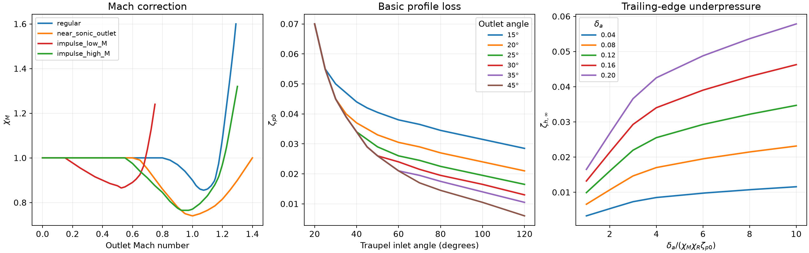

The trailing-edge plot shows the nomogram value $`\zeta_{h,\infty}`$. The code applies the following
Reynolds-number transition mentioned by Traupel:

```math
\zeta_h=g(Re)\zeta_{h,\infty}.
```

The transition factor is defined over three Reynolds-number intervals:

```math
g(Re)=0, \qquad Re\leq8\times10^4.
```

```math
g(Re)=\sqrt{1-\left(1-\frac{Re-8\times10^4}{7\times10^4}\right)^2}, \qquad
8\times10^4\lt Re\lt1.5\times10^5.
```

```math
g(Re)=1, \qquad Re\geq1.5\times10^5.
```

The quarter-ellipse transition is an approximation used in this implementation, since Traupel did not specify exact
formula. The following plots show the profile roughness correction, endwall friction coefficient and disk-friction
coefficient used by the model:

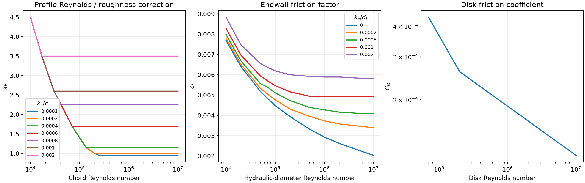

#### Fanning, endwall and secondary-flow losses

The fanning coefficient <var>ζ<sub>f</sub></var> depends on $`l/D_m`$ and speed parameter
$`\nu=1/\sqrt{2\psi_{ss,\mathrm{ideal}}}`$. Set $`\bar\zeta_p=\zeta_p+\zeta_f`$, $`L=l/p`$, and

```math
L_{\mathrm{crit}}=B\sqrt{\bar\zeta_p}.
```

$`B=10`$ for an impulse rotor and $`B=7`$ for an accelerating cascade.

For $`L\geq L_{\mathrm{crit}}`$, the residual endwall/secondary-flow loss is

```math
\zeta_{\mathrm{rest}}=\zeta_a+\frac{\zeta_p}{\zeta_{p0}}\frac{F}{L}.
```

For $`L\lt L_{\mathrm{crit}}`$, it is

```math
\zeta_{\mathrm{rest}}=\zeta_a+\frac{\zeta_p}{\zeta_{p0}}\frac{F}{L_{\mathrm{crit}}}
+A_c\frac{c}{p}\left(\frac{1}{L}-\frac{1}{L_{\mathrm{crit}}}\right).
```

$`A_c=0.035`$ for an impulse rotor and 0.02 for an accelerating cascade. <var>F</var> depends on turning angle
$`180^\circ-a-b`$ and inlet/outlet speed ratio. The complete aerodynamic row coefficient is

```math
\zeta_{\mathrm{aerodynamic}}=\zeta_p+\zeta_f+\zeta_{\mathrm{rest}}.
```

For the unshrouded stator, with axial row gap <var>s<sub>ax</sub></var> and hydraulic diameter $`d_h=2l`$,

```math
\zeta_a=\frac{c_f}{\sin b}\left(1+\frac{l}{D_m}\right)\frac{s_{ax}}{l}.
```

The friction-factor Reynolds number is the chord Reynolds number multiplied by $`2l/c`$. For an unshrouded rotor,
$`\zeta_a=0`$. For a shrouded row with axial shroud gap $`s_{ax,\mathrm{shroud}}`$,

```math
\zeta_a=\frac{0.04}{\sin b}\frac{s_{ax,\mathrm{shroud}}}{l}.
```

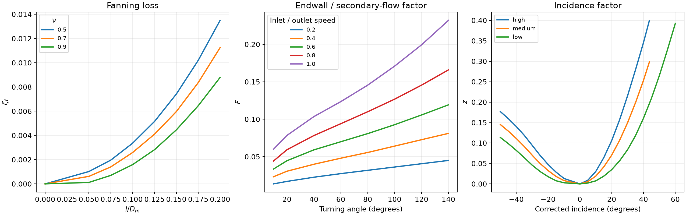

#### Incidence loss

`calculate_incidence_losses(...)` corrects the inlet-angle deviation <var>i</var> for inlet Mach number before reading <var>z</var>:

```math
M_c=\min(0.8,\max(0.5,M_{\mathrm{in}})), \qquad
i_c=\frac{i}{2(1-M_c)}, \qquad
\zeta_{\mathrm{incidence}}=z(i_c)\left(\frac{q_{\mathrm{in}}}{q_{\mathrm{out}}}\right)^2.
```

The incidence plot above shows `"high"`, `"medium"` and `"low"` loss coefficient curves. Medium is the average of the
two interpolated curves. In the current design-point sizing workflow, both stator and rotor incidence are set to zero.
The incidence-loss method accepts a nonzero deviation when used separately.

#### Unshrouded rotor clearance

`calculate_unshrouded_rotor_clearance_loss(...)` uses the rotor blade row velocities calculated without additional
losses. Define radial clearance <var>s<sub>r</sub></var>, Traupel reaction <var>R<sub>T</sub></var>, normalised inlet relative velocity
$`\bar w_1=w_{1,\mathrm{blade}}/u`$, and

```math
x=\max\left(\frac{s_r}{c}-0.002,0\right), \qquad
j=\frac{|\Delta w_\theta|}{v_{ax}}, \qquad
R_T=\frac{\Delta h_{r,\mathrm{ideal}}}
{\Delta h_{s,\mathrm{ideal}}+\Delta h_{r,\mathrm{ideal}}}.
```

The coefficient $`K_\sigma`$ is evaluated at $`(\sin\beta_{2,T},j,x)`$, and the loss is

```math
\zeta_{\mathrm{clearance}}=
K_\sigma\frac{2R_T\psi_{ss,\mathrm{ideal}}+\bar w_1^2}{2\psi_{ss,\mathrm{ideal}}}
\max\left(\frac{s_r}{l}-0.002\frac{c}{l},0\right)\frac{D_t}{D_m}.
```

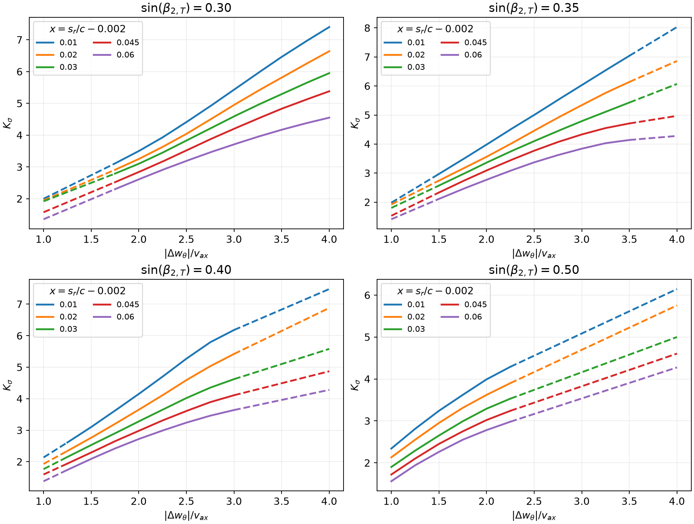

Solid curves show interpolation inside each graph's original velocity-change interval. Dashed portions show the
extensions prepared by the code: PCHIP supplies endpoint slopes and straight lines continue the curves to a common
$`j=1`$ to 4 grid. Final coefficient lookups use linear interpolation on that prepared grid. Thus `"closest"` clips
to the prepared grid bounds, which can extend beyond an original graph's measured interval.

#### Shrouded rotor clearance and half-labyrinth flow

`calculate_shrouded_rotor_clearance_loss(...)` evaluates leakage through a half-labyrinth seal. With seal area
$`A_{\mathrm{seal}}=\pi D_t s_r`$, tooth spacing <var>a</var><sub>seal</sub> and tooth count <var>n</var>,

```math
\dot{m}_{\mathrm{leak}}=\varepsilon A_{\mathrm{seal}}\Phi
\sqrt{p_1\rho_1}, \qquad
\mu_{\mathrm{leak}}=\frac{\dot{m}_{\mathrm{leak}}}{\dot{m}-\dot{m}_{\mathrm{leak}}}.
```

`calculate_phi(...)` obtains the critical pressure ratio <var>r</var><sub>crit</sub> from the tooth count and
$`a_{\mathrm{seal}}/s_r`$. It then evaluates the digitised squared flow function at

```math
r=\max\left(\frac{p_2}{p_1},r_{\mathrm{crit}}\right), \qquad
\Phi=\sqrt{\max\left(\Phi_{\mathrm{grid}}^2
\left(r,\frac{a_{\mathrm{seal}}}{s_r},n\right),0\right)}.
```

This holds the flow function constant below the critical pressure ratio. The figures show the implemented flow
function for a spacing/clearance ratio of 7 and the critical-ratio curves for all four digitised spacing ratios:

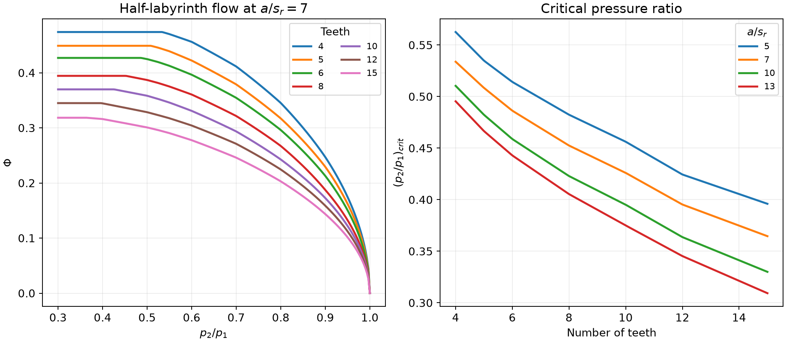

With design and operating speed parameters <var>ν<sub>d</sub></var> and <var>ν<sub>o</sub></var>, both based on their static-to-static ideal loading,

```math
\zeta_{\mathrm{clearance}}=\mu_{\mathrm{leak}}
\left[1-\left(\frac{\nu_o-\nu_d}{\nu_d}\right)^2\right], \qquad
\nu=\frac{1}{\sqrt{2\psi_{ss,\mathrm{ideal}}}}.
```

The stage sizing workflow uses the same design and operating loading, so the square-bracket term is one. Leakage
at or above the main mass flow is rejected. This is an empirical loss/leakage calculation; stage continuity still
uses the prescribed main mass flow.

#### Partial-admission and disk-friction losses

`calculate_admission_loss(...)` assumes one admitted sector. For $`0\lt\varepsilon\lt1`$,

```math
\zeta_{\mathrm{admission}}=
\frac{C(1-\varepsilon)}{\varepsilon\theta_m\psi_{ss,m,\mathrm{ideal}}}
+\frac{0.21(b_r/D_m)}{\varepsilon\sqrt{\psi_{ss,m,\mathrm{ideal}}}}.
```

Here <var>b<sub>r</sub></var> is the axial rotor width `width_rotor`, independently of the blade chord.
The coefficient is exactly zero at full admission. Here <var>θ<sub>m</sub></var> and $`\psi_{ss,m,\mathrm{ideal}}`$ are normalised
by blade speed at the mean diameter. For `partial_admission_rotor="free"` (when the rotor is not enclosed on all
sides),

```math
C=k\left(0.045+0.58\frac{l}{D_m}\right)\sin\beta_{2,T}.
```

$`k=0.8`$ for an impulse rotor and $`k=1`$ for an accelerating rotor.

For `partial_admission_rotor="enclosed"` (when the rotor is enclosed on all sides except of the admitted arc),

```math
C=0.0095+0.55\max\left(0.125-\frac{l}{D_m},0\right)^2.
```

The enclosed-rotor relation is intended for $`l/D_m\lt0.125`$; the implementation continues it beyond that range using
the limiting value due to lack of other data. `calculate_disk_friction_loss(...)` uses the <var>C<sub>M</sub></var> curve shown above:

```math
\zeta_{\mathrm{disk}}=
\frac{1.27C_M}{\varepsilon\theta_m\psi_{ss,m,\mathrm{ideal}}}
\left(\frac{D_h}{D_m}\right)^4\frac{D_h}{l}, \qquad
Re_{\mathrm{disk}}=\frac{\omega D_h^2\rho_1}{2\mu_g(T_1)}.
```

<var>μ<sub>g</sub></var> is gas dynamic viscosity. Mean-diameter normalisation is recovered from Euler-diameter quantities using
$`u_m=\omega D_m/2`$, $`\theta_m=\theta_2u/u_m`$ and
$`\psi_{ss,m,\mathrm{ideal}}=\psi_{ss,\mathrm{ideal}}(u/u_m)^2`$.

#### Conversion from losses to entropy rises

`calculate_entropy_increase(analysis_results, turbine_geometry, blade_row_results)` assembles the row coefficients
and additional losses. Stator and rotor passage losses use $`q=v_1`$ and $`q=w_{2,\mathrm{blade}}`$, respectively.
The entropy rise associated with a dissipated static enthalpy at the same outlet pressure is

```math
\Delta s=-c_p\ln\left(1-\frac{\Delta h_{\mathrm{loss}}}{c_pT_{\mathrm{out}}}\right).
```

The stator uses <var>T<sub>1</sub></var>, and the aerodynamic rotor passage uses $`T_{2,\mathrm{blade}}`$. Additional losses are work
losses rather than static enthalpy increments:

```math
\Delta h_{\mathrm{additional}}=
(\zeta_{\mathrm{disk}}+\zeta_{\mathrm{clearance}}+\zeta_{\mathrm{admission}})
\Delta h_{\mathrm{ideal,ss}}.
```

Because the local blade-row and complete stage have different outlet velocities, the static loss used for the
complete rotor entropy calculation includes the kinetic-energy correction:

```math
\Delta h_{r,\mathrm{loss,static}}=
\Delta h_{r,\mathrm{loss}}+\Delta h_{\mathrm{additional}}
+\frac{v_{2,\mathrm{blade}}^2-v_2^2}{2}.
```

The model calculates total rotor entropy rise at <var>T<sub>2</sub></var> with this static loss, then subtracts the passage entropy
rise to obtain `delta_s_rotor_additional`. It returns
`(delta_s_stator, delta_s_rotor, delta_s_rotor_additional, loss_model_results)`. The additional work loss and its
static enthalpy equivalent are stored separately in the loss results.

### IdealGas

`IdealGas` in `RocketTurbines/IdealGas.py` represents a fixed-composition, calorically perfect gas mixture.
Construct it with `T_max`, `T_min`, CoolProp `species` names and `mass_fractions`. Optional `cea_species` supplies
the corresponding NASA CEA names for transport properties. These two species lists must identify the same chemicals in the
same order; the library checks list lengths and database availability but does not validate chemical correspondence.

#### Composition and caloric properties

Mass fractions must be finite, nonnegative and sum to one within $`10^{-12}`$. Zero-fraction species are removed.
The temperature limits must satisfy $`T_{\max}\gt T_{\min}\gt0`$. `P_max` and `P_min`, both defaulting to $`10^5`$ Pa, are
used to check that each active CoolProp species is gas or supercritical gas at the corresponding temperature limit.
These two pressures are used for the gas-phase checks during `IdealGas` construction. The turbine inlet pressure
is a separate input, `p_t0`, passed to `size_turbine`.

For species molar masses <var>M<sub>i</sub></var> and mass fractions <var>Y<sub>i</sub></var>, mole fractions are

```math
X_i=\frac{Y_i/M_i}{\sum_jY_j/M_j}.
```

CoolProp supplies the mixture molar mass and gas constant. The class obtains a constant effective heat capacity
from the enthalpy difference at $`10^5`$ Pa over the supplied temperature interval:

```math
R=\frac{R_u}{M_{\mathrm{mix}}}, \qquad
c_p=\frac{h_{\mathrm{CP}}(T_{\max},10^5)-h_{\mathrm{CP}}(T_{\min},10^5)}
{T_{\max}-T_{\min}}, \qquad
c_v=c_p-R, \qquad \gamma=\frac{c_p}{c_v}.
```

The properties are stored as `R`, `Cp`, `Cv` and `gamma`. Turbine enthalpy is subsequently represented by $`h=c_pT`$;
the turbine does not reevaluate temperature-dependent CoolProp enthalpy during the stage solve.

#### Density and sound velocity

`calculate_density(p, T)` and `calculate_sound_velocity(T)` use

```math
\rho=\frac{p}{RT}, \qquad a=\sqrt{\gamma RT}.
```

Pressure and temperature must be finite and positive. The returned density is in kg/m³ and sound velocity in m/s.

#### Dynamic viscosity

`calculate_dynamic_viscosity(T)` obtains species viscosities from NASA CEA transport fits through
[ThermoProp](https://github.com/saakethramoju/ThermoProp). Active species must have CEA gas entries and viscosity
data. The mixture uses Wilke's rule:

```math
\mu_{\mathrm{mix}}=\sum_i\frac{X_i\mu_i}{\sum_jX_j\phi_{ij}}, \qquad
\phi_{ij}=\frac{\left[1+\sqrt{\mu_i/\mu_j}(M_j/M_i)^{1/4}\right]^2}
{\sqrt{8(1+M_i/M_j)}}.
```

The evaluation temperature is floored at the larger of 300 K and the highest minimum fitted viscosity temperature
among the active species. For example, H2O sets a floor of 373.2 K. Requests below that floor return the limiting
viscosity. The result is in Pa s.

#### Thermal conductivity

`calculate_thermal_conductivity(T)` obtains species conductivities in W/(m K) from NASA CEA through ThermoProp.
It uses CEA's frozen-composition mixture law from
[NASA RP-1311, section 5.2](https://ntrs.nasa.gov/citations/19950013764):

```math
k_{\mathrm{mix}}=\sum_i\frac{X_i k_i}{\sum_jX_j\psi_{ij}}, \qquad \psi_{ii}=1,
```

```math
\psi_{ij}=\frac{2M_j\mu_i}{(M_i+M_j)\eta_{ij}}
\left[1+2.41\frac{(M_i-M_j)(M_i-0.142M_j)}{(M_i+M_j)^2}\right], \qquad i\ne j.
```

Here <var>η<sub>ij</sub></var> is the CEA binary viscosity interaction parameter. ThermoProp uses its CEA fit when available
at the evaluation temperature, otherwise CEA's rigid-sphere estimate from the pure-species viscosities and molar
masses. The result is thermal conductivity with the gas composition held fixed; composition changes due to
chemical reactions are outside the `IdealGas` model.

The evaluation temperature is floored at the greatest of 300 K and the minimum fitted viscosity and conductivity
temperatures of every active species; all transport data use this same temperature. The constructor checks
conductivity availability and stores this temperature floor alongside the viscosity floor. Missing conductivity
fits raise `ValueError` during construction, and invalid temperatures raise `ValueError` when evaluating the
property. Other transport-range errors propagate from ThermoProp, as for viscosity.

```python
k = gas.calculate_thermal_conductivity(900.0)  # W/(m K)
```

Density, sound-velocity, viscosity and thermal-conductivity methods cache up to 1024 evaluations each.

### SupersonicTurbine

`SupersonicTurbine` in `RocketTurbines/SupersonicTurbine.py` constructs a supersonic stage whose meanline geometry
agrees with its stator nozzle and rotor blade contours. Constructing the object stores inputs but does not run the
design calculation. Call `couple_meanline_and_blading()` to calculate the stage and populate `turbine_meanline`,
`stator_shape`, `rotor_shape`, `x_solution` and `coefficients`; those attributes are initially `None`.
The meanline solver supplies flow states and annulus dimensions to `SupersonicTurbineBlading`; the resulting contours
supply chord-to-pitch ratios, rotor axial-width/chord ratio and edge thicknesses back to the meanline solver.

Its principal workflow is:

1. Construct an `IdealGas` mixture and a `TraupelLossModel` object.
2. Supply dictionaries for `Turbine1D.size_turbine`, `SupersonicStatorNozzle` and `SupersonicRotorBlade`.
3. Construct `SupersonicTurbine` with a flow separation margin and minimum stator/rotor metal thicknesses.
4. Call `turbine.couple_meanline_and_blading()`, or use `evaluate_design(...)` to evaluate trial designs manually.
5. Read `turbine_meanline`, `stator_shape`, `rotor_shape` and `coefficients` after coupling converges.
6. Check nozzle height, circumferential width and metal spacing. If the exits do not fit between the hub and tip
   or neighbouring nozzles overlap, change nozzle count, admission fraction or stage coefficients and repeat.

#### Assumptions and nomenclature

The meanline assumptions in the [`Turbine1D`](#turbine1d) section still apply. The stator consists of identical
nozzles placed at uniform angular pitch within one admitted sector. `no_blades_stator` is the number of nozzles in
that sector; `no_blades_rotor` counts blades around the full circumference. Stator packing and chord measurements use
the uncorrected nozzle contours. Here, an uncorrected contour is the shape before the blading library's boundary-layer
displacement correction. Nonsymmetric rotor measurements and plots use the boundary-layer-corrected contour when
that calculation is enabled and returns a corrected shape. Symmetric rotors and rotors without a boundary-layer
correction use the uncorrected contour.

The following symbols refer to the axial view of a nozzle exit, looking along the machine axis:

| Symbol | Meaning |
| --- | --- |
| <var>n</var> | Number of stator nozzles, `no_blades_stator`. |
| <var>R<sub>h</sub></var>, <var>R<sub>t</sub></var> | Hub and tip radii, `R_hub` and `R_tip`. |
| <var>R<sub>E</sub></var> | Euler radius, `R_Euler`; pitches and admission arcs are measured on this circle. |
| $`R_m=(R_h+R_t)/2`$ | Annulus mean radius, `R_mean`; generally different from <var>R<sub>E</sub></var>. |
| <var>R<sub>c</sub></var> | Actual nozzle exit-centre radius, `turbine_meanline.R_nozzle`. |
| $`H_a=R_t-R_h`$ | Radial annulus height. |
| $`p_s=2\pi R_E\varepsilon/n`$, $`p_r=2\pi R_E/n_r`$ | Total stator and rotor pitches, including metal blockage. |
| $`\delta=p_s/R_E`$ | Angular pitch between neighbouring nozzle centre lines. |
| <var>w</var>, <var>H</var> | Straight circumferential width and radial height of one exit. |
| <var>H</var><sub>max</sub> | Maximum permitted exit height for the selected construction. |
| <var>L<sub>e</sub></var> | Arc length of the Euler circle lying inside one nozzle exit. |
| <var>g</var> | Straight projected spacing between adjacent exits, used to assess minimum stator metal thickness. |
| $`A^{\ast}_{\mathrm{total}}`$, <var>b</var><sup>∗</sup>, <var>d</var><sup>∗</sup> | Total choked throat area, MOC throat width and de Laval throat diameter. |
| <var>b<sub>e</sub></var>, <var>d<sub>e</sub></var> | MOC exit width normal to the nozzle axis and de Laval exit diameter; $`d_e=H`$ for the elliptical exit. |
| <var>α<sub>m</sub></var> | Outlet metal/nozzle-axis angle from the machine axis; $`w=b_e/\cos\alpha_m`$ for MOC and $`w=d_e/\cos\alpha_m`$ for de Laval. |
| <var>c<sub>s</sub></var>, <var>c<sub>r</sub></var> | Stator throat-centre to exit-centre chord and rotor LE-to-TE chord. |

`t_TE_stator`, `t_TE_rotor` and `t_LE_rotor` denote circumferential projections of edge thicknesses. The inputs
`t_min_stator` and `t_min_rotor` prescribe metal thickness measured perpendicular to the local flow direction.
Using the flow angle for this conversion assumes that the metal-edge direction follows the calculated flow.
With meanline angles measured from the axial direction, the required projected stator spacing is

```math
t_{s,\min}^{\mathrm{proj}}=\frac{t_{\min,s}}{\cos\alpha_1}.
```

Stator boundary-layer calculations are disabled. The blading library's aftermixing calculation, which estimates
the mixed flow downstream of an exit, is disabled for both rows. A single nozzle has no neighbouring nozzle wall:
its meanline `t_TE_stator` is fixed at zero, and no inter-nozzle metal-thickness constraint is applied.

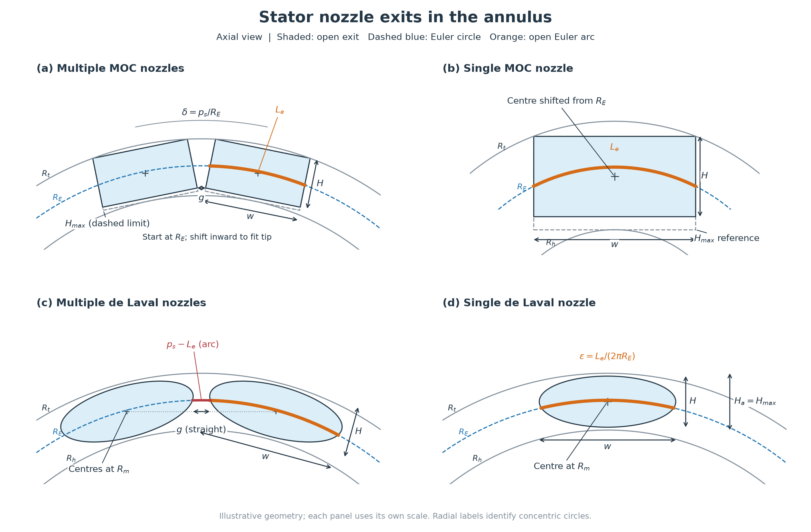

The shaded regions are open exits. Blue dashed curves are Euler circles; the orange highlighted arc is <var>L<sub>e</sub></var>.
For multiple nozzles, the Euler-circle arc $`p_s-L_e`$ is TE thickness that should be used for meanline calculations,
whereas <var>g</var> is a straight spacing between nozzles. This is minimum thickness projected on circumferential direction
between nozzle edges. Both MOC diagrams show actual exits shifted inward from <var>R<sub>E</sub></var> to keep their outer corners
at the tip. Their dashed maximum-height references are hub-tangent. These diagrams illustrate the construction rules
rather than a particular converged turbine design.

#### Constructor inputs and design setup

```python
from RocketTurbines.SupersonicTurbine import SupersonicTurbine

turbine = SupersonicTurbine(
    gas=gas,
    loss_model=loss_model,
    Turbine1D_arguments=meanline_arguments,
    SupersonicStatorNozzle_arguments=stator_arguments,
    SupersonicRotorBlades_arguments=rotor_arguments,
    separation_margin=0.05,
    t_min_stator=0.1e-3,
    t_min_rotor=0.1e-3,
    stator_nozzle_chord_scale=1.0,
    symmetric_blades=False,  # True uses outlet angle = -inlet angle for rotor shaping
    min_MOC_nozzle_width=5e-3,  # Minimum reference width for multiple MOC nozzles, m
)
turbine.couple_meanline_and_blading()
turbine.print_design_coupling_results()
```

The three argument dictionaries are copied during construction. They have the following roles:

| Argument | Required information and treatment                                                                                                                                                                                                                                                                                                                                                 |
| --- |------------------------------------------------------------------------------------------------------------------------------------------------------------------------------------------------------------------------------------------------------------------------------------------------------------------------------------------------------------------------------------|
| `Turbine1D_arguments` | Inputs for `size_turbine`, including explicit `chord_over_pitch_stator`, `chord_over_pitch_rotor`, `t_TE_rotor`, `rotor_width_to_chord` and `admission_fraction`. For multiple nozzles, also supply `t_TE_stator`. These geometry values initialize the coupling solve. Admission is prescribed for multiple nozzles and is an initial estimate for one nozzle.                                          |
| `SupersonicStatorNozzle_arguments` | Include `contour_method="moc"` or `"conical"` (de Laval), plus the chosen shaping options, such as `number_of_nodes` and, for a conical nozzle, `half_cone_metal_angle`. The class supplies exit Mach and angle, fluid, inlet total state, reference length and TE thickness.                                                                                                      |
| `SupersonicRotorBlades_arguments` | Chosen rotor shaping options. The class calculates `leading_edge_thickness_over_total_pitch` from `t_min_rotor` and the inlet angle, overriding any supplied value. It also supplies inlet/outlet Mach and angles, surface Mach numbers, fluid, inlet total state, blade count, Euler radius and RPM.                                                                              |
| `separation_margin` | A finite number strictly between 0 and 1, determining a fraction of the Mach interval bounded by the rotor separation limits.                                                                                                                                                                                                                                                      |
| `t_min_stator`, `t_min_rotor` | Finite, nonnegative normal metal thicknesses in m. Stator shaping and packing use `t_min_stator`. The rotor LE is prescribed from `t_min_rotor`; each rotor edge's flow angle converts this minimum to the required circumferential projection for its informational margin.                                                                                                       |
| `stator_nozzle_chord_scale` | Finite positive multiplier of the measured stator chord; default 1. It can account for an upstream turning section omitted by the nozzle generator.                                                                                                                                                                                                                                |
| `symmetric_blades` | Boolean, default `False`. When `True`, the rotor outlet angle is the negative inlet angle. When `False`, the blade-row outlet angle is used and LE/TE circumferential thickness matching varies ideal outlet Mach number used for blade construction at fixed angle. The meanline calculation is unchanged; its outlet Mach is an initial estimate for nonsymmetric rotor shaping. |
| `min_MOC_nozzle_width` | Finite positive minimum reference width in m for multiple MOC stator nozzles; default `5e-3`. If the width calculated from minimum metal thickness is smaller, the nozzle is widened and  `t_TE_stator_min_margin` becomes negative. Single MOC and de Laval nozzles are unaffected.                                                                                               |

For example, the shaping dictionaries can start with

```python
stator_arguments = dict(contour_method="moc", number_of_nodes=101)
rotor_arguments = dict(
    number_of_nodes=101,
)
# For a de Laval nozzle instead:
# stator_arguments = dict(contour_method="conical", half_cone_metal_angle=15.0,
#                         number_of_nodes=101)
```

Computed blading arguments override duplicate values in the input dictionaries. The constructor disables
`match_real_outlet_absolute_flow_mach` for the stator and `match_real_outlet_mach` for the rotor, warning if either
was requested. The meanline isentropic reference Mach numbers already account for the losses needed to reach the
actual flow state; matching the mixed Mach again in the blading calculation would count those losses twice.

`calculate_boundary_layer=False` is enforced for the stator and for symmetric rotors. Nonsymmetric rotors retain the
user's BL settings, including the blading library's default of `True` when the option is omitted. If BL runs and a
corrected shape is available, that shape supplies every rotor geometry measurement and both turbine plots; otherwise
the uncorrected rotor is used. `calculate_aftermixing=False` is enforced for both rows independently of the rotor BL setting.

For `symmetric_blades=False`, the constructor also enforces these rotor options:

```python
match_LE_and_TE_thickness = True
match_thickness_with_mach = True
match_thickness_with_angle = False
```

The blading library varies the ideal outlet Mach number used to construct the rotor until its leading-edge and
trailing-edge circumferential thicknesses match. The outlet flow angle stays fixed, and the meanline ideal outlet
Mach number is the starting guess. This thickness matching helps prevent an excessively thick trailing edge when
the prescribed inlet and outlet angles differ. With `symmetric_blades=True`, the constructor leaves the user's
thickness-matching options unchanged. `print_user_warnings=False` suppresses warnings emitted by `SupersonicTurbine`.

When rotor boundary-layer calculations are enabled, the blading library matches the leading-edge and trailing-edge
thicknesses of the corrected contour. `SupersonicTurbine` then uses that corrected geometry and the ideal outlet
Mach number found during its construction. A boundary-layer correction can reduce trailing-edge thickness and
change the outlet Mach number required to match the two edges. Downstream mixing remains disabled for the stator and rotor.

#### Coupling logic and numerical solution

The following shows the coupling logic between meanline design from `Turbine1D` and blade design from 
`SupersonicTurbineBlading` library:

```text
 SupersonicTurbine.__init__
   |
   v
 Copy input dictionaries; validate inputs and create the shared Fluid object.
 Disable aftermixing, mixed-flow Mach matching and stator/symmetric-rotor BL; retain nonsymmetric-rotor BL settings.
 Initialize design results to None; return without solving.
 Loss-model assumption: evaluate_design caps each TE thickness/pitch input to Turbine1D.size_turbine at 0.24.
 Retain full assumed TE thicknesses for shaping and residual matching; flag any limited losses.
   |
   v  (when the user calls couple_meanline_and_blading())
 SupersonicTurbine.couple_meanline_and_blading
   |
   v
 Assemble five unknowns x and their initial estimates:
   [stator chord/pitch, rotor chord/pitch, rotor TE thickness, stator TE thickness or admission,
    rotor_width_to_chord].
   Multiple nozzles: solve stator TE thickness; one nozzle: fix stator TE thickness = 0 and solve admission.
 Calculate Euler-radius pitches, positive component scales s and solution bounds.
   |
   +--> COUPLING LOOP: bounded relaxed Aitken ------------------------------------------------------+
   |      Iterate normalized unknowns z = x/s                                                       |
   |      |                                                                                         |
   |      v                                                                                         |
   |    normalized_mapping(z)                                                                       |
   |      |  Convert z to dimensional/mixed-unit unknowns x = s*z.                                  |
   |      v                                                                                         |
   |    calculate_new_solution(x)                                                                   |
   |      |  Insert chord/pitch ratios, TE thicknesses, admission and rotor_width_to_chord.         |
   |      v                                                                                         |
   |    SupersonicTurbine.evaluate_design                                                           |
   |      |                                                                                         |
   |      +--> Cap TE thickness inputs to Turbine1D.size_turbine at 0.24 of each row's pitch.       |
   |      |      Run nested loops; use uncapped TE thicknesses for shaping and residuals.           |
   |      |      Obtain flow states, blade-row angles, annulus radii and Euler-radius pitches.      |
   |      |                                                                                         |
   |      +--> Rotor shaping                                                                        |
   |      |      Apply Goldman--Scullin separation limits and separation_margin.                    |
   |      |      Select the blade-row outlet angle, or negative inlet angle for symmetric_blades.   |
   |      |      Calculate LE thickness projection = t_min_rotor/cos(inlet angle); construct rotor. |
   |      |      For nonsymmetric blades, match LE/TE thickness projections via outlet Mach.        |
   |      |      Use the BL corrected rotor for measurements and plots when available.              |
   |      |      Pass rotor LE thickness/total pitch; pitch includes metal at Euler radius.         |
   |      |      Measure TE thickness projection and chord between blade edges.                     |
   |      |      Measure rotor axial extent and match rotor_width_to_chord.                         |
   |      |      Store the obtained LE thickness in the meanline object.                            |
   |      |      Report circumferential LE/TE thickness margins                                     |
   |      |                                                                                         |
   |      +--> Stator shaping and placement                                                         |
   |      |      Calculate the total choked throat area required by mass flow.                      |
   |      |      |                                                                                  |
   |      |      +--> Multiple MOC nozzles                                                          |
   |      |      |      Determine nozzle placement.                                                 |
   |      |      |      Calculate MOC nozzle width; enforce the minimum reference width.            |
   |      |      |      Mass flow sets nozzle height.                                               |
   |      |      |                                                                                  |
   |      |      +--> Single MOC nozzle                                                             |
   |      |      |      Determine nozzle placement.                                                 |
   |      |      |      Calculate MOC nozzle exit width to maximize area.                           |
   |      |      |      Mass flow sets nozzle height.                                               |
   |      |      |                                                                                  |
   |      |      +--> Multiple de Laval nozzles                                                     |
   |      |      |      Throat area per nozzle sets throat diameter and nozzle reference scale.     |
   |      |      |      Place elliptical exits at mean radius; calculate metal thickness.           |
   |      |      |                                                                                  |
   |      |      +--> Single de Laval nozzle                                                        |
   |      |             Total throat area sets throat diameter and nozzle reference scale.          |
   |      |             Place the elliptical exit at mean radius                                    |
   |      |                                                                                         |
   |      +--> Shared stator measurements                                                           |
   |             Measure the Euler-circle arc through the nozzle exit.                              |
   |             Match stator TE thickness arc for multiple nozzles or admission for one nozzle.    |
   |             Measure throat-centre to exit-centre chord; apply stator_nozzle_chord_scale.       |
   |             Calculate height/width excesses and minimum stator-thickness margin.               |
   |             Store the actual exit-centre radius as turbine_meanline.R_nozzle.                  |
   |      |                                                                                         |
   |      v                                                                                         |
   |    Return five residuals r(x), meanline/blading objects and geometric coefficients:            |
   |      r1/r2: obtained minus assumed stator/rotor chord-to-pitch ratios.                         |
   |      r3:  obtained minus assumed rotor TE thickness.                                           |
   |      r4: stator TE thickness mismatch (multiple nozzles) or admission mismatch (one nozzle).   |
   |      r5: obtained minus assumed rotor_width_to_chord.                                          |
   |      |                                                                                         |
   |      v                                                                                         |
   |    calculate_new_solution: F(x) = x + r(x).                                                    |
   |    normalized_mapping: G(z) = F(s*z)/s.                                                        |
   |      |                                                                                         |
   |      v                                                                                         |
   |    Aitken checks every finite normalized residual G(z)-z against xtol.                         |
   |    If not converged: adapt the shared relaxation factor and clip the next z to bounds.         |
   |      |                                                                                         |
   |      +--> Repeat with updated z ---------------------------------------------------------------+
   |
   v  (after coupling converges; Aitken raises an error if it cannot converge)
 Evaluate the solved design again to obtain the final objects and coefficients.
 Store turbine_meanline, stator_shape and rotor_shape.
 Store x_solution, optimality coefficients, thickness margins and flags for capped TE thickness Turbine1D inputs.
   |
   v
 Engineer / outer optimizer checks nozzle packing:
   height_optimality <= 0; width_optimality <= 0; t_TE_stator_min_margin >= 0.
 Adjust nozzle count, flow coefficients or other free inputs and repeat as required.
 Coupling convergence establishes meanline/blading consistency; packing margins can remain infeasible.
```

For multiple nozzles, the five unknowns are

```math
\mathbf{x}=[(c/p)_s,\;(c/p)_r,\;t_{TE,r},\;t_{TE,s},\;(b/c)_r].
```

For a single nozzle, the fourth unknown is <var>ε</var>, and $`t_{TE,s}=0`$. The fifth unknown is always
`rotor_width_to_chord`: solving for it makes the meanline axial width agree with the constructed rotor shape.
Each residual is the value measured from the constructed geometry minus the trial value passed to the meanline
calculation. Rotor leading-edge thickness is calculated directly during each evaluation and is not a solver
unknown. Thus the fixed-point map is $`F(\mathbf{x})=\mathbf{x}+\mathbf{r}(\mathbf{x})`$.

Because this vector mixes ratios, lengths and possibly admission, `couple_meanline_and_blading()` solves for normalized variables
$`\mathbf{z}=\mathbf{x}/\mathbf{s}`$. Chord/pitch scales are the larger of the initial ratio and 1; rotor TE thickness
uses $`0.12p_r`$. The fourth scale is $`0.12p_s`$ for multiple nozzles, or initial admission clipped to $`[0.01,1]`$ for one
nozzle. The fifth scale, for `rotor_width_to_chord`, is exactly 1. The relaxed Aitken solver starts at relaxation 0.3,
adapts within 0.05 to 1.5, allows 60 updates and requires every normalized fixed-point residual to be below $`10^{-3}`$ in absolute value.

Bounds keep chord/pitch ratios at least $`10^{-8}`$, rotor TE thickness projection between zero and <var>p<sub>r</sub></var> (one full rotor pitch),
and stator TE thickness between zero and <var>p<sub>s</sub></var> (one full stator pitch). For a single nozzle, admission is bounded by $`10^{-6}`$ and 1.
Rotor width/chord is at least $`10^{-8}`$, with no upper bound: the width measures the contour's full axial extent.
These bounds constrain the coupling variables; nozzle-packing inequalities and rotor metal margins remain separate design checks.
Nonfinite initial estimates or estimates outside these bounds trigger a `UserWarning` and are replaced by their
corresponding solution scales. Finite initial estimates already within bounds are retained. Finite substitutes are
used when constructing scales from nonfinite dimensionless estimates.

During each `evaluate_design` call, a separate copy of the arguments passed to
`Turbine1D.size_turbine` receives capped trailing-edge thicknesses:

```math
t_{TE,\mathrm{Turbine1D}}=\min\left(t_{TE,\mathrm{assumed}},\;0.24p\right).
```

for both stator and rotor. This is a numerical assumption intended to prevent excessive trailing-edge losses from
interrupting coupling. It does not cap the assumed thickness in the solution vector, blading inputs or geometry
consistency residuals. Those residuals still match the full obtained thickness to the full assumed thickness.
The pitches are calculated from the current trial's shaft work, speed, blade counts and admission fraction.
The caller's dictionary is unchanged. The returned `turbine_meanline.t_TE_stator` and `t_TE_rotor` retain the capped
values used by `Turbine1D`; the full coupled thicknesses are in `x_solution`. 

`limited_TE_stator_losses` and `limited_TE_rotor_losses` are `True` when the corresponding assumed thickness exceeds
24% of its pitch in that evaluation. They describe the final evaluated design when stored after convergence.
A `True` flag means the results use modified losses and the predicted
efficiency may be optimistic. The engineer must improve the blading and reassess uncapped losses before accepting
the design.

#### Rotor shaping, separation limits and edge thicknesses

The rotor uses the actual relative inlet Mach `M_r1` and the isentropic rotor outlet Mach
`M_r2_ideal_r_real_s` as the initial outlet Mach. Its inlet angle is `beta_1`. With `symmetric_blades=False`, its shaping
outlet angle is `beta_2_blade` from the local blade-row solution, which excludes clearance, disk-friction and
partial-admission losses. The blading library varies the ideal outlet Mach number at that fixed angle to match
leading-edge and trailing-edge circumferential thicknesses. Any change in actual work or reaction caused by this
geometry adjustment is outside the meanline calculation: `Turbine1D` keeps its calculated flow state.
With `symmetric_blades=True`, the shaping outlet angle is `-beta_1`,
and thickness matching is not automatically enabled. Equal and opposite shaping angles alone do not guarantee equal
LE/TE thicknesses when the inlet and outlet Mach numbers differ. Mach numbers and angles in Turbine1D are not
overwritten by the rotor geometry solve. SupersonicStatorNozzle uses `M_s1_ideal` and `alpha_1`.

Goldman and Scullin's separation criterion (NASA TN D-4421, equations 36–40), implemented in
`_calculate_separation_mach_limits`, gives a minimum
pressure-side Mach $`M_{\ell,\min}`$ and maximum suction-side Mach $`M_{u,\max}`$. With <var>m</var> denoting `separation_margin`,
the selected surface Mach numbers are

```math
M_\ell=M_{in}-(1-m)(M_{in}-M_{\ell,\min}),\qquad
M_u=M_{out}+(1-m)(M_{u,\max}-M_{out}).
```

A margin of 0.05 reserves 5% of each endpoint-to-limit Mach interval. The chosen values must satisfy
$`1\le M_\ell\lt \min(M_{in},M_{out})`$ and $`M_u\gt \max(M_{in},M_{out})`$.

Each evaluation calculates the LE circumferential projection from the normal metal thickness and inlet angle:

```math
t_{LE,r}^{\mathrm{input}}=\frac{t_{\min,r}}{\cos\beta_1}.
```

Its ratio to total rotor pitch is supplied as `leading_edge_thickness_over_total_pitch`; a value supplied in the
rotor argument dictionary is overridden. After converting the contour to dimensional coordinates, the rotor's
trailing-edge circumferential thickness is measured:

```math
t_{TE,r}^{\mathrm{geom}}=p_r-p_{\mathrm{open,out}}.
```

The rotor TE thickness residual matches that value to the assumed `t_TE_rotor`; the input to `Turbine1D` is capped as
described above. The normal minimum thickness is converted to the circumferential projection required at each edge:

```math
t_{LE,r,\min}=\frac{t_{\min,r}}{\cos\beta_1},\qquad
t_{TE,r,\min}=\frac{t_{\min,r}}{\cos\beta_{\mathrm{out,shape}}}.
```

The reported circumferential thickness margins, in m, are

```math
q_{LE,r}=t_{LE,r}^{\mathrm{geom}}-t_{LE,r,\min},\qquad
q_{TE,r}=t_{TE,r}^{\mathrm{geom}}-t_{TE,r,\min}.
```

These are stored as `t_LE_rotor_min_margin` and `t_TE_rotor_min_margin`. The LE margin is zero to floating-point
roundoff. The TE margin may be positive or negative and is calculated using the blade
outlet angle. Both margins are informational and do not drive the internal coupling solver; a negative TE margin
reports metal thinner than the requested minimum. Matching circumferential LE/TE thickness projections does not
imply equal normal thicknesses when inlet and outlet angles differ. The rotor chord is the straight
distance between the blade LE and TE centres; its ratio to <var>p<sub>r</sub></var> allows to calculate the rotor chord/pitch residual.
These measurements use the BL corrected rotor when available.

The rotor axial width is $`b_r=\max(x)-\min(x)`$ over both blade surfaces. The fifth residual is:

```math
r_5=\frac{b_r^{\mathrm{geom}}}{c_r^{\mathrm{geom}}}
-\texttt{rotor\_width\_to\_chord}_{\mathrm{assumed}}.
```

Coupling both chord/pitch and width/chord makes the resulting meanline width consistent with the
generated rotor contour at convergence.

#### Stator throat sizing, chord and packing conditions

All four nozzle cases first calculate the total choked throat area required by the total stage mass flow:

```math
G^{\ast}=\frac{p_{t0}}{\sqrt{T_{t0}}}\sqrt{\frac{\gamma}{R}}
\left(\frac{2}{\gamma+1}\right)^{\frac{\gamma+1}{2(\gamma-1)}},\qquad
A^{\ast}_{\mathrm{total}}=\frac{\dot m_{\mathrm{total}}}{G^{\ast}}.
```

This area is stored as `turbine_meanline.A_throat_stator`. The rotor throat calculation follows it, measuring the
minimum gap <var>w<sub>E</sub></var> between the pressure- and suction-side passage contours at Euler radius.
The measurement includes the straight segments joining the contour nodes. Assuming geometrically similar sections
with $`w(r)=w_Er/R_E`$ and one passage per rotor blade, the admitted rotor throat area is

```math
\texttt{A\_throat\_rotor}=\varepsilon n_r\int_{R_h}^{R_t}w_E\frac{r}{R_E}\,dr
=\varepsilon n_r w_E\frac{R_t^2-R_h^2}{2R_E}.
```

This is stored as `turbine_meanline.A_throat_rotor`.

Each of <var>n</var> identical nozzles carries throat area $`A^{\ast}_{\mathrm{total}}/n`$. MOC nozzles have rectangular throats and
exits with a common radial height; their circumferential scale remains free until packing considerations fix it.
Conical de Laval nozzles have circular throats, so mass flow fixes their throat diameter and hence the dimensional
scale of the entire nozzle. Their angled exits appear elliptical in the axial view.

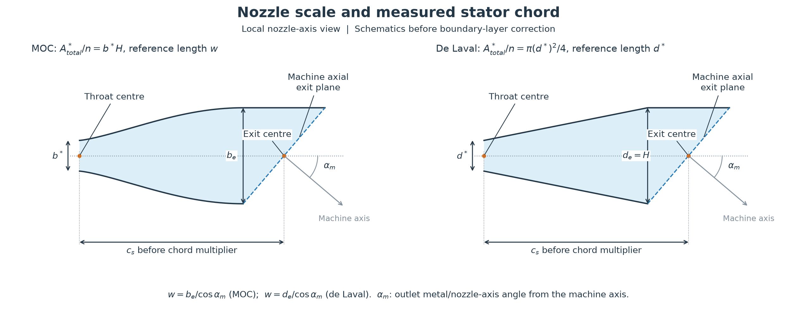

The nozzle generator extends the suction-side wall to terminate the exit in the machine axial plane. The class
measures the straight distance between the throat and exit opening centres, including that extension, and multiplies
it by `stator_nozzle_chord_scale` to obtain <var>c<sub>s</sub></var>. `stator_nozzle_chord_scale` allows to account for blade turning
upstream of the nozzle throat, which is not constructed by `SupersonicTurbineBlading`. Every case uses the stator chord/pitch
residual:

```math
r_1=\frac{c_s}{p_s}-(c/p)_{s,\mathrm{assumed}}.
```

Packing aims to fill the available annulus sector, make the Euler-circle blockage agree with the meanline model,
maintain manufacturable metal spacing and pass the specified mass flow. There are four nozzle cases that handle these
conditions as follows.

##### Multiple MOC nozzles

Select `contour_method="moc"` and $`n\gt 1`$. Start each rectangular exit centre at Euler radius <var>R<sub>E</sub></var> and shift it
radially when necessary to fit between hub and tip. First calculate the width that provides the required metal
spacing between adjacent exits when their inner edges touch the hub. Then apply `min_MOC_nozzle_width` as a lower
limit on width. If that lower limit widens the exit, the metal spacing can fall below the requested minimum.
For angular pitch <var>δ</var>, the spacing between adjacent nozzle corners is:

```math
g=2R_h\sin(\delta/2)-w\cos(\delta/2).
```

1. Set $`g=t_{s,\min}^{\mathrm{proj}}`$, giving
   $`w_{\mathrm{ref}}=[2R_h\sin(\delta/2)-t_{s,\min}^{\mathrm{proj}}]/\cos(\delta/2)`$.
   Enforce $`w=\max(w_{\mathrm{ref}},w_{\min})`$, where <var>w</var><sub>min</sub> is `min_MOC_nozzle_width`, default 5 mm.
   This permits construction even when <var>w</var><sub>ref</sub> is nonpositive. Widening the nozzle reduces the obtained
   metal spacing and can cause adjacent exits to overlap. If the resulting circumferential spacing between neighbouring 
   exits is smaller than `t_min_stator / cos(alpha_1)`, `t_TE_stator_min_margin` is negative and reports that the design
   violates the minimum metal thickness requirement.
2. Calculate the maximum height with the inner side tangent to the hub and outer corners at the tip:
   $`H_{\max}=\max(0,\sqrt{\max(0,R_t^2-w^2/4)}-R_h)`$. For the fixed width, this also maximizes exit area.
   If no positive height fits, $`H_{\max}=0`$ and the positive actual height produces a positive `height_optimality`.
3. Pass <var>w</var> as the MOC `reference_length`. The scaled contour supplies the uncorrected throat width <var>b</var><sup>∗</sup>.
4. Enforce mass flow with $`H=A^{\ast}_{\mathrm{total}}/(n b^{\ast})`$. This is both throat and exit radial height.
5. Calculate `height_optimality` as $`H-H_{\max}`$. Positive means the rectangle exceeds the available annulus;
   zero means the inner side touches the hub and outer corners touch the tip; negative means a shorter exit can fit.
6. Place the actual exit with inner-side coordinate
   $`y_0=\max[R_h,\min(R_E-H/2,\;R_h+H_{\max}-H)]`$ and centre radius $`R_c=y_0+H/2`$.
   Sum all Euler-circle arcs inside this exit to obtain <var>L<sub>e</sub></var>. If the circle crosses both radial sides and no tangential
   side, this reduces to $`L_e=2R_E\arcsin[w/(2R_E)]`$. The fourth residual is
   $`r_4=\max(0,p_s-L_e)-t_{TE,s}`$, matching the meanline stator TE thickness arc to the geometry.
   Clipping only this meanline TE thickness at zero prevents overlapping exits from passing negative thickness to `Turbine1D`.

This placement has three regimes. While the Euler-centred exit fits, $`R_c=R_E`$. Once its outer corners reach the
tip, shift the centre inward as height grows, keeping those corners at the tip and retaining a positive hub clearance.
At $`H=H_{\max}`$ the inner side becomes hub-tangent. For $`H\gt H_{\max}`$ keep that side at <var>R<sub>h</sub></var>; the centre then moves
outward and the outer corners exceed the tip. The height coefficient is negative before maximum height, zero at it
and positive afterwards.

Width is imposed by the construction approach, so `width_optimality` is zero. Calculate the obtained minimum
spacing between the actual adjacent inner corners at $`y_0\ge R_h`$. The obtained spacing and margin are

```math
t_{TE,s,\min}^{\mathrm{obtained}}
=2y_0\sin(\delta/2)-w\cos(\delta/2)
=t_{s,\min}^{\mathrm{proj}}-(w-w_{\mathrm{ref}})\cos(\delta/2)+2(y_0-R_h)\sin(\delta/2),
```

```math
\texttt{t\_TE\_stator\_min\_margin}
=t_{TE,s,\min}^{\mathrm{obtained}}-t_{s,\min}^{\mathrm{proj}}.
```

When the minimum width does not increase the reference width, the margin is nonnegative: it is positive above the
hub tangent line and zero at hub tangency. When the minimum width widens the nozzle, the margin is reduced and can
be negative, including at hub tangency. Negative obtained spacing denotes overlap; negative margin denotes spacing
below the required minimum. Neither is clipped. The engineer or outer optimizer must adjust the design until
`t_TE_stator_min_margin >= 0`. The width minimum prevents the nonpositive MOC nozzle exit width; it does not establish
feasible nozzle packing.

##### Single MOC nozzle

Select `contour_method="moc"` and $`n=1`$. With one nozzle, width cannot be determined from metal spacing between
adjacent nozzles. Instead, find the maximum-area rectangle within the tip circle whose centre is fixed at <var>R<sub>E</sub></var>.
Its height $`H_E=2h`$ determines the reference width <var>w</var>, with

```math
h=\frac{2(R_t^2-R_E^2)}{\sqrt{R_E^2+8R_t^2}+3R_E},\qquad
H_E=2h,\qquad w=2\sqrt{R_t^2-(R_E+h)^2}.
```

1. Keep this <var>w</var> and calculate $`H_{\max}=\sqrt{R_t^2-w^2/4}-R_h`$. This is the maximum fitting height when the
   centre may move: the inner side is hub-tangent and the outer corners touch the tip. It differs from <var>H<sub>E</sub></var>.
2. Use <var>w</var> as the MOC reference length to obtain <var>b</var><sup>∗</sup>. Set the actual height from mass flow,
   $`H=A^{\ast}_{\mathrm{total}}/b^{\ast}`$, and report $`H-H_{\max}`$.
3. Apply the same placement rule as for multiple MOC nozzles:
   $`y_0=\max[R_h,\min(R_E-H/2,\;R_h+H_{\max}-H)]`$ and $`R_c=y_0+H/2`$.
   The centre remains at <var>R<sub>E</sub></var> until the tip limits height, then shifts inward to maintain tip contact.
   At <var>H</var><sub>max</sub> the inner side reaches the hub; for greater heights, retain hub tangency and allow tip overfill.
4. Calculate <var>L<sub>e</sub></var> from the Euler-circle intersections and obtain admission
   $`\varepsilon_{\mathrm{geom}}=L_e/(2\pi R_E)`$.
5. Solve $`r_4=\varepsilon_{\mathrm{geom}}-\varepsilon_{\mathrm{assumed}}=0`$ in place of a stator TE thickness residual.

The meanline stator TE thickness is zero. `width_optimality` and `t_TE_stator_min_margin` are zero because no neighbouring
nozzle is present. A negative height coefficient means the actual height can fit at the selected width; a positive
coefficient means it is not possible to fit the nozzle and the stator must be adjusted. 

The calculation of <var>L<sub>e</sub></var> sums the parts of the Euler circle inside the actual, shifted rectangle. It includes
intersections with any of the four sides and returns zero if no part of the circle lies inside the exit.

For either MOC construction method, parameterize the right semicircle as $`x=R_E\sin\theta`$, $`y=R_E\cos\theta`$,
$`0\le\theta\le\pi`$. Use the placement rule above for <var>y<sub>0</sub></var> with either single or multiple MOC nozzles. Define

```math
\theta_0=\arccos\!\left(\mathrm{clip}\!\left(\frac{y_0+H}{R_E},-1,1\right)\right),\quad
\theta_1=\arccos\!\left(\mathrm{clip}\!\left(\frac{y_0}{R_E},-1,1\right)\right),\quad
\phi=\arcsin\!\left(\min\!\left(1,\frac{w}{2R_E}\right)\right).
```

The tangential sides admit $`[\theta_0,\theta_1]`$, while the radial sides admit
$`[0,\phi]\cup[\pi-\phi,\pi]`$. Their intersections give the total Euler diameter arc in the open nozzle passage:

```math
L_e=2R_E\left[\max(0,\min(\theta_1,\phi)-\theta_0)
+\max(0,\theta_1-\max(\theta_0,\pi-\phi))\right].
```

##### Multiple de Laval nozzles

Select `contour_method="conical"` and $`n\gt 1`$. The circular throat fixes

```math
d^{\ast}=\sqrt{\frac{4A^{\ast}_{\mathrm{total}}}{n\pi}}.
```

1. Pass <var>d</var><sup>∗</sup> as `reference_length` to generate the conical nozzle at the required isentropic exit Mach.
2. Read <var>w</var> from uncorrected `nozzle_passage_pitch` and <var>H</var> from uncorrected `nozzle_exit_width`. Here <var>H</var> is the
   exit diameter normal to the nozzle axis; its angled cut gives circumferential ellipse width <var>w</var>.
3. Centre each exit ellipse at <var>R<sub>m</sub></var>, with radial minor diameter <var>H</var>. Find its maximum radius <var>R</var><sub>max</sub>,
   including its flanks, and report `height_optimality` as $`R_{\max}-R_t`$.
4. Measure the straight projected gap between neighbouring ellipses and compare it with the required metal spacing.
5. Intersect the ellipse with the Euler circle to find <var>L<sub>e</sub></var>. The fourth residual is
   $`r_4=\max(0,p_s-L_e)-t_{TE,s}`$.

For semi-axes $`a=w/2`$ and $`b=H/2`$, the maximum distance from the turbine axis to the ellipse is

```math
R_{\max}=\begin{cases}
R_m+b, & a^2-b^2\le R_m b,\\[0pt]
\sqrt{a^2+R_m^2+\dfrac{(R_m b)^2}{a^2-b^2}}, & a^2-b^2\gt R_m b.
\end{cases}
```

The second case places the outermost point on a nozzle exit flank. The height coefficient is the signed radial overfill
in m and reduces to $`(H-H_a)/2`$ in the first case. A positive value reports tip overfill; zero indicates contact with
the tip circle.

The straight-spacing calculation projects both radially oriented ellipses onto the line joining their centres.
For $`\phi=\delta/2`$, the projected half-width of either ellipse is

```math
s_e=\sqrt{\left(\frac{w}{2}\cos\phi\right)^2+
          \left(\frac{H}{2}\sin\phi\right)^2},\qquad
g=2\left(R_m\sin\phi-s_e\right).
```

Consequently, `t_TE_stator_min_margin` is $`g-t_{s,\min}^{\mathrm{proj}}`$. Negative values retain the spacing deficit,
including overlap; they are not clipped. This projection is the implemented clearance measure, distinct from the
Euler-circle arc gap. Its approximate normal-metal margin is obtained by multiplying by $`\cos\alpha_1`$.

The available width at the required spacing is

```math
w_{\mathrm{available}}=\frac{2}{\cos\phi}
\sqrt{\max\left(0,
\left[R_m\sin\phi-\frac{t_{s,\min}^{\mathrm{proj}}}{2}\right]^2
-\left[\frac{H}{2}\sin\phi\right]^2\right)}.
```

It is set to zero if the centre spacing $`2R_m\sin\phi`$ is smaller than the required projected metal thickness.
`width_optimality` is $`w-w_{\mathrm{available}}`$. Unlike an MOC nozzle, a conical nozzle cannot independently vary
width and height after mass flow and expansion set its scale. Change nozzle count, admission fraction or stage
coefficients if the resulting exit dimensions or metal spacing do not meet their limits.

Only the meanline TE thickness arc in <var>r<sub>4</sub></var> is clipped at zero when exits overlap. This lets the coupling evaluate an
infeasible packing without assigning negative meanline TE thickness to `Turbine1D`; the negative 
`t_TE_stator_min_margin` still exposes the problem to the engineer or to the outer optimizer, just like for multiple
MOC nozzles. Convergence alone therefore does not establish a usable stator.

##### Single de Laval nozzle

Select `contour_method="conical"` and $`n=1`$.

1. Use the entire throat area to set $`d^{\ast}=\sqrt{4A^{\ast}_{\mathrm{total}}/\pi}`$ and generate the nozzle.
2. Read the elliptical exit dimensions <var>w</var> and <var>H</var> as for multiple conical nozzles, and centre the ellipse at <var>R<sub>m</sub></var>.
3. Calculate `height_optimality` as $`R_{\max}-R_t`$ using the same maximum-radius calculation as for multiple
   de Laval nozzles.
4. Find <var>L<sub>e</sub></var> by intersecting the ellipse with the Euler circle. Obtain
   $`\varepsilon_{\mathrm{geom}}=L_e/(2\pi R_E)`$ and solve the admission residual
   $`r_4=\varepsilon_{\mathrm{geom}}-\varepsilon_{\mathrm{assumed}}=0`$.

The meanline stator TE thickness is zero. There is no neighbouring-nozzle spacing constraint, so `width_optimality` and
`t_TE_stator_min_margin` are zero. The width still determines admission and must satisfy the local ellipse geometry
requirements; zero width coefficient does not remove those requirements.

#### Stored results, residuals and feasibility checks

`x_solution`, `turbine_meanline`, `stator_shape`, `rotor_shape` and `coefficients` are `None` after construction.
After `couple_meanline_and_blading()` converges, the public result attributes are:

| Attribute | Contents |
| --- | --- |
| `turbine_meanline` | `Turbine1D` object evaluated with capped TE inputs; its `t_TE_stator` and `t_TE_rotor` retain those capped values. Its `t_LE_rotor` stores the LE thickness projection; `R_nozzle` stores the actual nozzle exit-centre radius. |
| `stator_shape` | `SupersonicStatorNozzle` object; uncorrected dimensional geometry is in `dimensional_shapes.uncorrected`. |
| `rotor_shape` | `SupersonicRotorBlade` object; `dimensionalize().corrected` supplies nonsymmetric rotor geometry when BL is enabled and that shape exists; otherwise use `.uncorrected`. The same selection is used by both turbine plots. |
| `x_solution` | Converged design-variable vector described above, retaining full uncapped TE thickness assumptions for the blading. |
| `coefficients` | Dictionary of optimality coefficients, thickness margins and boolean TE-loss limitation flags listed below. |

The entries of `coefficients` are:

Despite the names `height_optimality` and `width_optimality`, these are signed geometric margins. A positive value
means the nozzle exceeds the available height or width; zero reaches the limit; a negative value leaves space.
The metal-thickness margins use the opposite sign convention: a negative value means metal is too thin.

| Key | Meaning                                                                                                                                                                                                                                                                    |
| --- |----------------------------------------------------------------------------------------------------------------------------------------------------------------------------------------------------------------------------------------------------------------------------|
| `height_optimality` | $`H-H_{\max}`$ for MOC; $`R_{\max}-R_t`$ for de Laval, in m. Require $`\le0`$; zero fills the permitted radial extent for the selected construction.                                                                                                                             |
| `width_optimality` | $`w-w_{\mathrm{available}}`$ in m for multiple de Laval nozzles; require $`\le0`$. Zero by construction for MOC and single-nozzle cases.                                                                                                                                       |
| `t_TE_stator_min_margin` | Obtained minus required projected spacing, in m; require $`\ge0`$. Multiple MOC and de Laval exits retain signed margins, including negative values (nozzle overlap). For MOC, enforcing `min_MOC_nozzle_width` can make this margin negative. Zero for single-nozzle cases. |
| `t_LE_rotor_min_margin` | Obtained circumferential LE thickness minus `t_min_rotor / cos(beta_1)`, in m. Zero to roundoff by construction.                                                                                                                                                           |
| `t_TE_rotor_min_margin` | Constructed circumferential trailing-edge thickness minus `t_min_rotor / cos(beta_2)`, in m, using the blade outlet angle. A negative value means the trailing-edge metal is thinner than requested. |
| `limited_TE_stator_losses` | Boolean: `True` when assumed stator TE thickness exceeds 24% of stator pitch and its loss-model input is limited. Always `False` for one stator nozzle, whose TE thickness is zero.                                                                                        |
| `limited_TE_rotor_losses` | Boolean: `True` when assumed rotor TE thickness exceeds 24% of rotor pitch and its loss-model input is limited.                                                                                                                                                            |

The input dictionary copies retain the constructor's setup and initial estimates; use `turbine_meanline` to read
the resulting meanline design. For example:

```python
stage = turbine.turbine_meanline
eta_ts = stage.analysis_results_at_design_point["eta_ts"]
nozzle_exit = turbine.stator_shape.dimensional_shapes.uncorrected
rotor_shapes = turbine.rotor_shape.dimensionalize()
rotor_contour = rotor_shapes.corrected if rotor_shapes.corrected is not None else rotor_shapes.uncorrected
packing = turbine.coefficients
turbine.print_design_coupling_results()
```

`evaluate_design(meanline_arguments)` evaluates a trial design and returns
`(residuals, turbine_meanline, stator_shape, rotor_shape, coefficients)`. The five residuals, in order, are stator
chord/pitch, rotor chord/pitch, rotor TE thickness projection, stator TE thickness arc or single-nozzle admission,
and rotor axial-width/chord ratio.
The first two are dimensionless; the third is in m; the fourth is in m for multiple nozzles and dimensionless for a
single nozzle. The fifth residual is dimensionless.

Manual calls of `evaluate_design` return trial objects and coefficients without changing the five stored result attributes or
running the outer coupling loop. The meanline and blading calculations still include their own internal numerical solves.
For example, evaluate a trial design and pass its returned coefficient dictionary to the printer to see nozzle-fit
and metal-thickness margins:

```python
residuals, meanline, stator, rotor, coefficients = turbine.evaluate_design(turbine.Turbine1D_arguments)
turbine.print_design_coupling_results(coefficients)
```

`print_design_coupling_results(coefficients=None)` prints each coefficient and its range that indicates feasible design,
then prints the boolean loss-limitation flags with an explanation of the 0.24 cap. Packing excesses must be
nonpositive and thickness margins nonnegative; the flags are informational rather than feasibility inequalities.
Omitting the dictionary uses `turbine.coefficients`; if that is still `None`, it prints
`SupersonicTurbine.coefficients is None`.

The geometry figures below use the current `example.py` turbine inputs, with `calculate_boundary_layer=False`
for both stator and rotor before coupling.

Call `turbine.plot_3D_geometry()` after coupling to view the assembled & interactive turbine in 3D.

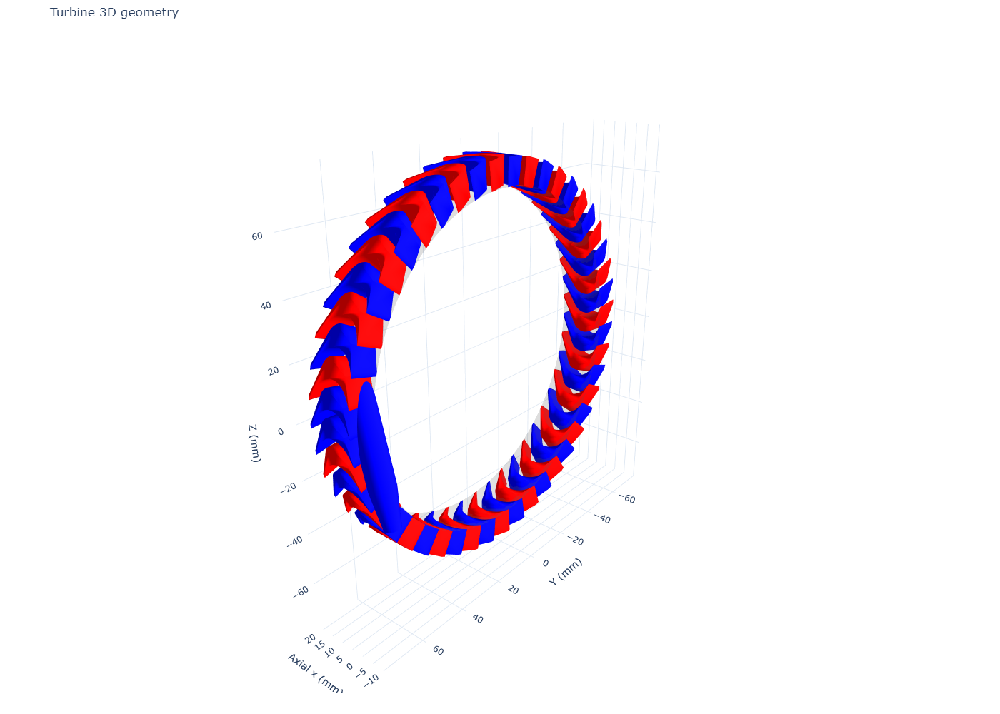

Call `turbine.plot_2D_geometry(number_of_rotor_blades=10)` to plot an axial/circumferential turbine section at Euler
diameter.

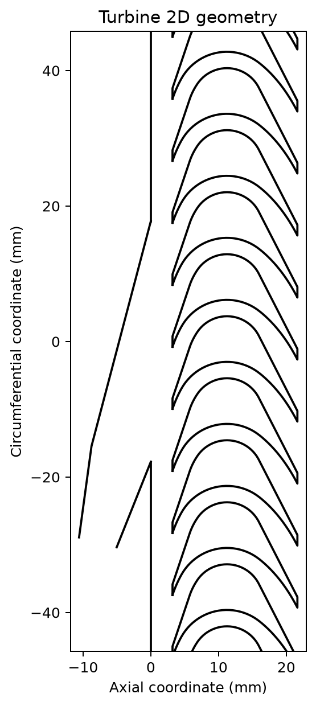

Successful coupling establishes agreement between the meanline model and the generated shapes. The engineer or
outer optimizer must separately check the packing optimality coefficients and thickness margins. Negative height
or width excesses indicate unused space; values near zero fill the corresponding available dimension. Changing nozzle
count, prescribed multi-nozzle admission, flow coefficient or loading can alter the annulus and resolve packing
deficits. For a single nozzle, admission is an outcome of the coupled geometry rather than an independent final input.

#### Validity limits and failures

The stator isentropic exit Mach, actual rotor relative inlet Mach and isentropic rotor relative outlet Mach must all
exceed one. Rotor inlet/outlet angles must have positive axial components, and the stator outlet angle must be
strictly between zero and 90 degrees from axial.

Invalid inputs or violated construction assumptions raise `ValueError`; missing dictionary inputs raise `KeyError`.
The bounded Aitken solver raises `RuntimeError` for nonfinite values, stagnation or failure to converge within its
iteration limit. Positive packing excesses or negative spacing margins can remain as reported coefficients after a
successful solve and must still be addressed by the engineer or outer optimizer when selecting the design.

### GA_optimizer: optimization_functions and scouting_functions

`optimize_turbine` searches for the most efficient turbine within user-specified input ranges and design limits.
It first samples those ranges with a Sobol sequence, which spreads candidate designs across the search domain.
It then uses [pymoo's mixed-variable genetic algorithm](https://pymoo.org/customization/mixed.html) (GA) to select,
combine and modify promising designs. Mixed variables means continuous inputs such as RPM can be optimized
together with integer inputs such as blade count.

The objective is one selected efficiency: isentropic or polytropic, on a total-to-total or total-to-static basis
(`eta_tt`, `eta_ts`, `eta_poly_tt` or `eta_poly_ts`), chosen with `efficiency` and `efficiency_type`. RPM, coefficients,
blade counts and the other bounded design variables are varied to maximize that efficiency subject to the constraints.
With `mode="Turbine1D"`, evaluations use `Turbine1D` meanline sizing and its loss model, with meanline constraints. With
`mode="SupersonicTurbine"`, evaluations construct and couple the meanline model with stator-nozzle and rotor blading
through `SupersonicTurbine`; efficiency comes from the converged coupled meanline, and blading packing, thickness and
manufacturing constraints can also be imposed. The selected mode and objective are used throughout both prescouting and GA.

The initial sampling phase, called prescouting, evaluates 64 proposals by default. It then combines small changes
around promising designs with new proposals across the full input ranges until it finds a feasible starting design
or stops making progress. Feasible means the turbine can be calculated and meets all specified design constraints.
If no feasible design is found, the GA starts from the design with the smallest constraint violation. The user does
not need to supply a feasible starting design. The search does not certify a global optimum.

This workflow is shown below:

```text
 optimize_turbine
   |
   v
 Fixed inputs, bounded design variables, constraints, gas and loss model
 Select one model and one efficiency for the whole run:
   Turbine1D -> meanline sizing; SupersonicTurbine -> coupled meanline and blading.
 Prepare shared threaded evaluator, evaluation cache and successful-coupling archive.
   Model failure -> penalty; model success -> efficiency and constraint violation (CV).
   Coupled mode reuses the nearest compatible successful coupling when available.
   |
   v
 Initial batch: geometry-informed Sobol proposals (64 by default)
   |
   +--> PRESCOUTING LOOP ---------------------------------------------------------------------------+
   |    Evaluate current proposals through the shared evaluator.                                    |
   |    Rank by smallest CV, then highest efficiency.                                               |
   |    |                                                                                           |
   |    +--> Feasible design found, or CV improvement stagnated? -> Leave prescouting.              |
   |    |                                                                                           |
   |    v  (otherwise)                                                                              |
   |    Perturb the best scout leaders and add new global Sobol proposals.                          |
   |    |                                                                                           |
   |    +--> Repeat with the new proposals ---------------------------------------------------------+
   |
   v  (feasible seed found, or prescouting stagnated)
 Choose the best feasible scout; if none is feasible, use the design with smallest CV.
 Build the initial GA population (16 designs by default):
   1 unchanged scout leader + 7 local perturbations + 8 new global Sobol proposals.
   |
   +--> PYMOO MIXED-VARIABLE GA LOOP ---------------------------------------------------------------+
   |    Evaluate the initial population or new offspring through the same evaluator.                |
   |    Survival favors feasibility, then efficiency; infeasible designs compete by CV.             |
   |    Update the best feasible design, statistics and history.                                    |
   |    Print generation data and update the scatter plot when enabled.                             |
   |    |                                                                                           |
   |    +--> Stagnation, optional generation cap, or no unique offspring? -> Finish.                |
   |    |                                                                                           |
   |    v  (otherwise)                                                                              |
   |    Select parents; apply crossover and mutation; round integer blade counts.                   |
   |    |                                                                                           |
   |    +--> Continue with the next generation -----------------------------------------------------+
   |
   v
 Return the best feasible turbine, design and efficiency, plus history and failure counts.
 If no feasible design was found: success=False; return the closest attempt in best_infeasible.
```

`GA_optimizer/optimization_functions.py` contains `optimize_turbine`, including model evaluation, constraints,
coupling initialization, plotting and GA control. `GA_optimizer/scouting_functions.py` contains the documented
Sobol sampler, local proposal generator and `prescout_design_domain` feasibility search. These helpers share the
optimizer's random generator, evaluator, cache and coupling archive. The end of `example.py` contains a complete
coupled-turbine optimization example. Fixed inputs and bounded design variables are supplied separately:

```python
from RocketTurbines.GA_optimizer.optimization_functions import optimize_turbine

Turbine1D_arguments = dict(
    reaction_isentropic_tt=0., s_ax_over_pitch_rotor=0.35,
    shaft_power=25000., mdot=0.15, T_t0=800., p_t0=5e6, radial_clearance=0.1e-3,
    chord_over_pitch_stator=3.3, chord_over_pitch_rotor=2.518,
    t_TE_stator=0.5e-3, t_TE_rotor=0.5e-3, Ra_roughness=3e-6,
    delta_s_estimate=(350., 130., 200.),
)
optimization_arguments = dict(
    RPM=[25000., 50000.], work_coefficient_tt=[1., 4.], flow_coefficient=[0.25, 2.],
    no_blades_stator=[1, 120], no_blades_rotor=[20, 300], admission_fraction=[0.002, 1.],
    separation_margin=[0.05, 0.50],
)
SupersonicTurbine_arguments = dict(
    t_min_stator=0.5e-3, t_min_rotor=0.5e-3, stator_nozzle_chord_scale=1.,
    print_user_warnings=False,
)
constraints = {
    "D_tip": [None, 0.15], "l_rotor": [0.010, None],
    "l_rotor/D_mean": [None, 0.25], "alpha_1_deg": [None, 75.],
    "M_ax_1": [None, 1.], "M_ax_2": [None, 1.], "chord_over_pitch_rotor": [2.5, 3.3],
    "height_optimality": [-0.003, 0.], "width_optimality": [None, 0.],
    "t_TE_stator_min_margin": [0., None],
}

# Reuse your IdealGas and TraupelLossModel objects; each worker gets its own copies.
result = optimize_turbine(
    gas=gas, loss_model=loss_model, Turbine1D_arguments=Turbine1D_arguments,
    optimization_arguments=optimization_arguments, SupersonicTurbine_arguments=SupersonicTurbine_arguments,
    constraints=constraints,
    mode="SupersonicTurbine", efficiency="total-to-total", efficiency_type="isentropic",
    SupersonicStatorNozzle_arguments=dict(contour_method="conical", number_of_nodes=51,
        half_cone_metal_angle=7., calculate_boundary_layer=False),
    SupersonicRotorBlades_arguments=dict(number_of_nodes=51, calculate_starting=False,
        calculate_boundary_layer=False, use_leading_edge_entry_correction=False),
    n_threads=None, plot_axes=["flow_coefficient", "work_coefficient_tt"], seed=1,
)
if result["success"]:
    turbine = result["best_turbine"]
    print(result["best_efficiency"], result["best_design"])
print(result["termination"], result["statistics"])
```

The `gas` and `loss_model` arguments are existing `IdealGas` and `TraupelLossModel` objects. `Turbine1D_arguments`
contains fixed inputs for `Turbine1D.size_turbine`, such as power, inlet conditions and clearances.
`SupersonicTurbine_arguments` holds fixed coupling inputs such as minimum metal thicknesses and symmetry choice.
`SupersonicStatorNozzle_arguments` and `SupersonicRotorBlades_arguments` contain nozzle- and blade-construction
options such as contour method, node count and boundary-layer calculation. Values that the search may vary belong
in `optimization_arguments` as lower/upper bounds.

Only the following names are accepted in `optimization_arguments`. Every entry requires two strictly increasing
bounds, given as a list or tuple; scalars belong in the corresponding fixed-input dictionary. A name cannot occur
in both a fixed dictionary and `optimization_arguments`. At least one bounded variable must be active in the
selected mode; an empty dictionary is rejected. Separation-margin bounds alone do not define a search in
`Turbine1D` mode. With a fixed single stator nozzle in `SupersonicTurbine` mode, admission is solved internally,
so admission bounds alone are also insufficient; provide another active bounded variable.

| Optimization variable | Type | Model |
|---|---|---|
| `RPM` | Real | Both |
| `work_coefficient_tt` | Real | Both |
| `flow_coefficient` | Real | Both |
| `no_blades_stator` | Integer | Both |
| `no_blades_rotor` | Integer | Both |
| `admission_fraction` | Real | Both |
| `separation_margin` | Real | SupersonicTurbine |
| `reaction_isentropic_tt` | Real | Both |

Axial gap/pitch, thicknesses, chord/pitch estimates, seal-tooth count, duty
requirements and other settings are fixed inputs. In `SupersonicTurbine` mode the inner solver still determines final
chord/pitch and thickness values from their fixed initial estimates; their output constraints remain active.

Unspecified optional inputs use the models' defaults. Unknown names, overlapping fixed/bounded inputs, invalid
optimization intervals and missing required inputs raise errors before scouting. Requirements on input values
are checked by the turbine and blading constructors and by the numerical routines they call. The optimizer passes
fixed input values to those models unchanged.

With `mode="Turbine1D"`, `SupersonicTurbine_arguments`, separation-margin bounds and blading dictionaries are ignored.
Give only meanline constraints in that mode: nozzle packing coefficients and
manufacturing margins do not exist in a meanline calculation in `Turbine1D`, so requesting them raises an error. For example:

```python
meanline_constraints = {name: constraints[name] for name in
    ("D_tip", "l_rotor", "l_rotor/D_mean", "M_ax_1", "M_ax_2", "alpha_1_deg")}
meanline_result = optimize_turbine(
    gas, loss_model, Turbine1D_arguments, optimization_arguments, meanline_constraints, mode="Turbine1D",
    efficiency="total-to-static", efficiency_type="polytropic", n_threads=4,
)
```

The two efficiency selectors are independent:

| `efficiency` | `efficiency_type` | Maximized result |
|---|---|---|
| `total-to-total` | `isentropic` | `eta_tt` |
| `total-to-static` | `isentropic` | `eta_ts` |
| `total-to-total` | `polytropic` | `eta_poly_tt` |
| `total-to-static` | `polytropic` | `eta_poly_ts` |

Constraints can name scalar geometry attributes, analysis, blade-row and loss results, or coupled geometry
coefficients. Use `[lower, upper]` with `None` for an open end, or a boolean for a boolean result. Numeric ranges
include their endpoints. Simple ratios of two output names are supported directly, such as `l_rotor/D_mean`. 
Lengths, including `height_optimality`, are in metres.

The two **strict** `t_TE_stator/p_stator < 0.2` and `t_TE_rotor/p_rotor < 0.2` constraints are always present, since
above them losses from `TraupelLossModel` quickly increase. Other engineering limits must be supplied explicitly 
in `constraints`.

In `SupersonicTurbine` mode, the chord/pitch ratios, TE thicknesses and rotor width/chord are initial coupling estimates,
not independent outer variables. They must be constants in the input dictionary; constrain their final outputs
to restrict the constructed geometry. With one stator nozzle, admission is also solved internally; its input
is only an estimate. A fixed single-nozzle search removes that inactive design variable automatically.

Each coupled evaluation first tries the nearest compatible successful coupling from earlier completed batches,
including its rotor width/chord estimate. Single- and multi-nozzle archives stay separate. If that attempt fails,
one low-loss initialization is tried. For each design, the optimizer uses the first coupled solution that converges.
Failed model evaluations receive finite violation penalties; successful but infeasible designs retain their
individual continuous constraint residuals so feasibility guides GA selection.

`n_threads=None` uses the available logical CPU count; a requested count is capped at that number. Evaluation
batches use a thread pool, with concurrency also limited by the number of candidates.
Progress prints each scouting iteration and GA generation: elapsed time, evaluations,
successful/failed construction attempts, feasible designs, best feasible efficiency, and smallest constraint
violation (`CV`). CV summarizes how far a design exceeds its constraints; smaller values mean less violation.
With `verbose=True` (the default), every phase has explicit start/completion lines such as
`Prescout iteration 0 started`, `GA generation 1 started` and `GA generation 1 completed | ...`.
Set `verbose=False` to silence these lines. Progress rows are also retained in the
returned `history`.

`plot_axes=["input_x", "input_y"]` enables a live scatter plot using the candidate inputs passed to the model, such
as flow coefficient and work coefficient. The axes use those search inputs rather than geometry values adjusted
internally during meanline/blading coupling.
Feasible designs are circles colored by efficiency using a colorbar. Successfully
constructed but infeasible designs are squares. Construction failures are omitted from the plotted points.
Omit `plot_axes` to disable plotting. By default, `optimize_turbine` keeps the final interactive plot open until its
windows are closed, then returns the results. Set `block_plot=False` to return immediately after optimization. 

Local perturbations during scouting and GA initialization can be configured separately from GA mutation:

```python
perturbation_scales = (0.02, 0.005)
perturbation_standard_deviations = {"no_blades_stator": 0.5, "no_blades_rotor": 1., "RPM": 250.}
# Pass both settings to optimize_turbine using the matching keyword arguments.
```

`perturbation_scales` controls the size of random changes around an existing design. For each continuous variable,
the change is drawn from a Gaussian distribution centered at zero, with
`standard deviation = scale * (upper bound - lower bound)`. For example, without an override, RPM bounds
`[25000, 50000]` and a scale of `0.02` give a standard deviation of 500 rpm.

The default scales are `(0.035, 0.012)`. Their use depends on the phase:

- During additional scouting, each call generates one local proposal around a scout leader. The scale sequence
  restarts with each call, so these proposals always use the first scale: `0.035` by default.
- During GA initialization, one call generates several neighbors around the best scout design. The first neighbor
  uses `0.035`, the second uses `0.012`, the third uses `0.035`, and so on. The unchanged scout design is also retained.

`perturbation_standard_deviations` sets an absolute standard deviation for any named variable, overriding its usual
setting. In the example above, `"RPM": 250.` makes every local RPM change use a standard deviation of 250 rpm,
regardless of the relative scale. Blade counts use absolute defaults of one stator nozzle and three rotor blades
unless overridden; `perturbation_scales` applies only to continuous variables.

These settings describe standard deviations, so larger changes are possible. Proposals are clipped to the variable
bounds, and blade counts are rounded to integers. They affect local scouting and GA initialization; later GA
crossover and mutation use their own settings.

The optional `pymoo_arguments` dictionary overrides only the default GA settings; omitting it or passing `{}`
retains the tuned defaults. For example:

```python
pymoo_arguments = {
    "pop_size": 16, "n_offsprings": 16,
    "crossover_probability": 0.9, "crossover_eta": 15.,
    "mutation_probability": 1., "mutation_eta": 20.,
}
# Add pymoo_arguments=pymoo_arguments to the optimize_turbine(...) call.
```

`pop_size` overrides the separate `population_size` argument and controls the initial population as well.
Without `n_offsprings`, pymoo uses the default population size. The four probability/eta entries configure
simulated binary crossover (SBX) and polynomial mutation for both real and integer variables; integer rounding remains enabled.
To replace pymoo's built-in operators, the dictionary also accepts `selection`, `crossover`, `mutation`, `mating`,
`survival`, `repair`, `eliminate_duplicates` and `advance_after_initial_infill`. Mixed crossover/mutation overrides must be operator
dictionaries keyed by pymoo's `Real`/`Integer` types. A custom `mating` object replaces the default mating
configuration; do not combine it with individual operator settings. 

Default GA settings are population 16, random parent selection, SBX crossover probability 0.9/eta 15,
polynomial mutation probability 1/eta 20, and integer repair. Half the initial GA population is near the scout
leader and half is global. Stopping uses an eight-generation stagnation window, with efficiency improvement
tolerance `5e-4` (0.05 percentage points). Scouting stops on finding a feasible design or on constraint-violation
stagnation. `max_generations=None` adds no generation cap; set an integer to limit GA generations.
GA also stops if it cannot generate further unique offspring.

`seed` is an integer that initializes the random-number generators used by scouting and GA. It controls the
scrambled Sobol samples, random local perturbations, and random choices during GA parent selection, crossover
and mutation. Using `seed=1` (the default) makes these random choices repeatable when the inputs and settings
stay the same. Changing it to another integer, such as `seed=2`, gives a different random search path and may
produce a different final design. Use `seed=None` for a new random sequence on each run.

The return dictionary contains `success`, `best_turbine`, `best_design`, `best_results`, `best_efficiency`,
`best_infeasible`, `termination`, `elapsed_seconds`, `statistics`, `history`, `evaluations`, and `figure`.
`best_design` contains outer inputs; `best_results` contains actual coupled outputs, which can differ for
internally solved quantities. If no feasible design is found, best-result fields are `None` and
`best_infeasible` describes the closest attempt. A generation-limited run can return a feasible incumbent;
its termination reason states the generation limit rather than claiming numerical convergence.
Statistics count unique evaluated designs, cache hits, successful/failed construction attempts (including
retries), feasible designs, exact construction-failure messages and output-evaluation errors. A successful
construction is not necessarily feasible.

#### Smith chart

`GA_optimizer/Smith_chart.py` provides `plot_Smith_chart` for a parametric meanline study before optimization.
It sizes a fresh `Turbine1D` at every flow/work coefficient pair, keeping the other meanline inputs fixed.
Use coefficient arrays to set the sampled domain and resolution, and select `eta_tt`, `eta_ts`, `eta_poly_tt`
or `eta_poly_ts`. Failed evaluations and unusable efficiencies remain blank; contours do not bridge failed cells.

```python
import numpy as np
from RocketTurbines.GA_optimizer.Smith_chart import plot_Smith_chart

smith_chart = plot_Smith_chart(
    flow_coefficient_array=np.linspace(0.25, 3., 50),
    work_coefficient_array=np.linspace(1., 6., 50), efficiency_to_plot="eta_tt",
    Turbine1D_arguments=Smith_chart_arguments, gas=gas, loss_model=loss_model,
    stator_angle_constraint=None, l_over_D_constraint=None, D_tip_constraint=None, l_blade_constraint=None)
```

The optional upper limits are `stator_angle_constraint` for signed `alpha_1_deg` in degrees,
`l_over_D_constraint` for `l_rotor/D_mean`, and `D_tip_constraint` for tip diameter in metres. For example,
use `75.`, `0.25` and `0.15` respectively. `l_blade_constraint` adds a minimum rotor blade length in metres,
using `l_rotor`; for example, `0.010` requires at least 10 mm. Each defaults to `None`, which disables that limit.
Designs violating a limit are masked like failed evaluations, omitted from the plot, and counted in
`failure_reasons`. Only the first violated limit is counted for each excluded point.

Example output with the optional limits disabled, using a 50 × 50 grid and isentropic total-to-total efficiency:

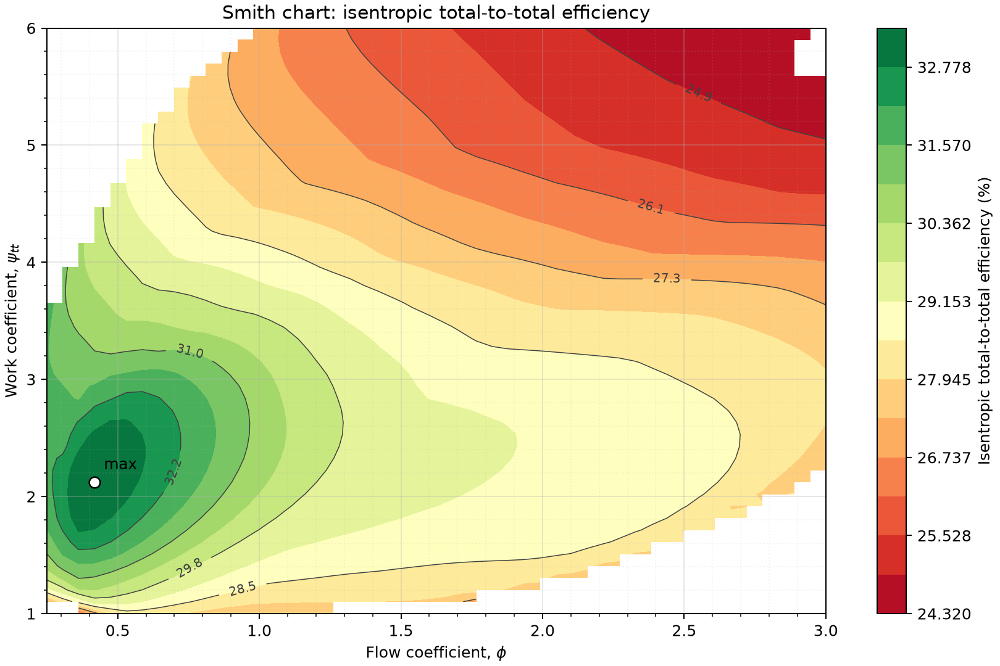

`Smith_chart_arguments` contains fixed `Turbine1D.size_turbine` inputs, excluding `flow_coefficient`,
`work_coefficient_tt`, `gas` and `loss_model`; `example.py` supplies a complete dictionary before its optimization
section. The function displays the plot and returns its figure, axes, coefficient arrays, masked efficiency grid,
best sampled coefficients and efficiency, and failure-reason counts. The grid is indexed as `[work, flow]` and
stores efficiencies as fractions. All failed samples produce an explanatory empty plot with both best fields set
to `None`.

## Tool Validation

The following comparisons use experimental data and original design information from these NACA/NASA reports.
Page numbers below refer to the printed report pages.

1. T. P. Moffitt, **Design and Experimental Investigation of a Single-Stage Turbine with a Rotor Entering Relative
   Mach Number of 2**, NACA RM E58F20a (1958): pp. 4-8, Tables I-II and Figures 1 and 6.
   [Original report](https://ntrs.nasa.gov/api/citations/19630010654/downloads/19630010654.pdf).
2. W. J. Whitney and W. T. Wintucky, **Experimental Investigation of a 7-Inch-Tip-Diameter Transonic Turbine**,
   NACA RM E57J29 (1958): pp. 2-4, Tables I-II and Figures 2 and 4(a).
   [Original report](https://ntrs.nasa.gov/api/citations/19930089982/downloads/19930089982.pdf).
3. W. J. Whitney, D. E. Monroe and R. Y. Wong, **Investigation of Transonic Turbine Designed for Zero Diffusion
   of Suction-Surface Velocity**, NACA RM E54F23 (1954): pp. 4-5, design assumptions for the velocity diagram
   shared by the scaled 7-inch turbine in NACA RM E57J29.
   [Original report](https://ntrs.nasa.gov/api/citations/19930090527/downloads/19930090527.pdf).
4. H. E. Rohlik, **Investigation of Eight-Stage Bleed-Type Turbine for Hydrogen-Propelled Nuclear Rocket
   Applications. I - Design of Turbine and Experimental Performance of First Two Stages**, NASA TM X-475
   (1961): pp. 6-12, Tables I-III and Figures 5-6.
   [Original report](https://ntrs.nasa.gov/api/citations/19660030323/downloads/19660030323.pdf).
5. H. A. Klassen, **Cold-Air Investigation of Effects of Partial Admission on Performance of 3.75-Inch
   Mean-Diameter Single-Stage Axial-Flow Turbine**, NASA TN D-4700 (1968): pp. 2-8, Table I and Figures 1 and 5.
   [Original report](https://ntrs.nasa.gov/api/citations/19680020769/downloads/19680020769.pdf).
6. T. P. Moffitt and F. W. Klag Jr., **Experimental Investigation of the Partial-Admission Performance
   Characteristics of a Single-Stage Mach 2 Supersonic Turbine**, NASA TM X-80 (1959): pp. 4-6 and Figures 1
   and 6; blade coordinates are supplied by NACA RM E58F20a.
   [Original report](https://ntrs.nasa.gov/api/citations/19670022828/downloads/19670022828.pdf).

### How the comparisons were calculated

The reports give turbine dimensions, rotational speeds and experimental pressure ratios. The sizing function
`Turbine1D.size_turbine` instead requires shaft power, mass flow and dimensionless flow and reaction inputs.
[`docs/validate_turbine1d.py`](docs/validate_turbine1d.py) calculates the missing sizing inputs from the reported operating conditions
and the assumptions listed before each comparison.

Total (stagnation) pressure includes the effect of bringing the flow to rest isentropically; static pressure is
the local pressure in the moving gas. Both efficiencies divide actual specific shaft work by an ideal isentropic
enthalpy drop starting from the inlet total state. Total-to-total efficiency uses outlet total pressure to define
that ideal drop; total-to-static efficiency uses outlet static pressure. Moffitt, Klassen and Moffitt-Klag are
compared on a total-to-static basis; Whitney and Rohlik on a total-to-total basis.

The following terms describe those inputs:

- **Flow coefficient** is outlet axial gas velocity divided by blade speed. The ratios are derived from each
  report's design velocity diagram. When two velocities are divided by the same reference velocity in a diagram,
  dividing those two ratios gives the required coefficient. For example, Whitney gives 0.724/0.550 = 1.31636.
- **Critical velocity**, used in several report diagrams, is the sonic reference velocity calculated from the
  local total temperature. A velocity divided by critical velocity is different from a Mach number, which uses
  the speed of sound at the local static temperature.
- **Isentropic reaction** is the rotor static-enthalpy drop divided by the stage total-to-total enthalpy drop
  in a fully isentropic reference calculation. `docs/validate_turbine1d.py` derives this ratio from the reports' design pressures
  and velocities using their heat-capacity ratio of 1.4. **Real reaction** uses the actual rotor static-enthalpy
  drop and actual stage work, including losses. Klassen specifies zero real reaction; `docs/validate_turbine1d.py` holds that
  value at zero and solves for the corresponding isentropic reaction.
- **Admission** is the fraction of the stator circumference that supplies flow to the rotor. At 50% admission,
  half of the stator circumference is active. The remaining circumference contains inactive passages.
- **Blade-jet speed ratio** is blade speed divided by the jet velocity that an ideal isentropic expansion through
  the specified pressure ratio would produce. **Equivalent speed** is speed corrected to the report's reference
  inlet conditions so tests at different temperatures or with different gases can be compared. Each case states
  how the actual blade speed or rpm used in the model is obtained.

For each turbine and admission value, `docs/validate_turbine1d.py` performs these calculations:

1. Fix inlet pressure, inlet temperature, rotational speed, annulus dimensions, blade geometry, clearances and
   the selected pressure ratio at the values stated in the case's input table.
2. Fix the design flow coefficient and isentropic reaction derived from the report. For Klassen, fix the design
   flow coefficient and zero real reaction instead. Using these design values at the experimental operating point
   is an assumption; `docs/validate_turbine1d.py` does not derive new values from measured flow conditions at each admission.
3. Solve for specific shaft work and the three entropy rises until the flow and calculated losses agree and
   the selected pressure ratio is reached. Calculate mass flow from outlet density, axial velocity and annulus area;
   calculate shaft power as mass flow times specific work.
4. Pass the resulting inputs to `Turbine1D.size_turbine` and calculate efficiency from its converged results.
   Compare that efficiency with the measured value.

Pressure ratio and annulus dimensions are therefore specified test conditions, while shaft work and efficiency
are calculated results. In the admission graphs, outlet axial gas velocity divided by blade speed is held at its
design value. Because rotational speed and diameter are also fixed within each admission series, this assumes
the same outlet axial velocity at every admission. Moffitt-Klag also keeps the design isentropic reaction fixed;
Klassen requires zero real reaction at every admission.

The **Moffitt input data**, **Whitney input data**, **Rohlik input data**, **Klassen input data**, and
**Moffitt-Klag input data** tables below use the units printed in the original reports. In those tables,
psia means pounds per square inch absolute, in Hg means inches of mercury absolute, F means degrees Fahrenheit,
and R means degrees Rankine. [`docs/validate_turbine1d.py`](docs/validate_turbine1d.py) converts the listed values
to SI units before passing them to `Turbine1D`. Blade speed and flow coefficients taken at the annulus mean diameter are
converted to the model's Euler diameter, defined as diameter that separates annulus into equal areas. This conversion preserves
rotational speed and dimensional velocities. Isentropic reaction is unchanged by the radius conversion.

### Loss-model options used for the comparisons

The `extrapolation_method` argument of `TraupelLossModel` determines how the empirical loss coefficients are
calculated when Mach number, Reynolds number, flow angle or a geometry ratio lies outside the stored data range:

- **`extrapolation_method="linear"`** extends the trend at the edge of the coefficient table beyond its stored range.
- **`extrapolation_method="closest"`** limits each out-of-range input to the nearest table boundary and interpolates
  there. For example, a Mach number above the table's maximum uses the coefficient at the maximum supported Mach number.

Both methods interpolate inside the stored ranges. The Moffitt, Whitney and Rohlik efficiency tables and the
Klassen and Moffitt-Klag admission graphs compare these two ways of handling out-of-range inputs.
For a given turbine, admission and clearance variant, changing this argument leaves the stated
inlet conditions, speed, geometry, clearances, surface roughness, flow coefficient and reaction constraint fixed.
Shaft work, mass flow, entropy generation and efficiency are recalculated for each method.

The separate `rotor` argument chooses an empirical family of rotor-loss correlations. It controls the Mach-number
correction and, for impulse rotors, the endwall and partial-admission constants. The selected families are:

| Turbine | `TraupelLossModel` rotor argument | Physical reason for the choice |
|---|---|---|
| Moffitt and Moffitt-Klag | `rotor="impulse_high_M"` | Supersonic impulse blading. This correlation represents a sharp leading edge; applying it to the reports' finite leading edges is an approximation. |
| Whitney and Rohlik | `rotor="regular"` | Reaction blading with accelerating relative flow. `regular` is the name of that empirical curve family. |
| Klassen | `rotor="impulse_low_M"` | Impulse blading with rounded leading edges. |

These choices are based on the reported blade designs and are kept fixed when comparing `linear` with `closest`.
They are not selected according to which predicted efficiency is nearer the measurement. Every case uses
`stator="regular"`, the empirical family for accelerating stator flow. The incidence-loss option is `"medium"`,
which averages Traupel's higher and lower incidence-loss curves; the sizing calculation assumes zero incidence
(no deviation from the design inlet flow direction).

### Assumptions and numerical checks

The following modelling choices apply to every comparison unless a case's input table states a different value.

| Modelling choice | Value used and its meaning |
|---|---|
| Gas composition | Air is represented by nitrogen/oxygen mass fractions 0.767/0.233. Rohlik uses pure nitrogen. The composition stays fixed through the turbine. |
| Heat capacities | Constant-pressure heat capacity is averaged between 150 K and inlet temperature. For inlet temperatures below 301 K, the averaging range is 150 K to 301 K instead. Constant-volume heat capacity is then constant-pressure heat capacity minus the gas constant. |
| Gas viscosity | `IdealGas` uses NASA CEA species viscosity fits and Wilke's mixture rule. For the nitrogen/oxygen mixtures used here, viscosity is evaluated at 300 K whenever the calculated gas temperature is lower than 300 K. |
| Annulus area | Stator inlet, stator exit and rotor exit use one ring-shaped flow area between hub and tip. The chosen mean diameter and radial passage height are listed for each turbine. Real changes in passage height between rows are approximated by that single height. |
| Blade chord and rotor width | Aerodynamic losses use the reported blade chord. Axial rotor width is approximated by chord times the cosine of stagger angle, where stagger is the angle between the chord and machine axis. |
| Trailing-edge thickness | Each reported edge radius is doubled to obtain its normal diameter. That diameter is divided by the cosine of the calculated outlet flow angle to obtain the circumferential thickness required by the loss model. The stator uses its absolute outlet angle; the rotor uses the relative outlet angle from the aerodynamic passage calculation. Using flow direction to represent metal-edge orientation is an assumption. |
| Surface roughness | `Ra_roughness=0`: the blade surfaces are treated as smooth. |
| Rotor tip and row gaps | Each case states its radial rotor-tip gap. Axial separation between stator and rotor is 0.35 rotor pitch unless a reported dimension is available. Rotor pitch is circumference divided by rotor blade count. |
| Rotor shroud and partial-admission enclosure | Rotors are unshrouded: no band connects the blade tips. Partial-admission losses use `partial_admission_rotor="free"`, the formula for a rotor not enclosed on all sides. Each partially admitted stator has one active circumferential sector. |
| Included losses | Aerodynamic blade-row losses, disk friction, rotor-tip clearance and partial admission are included. The Rohlik sensitivity calculation disables only rotor-tip clearance loss. Shaft-bearing losses are not calculated by `Turbine1D`. |

There are 26 numerical cases: two extrapolation methods for Moffitt, two for Whitney, four combinations of
extrapolation and clearance loss for Rohlik, eight admission/method combinations for Klassen, and ten for
Moffitt-Klag. Each solution matches its specified pressure ratio and annulus dimensions and satisfies the entropy
balance checks in `docs/validate_turbine1d.py`. Passing those checks establishes numerical consistency; agreement with measurements
is shown separately in the efficiency tables and graphs.

The entropy solver needs starting guesses for stator, rotor aerodynamic and additional rotor entropy generation.
`docs/validate_turbine1d.py` supplies the guesses from its calculation of the test conditions, then verifies the result by calling
`size_turbine`. Automatic starting guesses also converge in 14 cases. They fail in the 12 Moffitt and Moffitt-Klag
cases, for which the supplied initial guesses are needed to reproduce the plotted and tabulated solutions.

[`docs/validate_turbine1d.py`](docs/validate_turbine1d.py) reruns all cases and regenerates the two graphs.
[`turbine1d_literature.json`](docs/validation/turbine1d_literature.json) records exact model inputs, starting guesses,
gas properties, loss breakdowns and file hashes identifying the model version used.
[`turbine1d_literature.csv`](docs/validation/turbine1d_literature.csv) contains the efficiency comparison as a table.
The README's numerical tables are written separately and must be updated from those results after rerunning a
changed model. The PNG files are the images displayed in this README.

### Moffitt: full-admission supersonic turbine

The selected point is design speed near the design inlet-total-to-outlet-static pressure ratio in NACA RM E58F20a.
The comparison uses total-to-static efficiency.

**Moffitt input data**

| Input | Taken from the original report or derived from it | Assumption used for the comparison |
|---|---|---|
| Inlet conditions and speed | Air; 75 psia; 340 F; mean blade speed 424.8 ft/s (Figure 1) | Nominal inlet pressure and temperature are used as total conditions |
| Pressure ratio | Approximately 30 at the reported maximum work point | Exactly 30 is imposed |
| Annulus | Mean diameter 10.3 in; inlet/outlet hub-tip ratios 0.90/0.87 | The outlet passage height, 0.7160 in, is used for both rows |
| Blading | 32 stator and 48 rotor blades; Tables I-II give the coordinates | Stator straight chord is approximated as 1.3293 in from the leading-face midpoint and trailing-edge centre; rotor chord is 1.595 in |
| Width and trailing edges | Rotor stagger 9.6 degrees; stator and rotor trailing-edge radii both 0.005 in | Axial rotor width = 1.595 in times cos(9.6 degrees). Each 0.010-in edge diameter is divided by the cosine of its calculated outlet flow angle to obtain circumferential thickness. |
| Flow coefficient | Exit angles 21.7 and 27.6 degrees from the circumferential direction (Figure 1) give outlet axial velocity / mean blade speed = 1.66648 | Hold the mean-diameter flow coefficient at 1.66648 while calculating work at the measured pressure ratio. |
| Isentropic reaction | The design assumes 14% stator total-pressure loss. Stator-exit Mach 2.43, stage-exit Mach 1.69 and design outlet-static/inlet-total pressure ratio 0.0333 give isentropic reaction 0.15007 using heat-capacity ratio 1.4. | Hold isentropic reaction at 0.15007 for both loss extrapolation methods. |
| Gaps and rotor loss correlation | The rotor has a recessed casing clearance and supersonic impulse blading | Assume radial clearance 0.010 in and axial gap 0.35 rotor pitch. Use `rotor="impulse_high_M"`, the sharp-leading-edge impulse correlation, as an approximation to the reported finite leading edge. |

The recessed casing and changing passage height are represented approximately. The published 41.4% efficiency
includes those physical features. Error is calculated efficiency minus measured efficiency, in percentage points (pp).

| Extrapolation | Measured efficiency | Turbine1D efficiency | Error |
|---|---:|---:|---:|
| `linear` | 41.40% | 36.39% | -5.01 pp |
| `closest` | 41.40% | 41.43% | +0.03 pp |

### Whitney: 7-inch transonic turbine

Whitney and Wintucky's NACA RM E57J29 places the measured peak total-to-total efficiency of 85% at design speed
over total-pressure ratios including 2.0 and 2.1. The comparison uses the midpoint of that interval.

**Whitney input data**

| Input | Taken from the original reports or derived from them | Assumption used for the comparison |
|---|---|---|
| Inlet conditions | Dry air; 32 in Hg absolute; 600 R | Inlet pressure and temperature are treated as total conditions |
| Pressure ratio and speed | The measured peak occurs over total-pressure ratios 2.0-2.1. The design diagram gives mean blade speed / inlet critical velocity = 0.498 (NACA RM E57J29, Figure 2). | Use total-to-total pressure ratio 2.05. Calculate actual speed from 0.498, inlet temperature and the nitrogen/oxygen gas properties: approximately 21,151 rpm. |
| Annulus and blade counts | Tip diameter 6.970 in; hub/tip = 0.70; 32 stator and 37 rotor blades | Constant mean diameter 5.9245 in and common span 1.0455 in |
| Chords, widths and edges | Stator chord 1.034 in; rotor chord 1.443 in; rotor stagger 7.9 degrees. Stator trailing-edge radius 0.008 in and rotor trailing-edge radius 0.010 in (Tables I-II). | Axial rotor width = 1.443 in times cos(7.9 degrees). Convert the 0.016-in stator and 0.020-in rotor edge diameters to circumferential thickness using their calculated outlet angles. |
| Flow coefficient | Mean-section exit axial velocity / critical velocity = 0.724 and blade speed / the same critical velocity = 0.550 (Figure 2). Their quotient is 1.31636. | Hold the mean-diameter flow coefficient at 1.31636 while calculating the peak-condition comparison. |
| Isentropic reaction | NACA RM E57J29 uses the velocity diagram of the larger turbine in NACA RM E54F23. That diagram assumes 3% stator total-pressure loss and 88% design total-to-total efficiency; its pressure and velocity data give isentropic reaction 0.29144. | Hold isentropic reaction at 0.29144. The 88% design assumption is used only to derive this input; the measured 85% comparison target is never used to solve the model. |
| Clearance, gap and rotor loss correlation | Radial tip clearance 0.015 in; accelerating reaction rotor | Use the reported radial clearance, assume axial gap 0.35 rotor pitch, and select `rotor="regular"`, the accelerating-cascade correlation. |

| Extrapolation | Measured peak efficiency | Turbine1D efficiency | Error |
|---|---:|---:|---:|
| `linear` | 85.00% | 80.99% | -4.01 pp |
| `closest` | 85.00% | 81.22% | -3.78 pp |

### Rohlik: first stage and clearance-loss sensitivity

This comparison uses the **first stage operating alone**, whose measured total-to-total efficiency is about 67%
at blade-jet speed ratio 0.284 (Rohlik's NASA TM X-475, Figure 5). The first-stage value of 68% within the two-stage
assembly describes a different operating condition. The report also converts design quantities to equivalent air-test
conditions. The pressure and velocity values from that conversion are used to derive the design isentropic
reaction; the gas used in the actual model calculation is nitrogen.

**Rohlik input data**

| Input | Taken from the original report or derived from it | Assumption used for the comparison |
|---|---|---|
| Inlet conditions and speed | Nitrogen; nominal 100 psia; 52 F reference temperature; 6830 rpm at design equivalent speed | Nominal inlet values are used as total conditions |
| Pressure ratio | Design blade-jet ratio 0.284; first-stage total-to-static pressure ratio converted to equivalent air conditions, 1.326 | Calculate the nitrogen pressure ratio from blade-jet ratio 0.284, speed 6830 rpm, mean diameter 6.81 in, inlet temperature and nitrogen gas properties. The resulting inlet-total/outlet-static pressure ratio is 1.34050. |
| Annulus and blades | Mean diameter 6.81 in; passage height 0.268 in; 93 stator and 128 rotor blades (Tables I-II) | Use 0.268-in passage height for the stator and rotor flow areas, including the region occupied by the physical tip gap. |
| Chords, widths and edges | Stator chord 0.333 in; rotor chord 0.307 in; rotor stagger 3 degrees 31 minutes; trailing-edge radii 0.004 in (Tables II-III) | Axial rotor width = 0.307 in times the cosine of 3 degrees 31 minutes. Convert each 0.008-in edge diameter to circumferential thickness using its calculated outlet angle. |
| Flow coefficient | First-stage exit axial velocity / critical velocity = 0.152 and blade speed / the same critical velocity = 0.199 (Table I). Their quotient is 0.76382. | Hold the mean-diameter flow coefficient at 0.76382 in both clearance calculations. |
| Isentropic reaction | The design assumes 4% stator total-pressure loss. Stator-exit velocity / critical velocity = 0.541, stage-exit velocity / critical velocity = 0.255, and air-equivalent pressure ratio 1.326 give isentropic reaction 0.26200 using heat-capacity ratio 1.4. | Hold isentropic reaction at 0.26200 with clearance loss enabled and disabled. |
| Gaps and rotor loss correlation | Radial tip clearance 0.019 in; axial row gap 0.050 in; reaction rotor | Use both reported gaps and `rotor="regular"`, the accelerating-cascade correlation. For the sensitivity calculation, keep the physical gaps and set only the calculated tip-clearance loss to zero. |

The clearance-off calculation retains the reported physical geometry, inlet conditions, speed, pressure-ratio
target, flow coefficient and isentropic reaction. Work and mass flow are recalculated to satisfy those same
conditions. Aerodynamic and disk-friction losses remain active.

| Clearance loss | Extrapolation | Measured efficiency with physical clearance | Turbine1D efficiency | Error |
|---|---|---:|---:|---:|
| Included | `linear` | 67.00% | 46.14% | -20.86 pp |
| Included | `closest` | 67.00% | 49.23% | -17.77 pp |
| Disabled, diagnostic | `linear` | 67.00% | 76.57% | +9.57 pp |
| Disabled, diagnostic | `closest` | 67.00% | 76.24% | +9.24 pp |

The reported clearance is **7.09% of passage height**. Its calculated loss coefficient, clearance work loss divided
by the ideal static-to-static enthalpy drop, is 0.21051 with `linear` and 0.17895 with `closest`. At full admission,
the additional rotor work losses are tip-clearance loss and disk friction. Clearance contributes approximately
99.6% of that additional loss total with `linear` and 99.5% with `closest`; aerodynamic blade-row losses are accounted for
separately. Disabling clearance loss raises calculated efficiency by **30.43 pp** and **27.01 pp**, respectively. 
The tip-clearance formula therefore produces most of the efficiency shortfall in these calculations. The rows
labelled "Disabled, diagnostic" describe a hypothetical removal of that loss; the 67% measurement comes from a
turbine with the physical 0.019-in gap. Rohlik's report identifies the unusually large gap as a real efficiency
penalty. Its large value may thus explain why clearance loss model fails to predict efficiency penalty accurately for
this validation case. 

### Klassen: partial-admission comparison

Klassen's NASA TN D-4700 compares four admissions at blade-jet speed ratio 0.377 and approximately the same
total-to-static pressure ratio of 3.0. The graph uses total-to-static efficiency.

**Klassen input data**

| Input | Taken from the original report or derived from it | Assumption used for the comparison |
|---|---|---|
| Test conditions | Air; 25 psia; 540 R (300 K); pressure ratio 3.0; blade-jet speed ratio 0.377 | Nominal inlet values are total conditions; the report's approximately equivalent static/static and total/static pressure ratios are treated as equal |
| Speed | Blade-jet speed ratio 0.377 | Calculate ideal jet velocity from pressure ratio 3.0, inlet temperature and nitrogen/oxygen gas properties; multiply by 0.377 to obtain mean blade speed 152.28 m/s, approximately 30,534 rpm. |
| Annulus | Mean diameter 3.75 in; stator blade height 0.217 in; rotor blade height 0.226 in | Use passage height 0.217 in for both rows. |
| Admission and blades | Admissions 100%, 50.98%, 31.37%, 11.76%; 95 rotor blades; 16 active stator blades at 31.37% | Active stator counts 51, 26, 16 and 6 follow the reported admissions and pitch |
| Chords, widths and edges | Stator chord 0.453 in; rotor chord 0.312 in; rotor stagger 7.1 degrees. Stator trailing-edge radius 0.0024 in and rotor trailing-edge radius 0.0025 in (Table I). | Axial rotor width = 0.312 in times cos(7.1 degrees). Convert the 0.0048-in stator and 0.0050-in rotor edge diameters to circumferential thickness using their calculated outlet angles. |
| Flow and reaction | Exit axial velocity / critical velocity = 0.372 and blade speed / the same critical velocity = 0.531 give flow coefficient 0.70056. Design real reaction is zero (Figure 1 and p. 2). | Hold the mean-diameter flow coefficient at 0.70056 and real reaction at zero for all four admissions. Solve for isentropic reaction separately in each calculation. |
| Gaps and rotor loss correlation | Zero-reaction rotor with rounded leading edge | Assume radial clearance 0.10 mm and axial gap 0.35 rotor pitch. Use `rotor="impulse_low_M"`, the rounded-leading-edge impulse correlation. |

The 68% and 56% endpoints are stated in the report text. The approximately 64% and 62.5% intermediate values
are visual readings of Figure 5 at speed ratio 0.377; their error bars show about +/-1 pp reading precision.
They are not experimental uncertainty bounds. Model lines connect the four computed admissions.

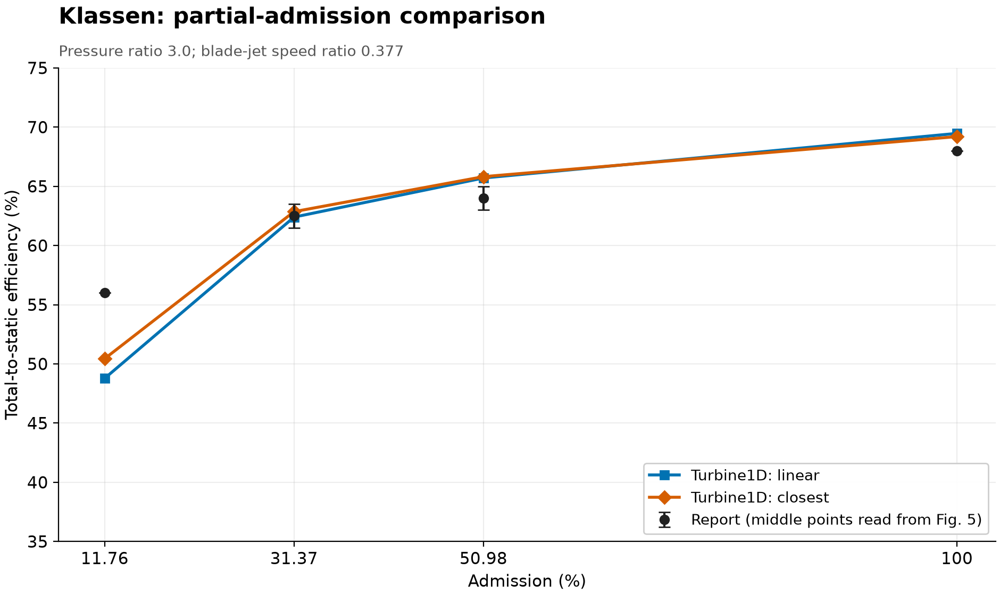

At 31-100% admission the efficiency differences are approximately 0.1-1.8 pp. At 11.76% admission the code gives
48.78% (`linear`) and 50.44% (`closest`), compared with 56%. The calculated decrease toward low admission is
stronger than the measured decrease when radial clearance is assumed to be 0.10 mm and the design flow coefficient
and zero real reaction are held fixed across admissions.

### Moffitt and Klag: partial-admission comparison

Moffitt and Klag's NASA TM X-80 tests the supersonic turbine described in NACA RM E58F20a over five admissions.
The selected comparison is at design equivalent speed and outlet-static/inlet-total pressure ratio 0.033.
The graph uses total-to-static efficiency.

**Moffitt-Klag input data**

| Input | Taken from the original reports or derived from them | Assumption used for the comparison |
|---|---|---|
| Test conditions | Air; 75 psia; 200 F; outlet-static/inlet-total pressure ratio 0.033 | Nominal inlet values are total conditions; inverse pressure ratio is 30.30303 |
| Speed | Equivalent mean blade speed 342 ft/s | Actual mean blade speed = 342 ft/s times the square root of inlet temperature in K divided by 288.15 K: 117.56 m/s, approximately 8582 rpm. |
| Geometry | NASA TM X-80 uses the 10.3-in mean-diameter turbine from NACA RM E58F20a. Inlet hub-tip ratio is 0.90 and outlet hub-tip ratio is 0.87. | Use the outlet passage height, 0.7160 in, for both rows. Use stator chord 1.3293 in and rotor chord 1.595 in, derived from NACA RM E58F20a's blade coordinates. |
| Admission and blades | 100%, 75%, 50%, 25%, 12.5%; active stator counts 32, 24, 16, 8, 4; 48 rotor blades | Treat the active nozzles as one continuous circumferential sector. |
| Flow and reaction | The design velocity diagram in NASA TM X-80 gives mean-diameter flow coefficient 1.66648. The design pressures and Mach numbers in NACA RM E58F20a give isentropic reaction 0.15007. | Hold flow coefficient at 1.66648 and isentropic reaction at 0.15007 for all five admissions. |
| Width, gaps and rotor loss correlation | Rotor stagger 9.6 degrees; trailing-edge radii 0.005 in; recessed casing clearance | Axial rotor width = 1.595 in times cos(9.6 degrees). Convert the 0.010-in edge diameters using calculated outlet angles. Assume radial clearance 0.010 in and axial gap 0.35 rotor pitch; select `rotor="impulse_high_M"`, the sharp-leading-edge impulse correlation. |

The report describes approximately constant efficiency near 42.5% over the admission range, within its measurement
accuracy. The dashed reference line represents that published mean trend; it does not represent five separate
exact measurements. Model lines connect the five computed admissions.

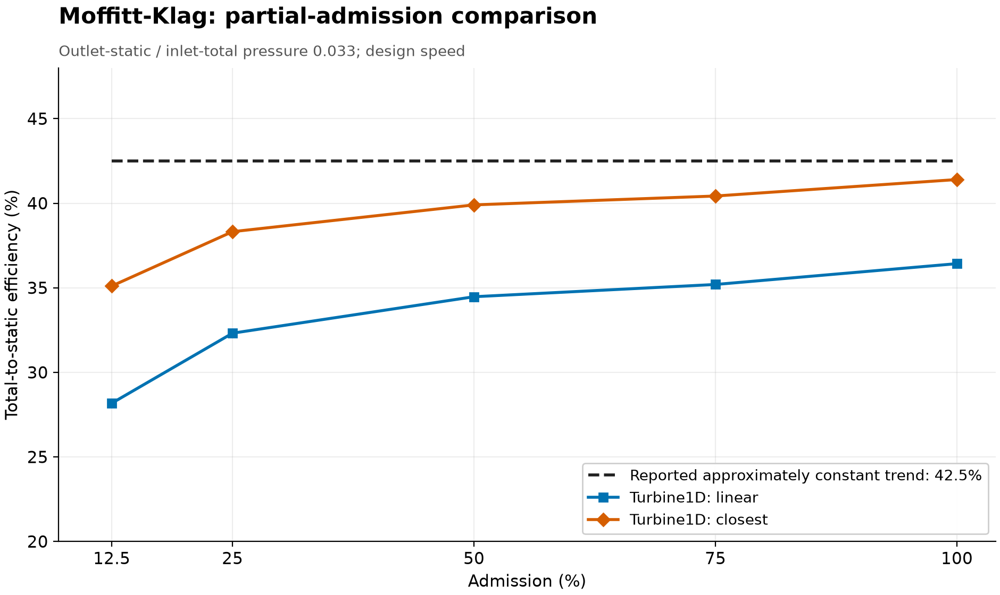

The code predicts a decrease from 36.43% to 28.17% with `linear`, and from 41.40% to 35.10% with `closest`.
Both extrapolation methods predict a greater efficiency decrease as admission falls than the report's approximately
flat trend. The model uses one passage height of 0.7160 in, holds the design flow coefficient at 1.66648, and
represents the recessed casing by an assumed uniform radial gap of 0.010 in. The comparison therefore depends on
those approximations to the tested flow passage and operating flow.
