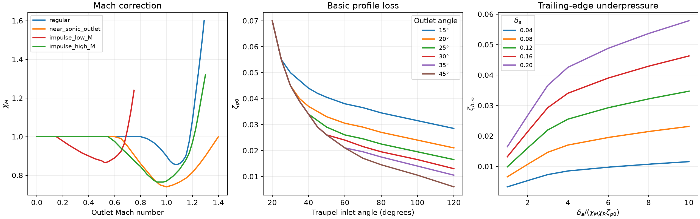
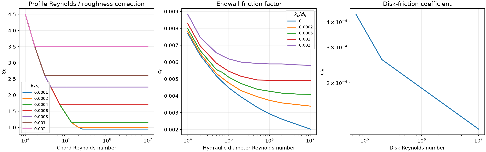
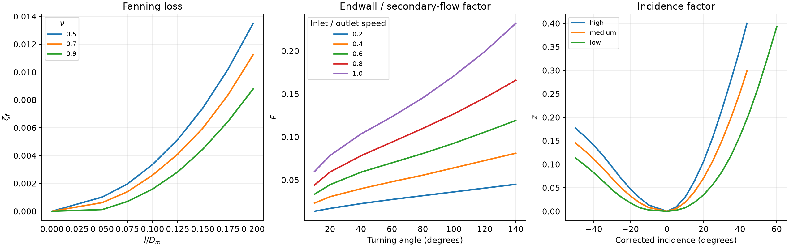
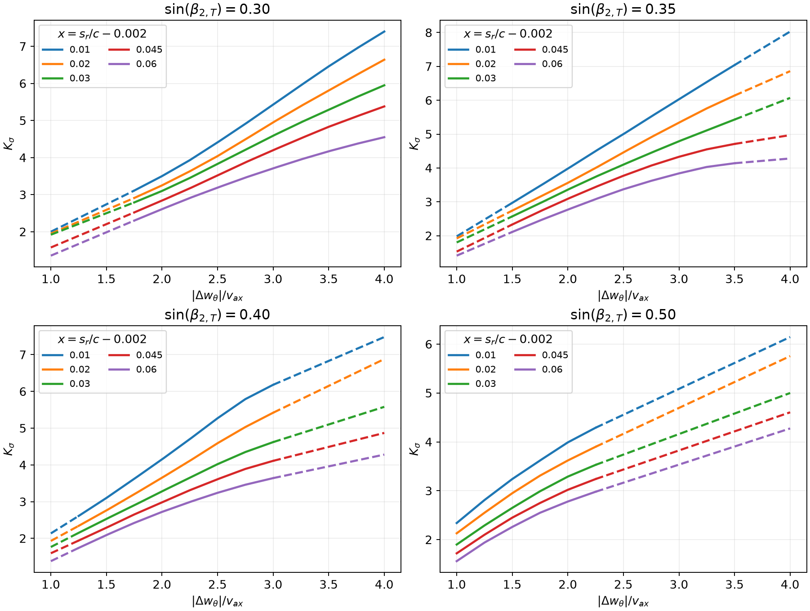
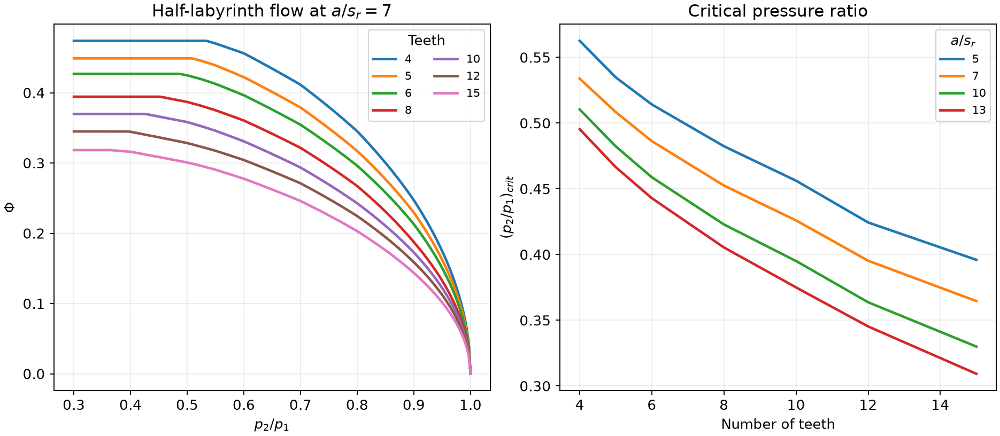
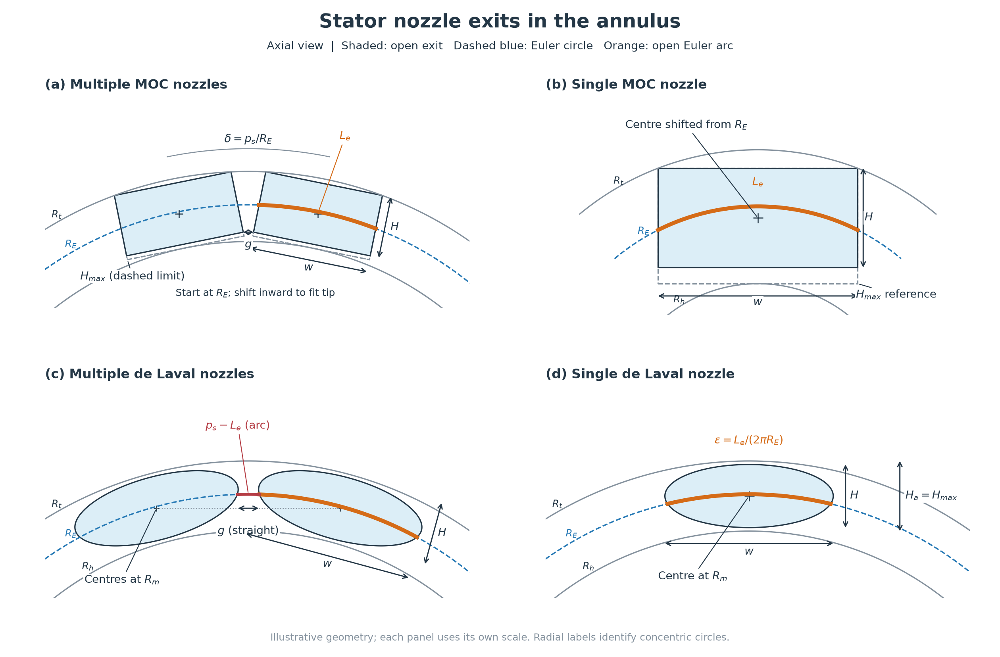
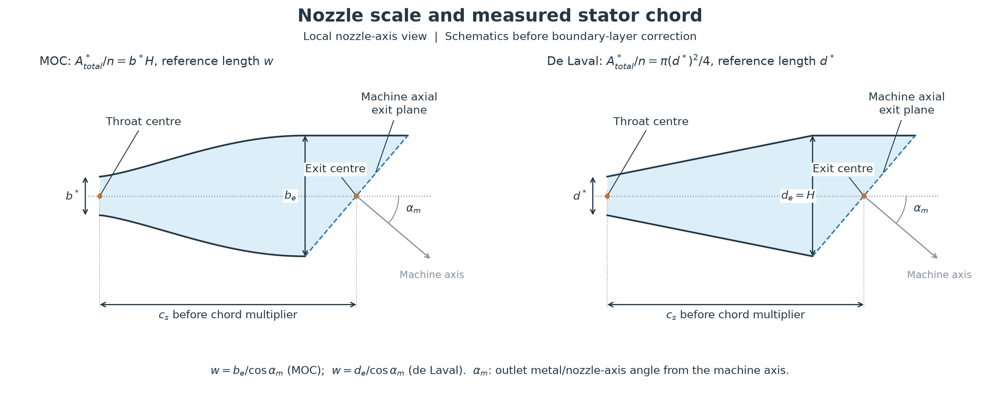

# RocketTurbines

## Introduction

Hi,

Welcome to RocketTurbines, a Python library for sizing and meanline analysis of axial turbines. It was created with
supersonic rocket turbines in mind, but can also be used for subsonic stages. It calculates turbine dimensions,
nonisentropic flow states, velocities, flow angles and losses based on given requirements. I hope you will find it
useful.

With kind regards, Jan

## General Overview

RocketTurbines sizes a single turbine stage from prescribed shaft power, mass flow, RPM, work and flow
coefficients and isentropic reaction. The stage flow calculations and its empirical losses are coupled: a numerical
solver finds entropy rises that agree with the losses calculated for the resulting flow and geometry.

There are two design workflows: use [`Turbine1D`](#turbine1d) for meanline sizing with prescribed blade-row geometry,
or [`SupersonicTurbine`](#supersonicturbine) to solve the additional coupling between meanline sizing and supersonic
blading. The latter supports rectangular method-of-characteristics (MOC) stator nozzles and conical de Laval nozzles,
with either one nozzle or multiple nozzles in an admitted sector. It also uses MOC to construct rotor blades.
Its packing coefficients help the engineer or an outer optimizer choose nozzle count, admission and stage coefficients.

The repository is organised as follows:

- `RocketTurbines/Turbine1D.py` defines `Turbine1D` class, which includes turbine sizing procedure and thermodynamic
  calculations.
- `RocketTurbines/TraupelLossModel.py` defines `TraupelLossModel` class, which is a digitized loss model from
  "Thermische Turbomaschinen" (2001) by Traupel. It includes sampled empirical coefficients from graphs and methods to
  calculate loss coefficients and entropy generation through the state.
- `RocketTurbines/IdealGas.py` defines the `IdealGas` class, which defines mixture properties used by the turbine and
  loss model classes.
- `RocketTurbines/SupersonicTurbine.py` defines `SupersonicTurbine`, which couples `Turbine1D` to
  `SupersonicStatorNozzle` and `SupersonicRotorBlade` from the `SupersonicTurbineBlading` library.
- `RocketTurbines/RelaxedAitken.py` supplies the bounded, adaptively relaxed fixed-point solver used by `Turbine1D` and
  `SupersonicTurbine`.
- `RocketTurbines/example.py` demonstrates sizing a partial-admission impulse turbine with a water-vapour/oxygen mixture.
- `docs/figures/` contains the empirical-coefficient plots and supersonic nozzle diagrams shown below.
  `docs/plot_traupel_coefficients.py` and `docs/plot_supersonic_geometry.py` regenerate them with Matplotlib.
- `setup.py` installs the five modules above and their dependencies, including `SupersonicTurbineBlading` from GitHub;
  `LICENSE` contains the GNU General Public License version 3.

The current workflows include design-point sizing. Meanline results are stored in the `Turbine1D` object;
`SupersonicTurbine` additionally stores the coupled meanline object, nozzle and rotor shapes, and packing margins.
Independent off-design analysis and performance-map creation are not yet implemented.

All dimensional inputs and outputs use SI units. Pressures are in Pa, temperatures in K, mass flow in kg/s, shaft
power in W, lengths in m, specific enthalpy in J/kg and specific entropy in J/(kg K). Rotational speed is in RPM.
Flow angles are in radians unless degrees are explicitly stated. The `SupersonicTurbineBlading` argument dictionaries
use that dependency's angle convention in degrees; `SupersonicTurbine` converts the meanline angles from radians to 
degrees when supplying them.

## Installation

Python 3.11 or newer is required. Install the library directly from GitHub:

```text
pip3 install git+https://github.com/janstruzinski/RocketTurbines
```

## Disclaimer

This library is intended for preliminary turbine sizing and engineering analysis. The extrapolation of empirical
correlations and meanline assumptions should be checked for the particular design. LLM was used for the generation of
this README, docstrings and a few parts of the code.

## Documentation

### Turbine1D

`Turbine1D` in `RocketTurbines/Turbine1D.py` represents a steady, one-dimensional, nonisentropic axial turbine stage.
Its principal workflow is:

1. Construct an `IdealGas` mixture and a `TraupelLossModel` object.
2. Construct an empty `Turbine1D` object.
3. Call `size_turbine(...)` with the required shaft power, flow conditions, stage coefficients and geometry inputs.
4. Read the geometry attributes and the three stored design-point result dictionaries from `Turbine1D` object..

#### Assumptions and nomenclature

The model uses a calorically perfect ideal gas, negligible inlet velocity at station 0, equal flow areas at stations 1
and 2 and a constant Euler diameter. Rotor axial width is taken equal to its chord. Geometry is represented at the
meanline; the code calculates flow angles, not blade metal angles or detailed blade profiles.

Station 0 is before the stator, station 1 is between the stator and rotor, and station 2 is after the rotor. In the
equations below, $v$ is absolute velocity, $w$ is rotor-relative velocity, $u$ is blade speed, $h$ is static enthalpy,
and $h_t=h+v^2/2$ is absolute total enthalpy. Naming convention uses `_t` for total properties, `_s` and `_r` for
stationary and rotating reference frames, `_ideal` for isentropic reference quantities, and `_tt`, `_ts` and `_ss`
for total-to-total, total-to-static and static-to-static quantities. `_ideal_r_real_s` means isentropic rotor expansion
following the actual stator state.

Angles in the turbine results are measured from the axial/meridional direction. The `_blade` results describe the
rotor passage flow state calculated only with its aerodynamic losses at the same outlet static pressure as the complete
stage. They supply the local cascade flow needed by the loss correlations.

#### Design-point quantities and geometry

`size_turbine(...)` takes `gas`, `work_coefficient_tt`, `flow_coefficient`, `reaction_isentropic_tt`, `RPM`,
`shaft_power`, `mdot`, `T_0`, `p_0` and a `loss_model`. The specified loading is the real work coefficient;
the specified flow coefficient is based on the rotor outlet axial velocity:

$$
\Delta h_t=\frac{P_{\mathrm{shaft}}}{\dot{m}}, \qquad
\psi_{tt}=\frac{\Delta h_t}{u^2}, \qquad
\theta_2=\frac{v_{ax,2}}{u}.
$$

The speed and Euler diameter follow directly:

$$
u=\sqrt{\frac{\Delta h_t}{\psi_{tt}}}, \qquad
\omega=\frac{2\pi N}{60}, \qquad D_E=\frac{2u}{\omega}.
$$

Here $N$ is `RPM`. Inlet and prescribed outlet total enthalpies are

$$
h_{t0}=c_pT_0, \qquad h_{t2}=h_{t0}-\Delta h_t.
$$

`reaction_isentropic_tt` is the rotor static enthalpy drop divided by the stage total-to-total enthalpy drop in the
fully isentropic reference stage:

$$
R_{h,tt,\mathrm{ideal}}=
\frac{h_{1,\mathrm{ideal}}-h_{2,\mathrm{ideal}}}
{h_{t0}-h_{t2,\mathrm{ideal}}}.
$$

The remaining inputs prescribe radial clearance, stator and rotor blade counts, chord-to-pitch ratios, trailing-edge
thickness and surface roughness. For admission fraction $\varepsilon$, stator blades number $n_s$ is blade count within
the admitted arc and rotor blades number $n_r$ is blade count around the full circumference,

$$
p_s=\frac{\varepsilon\pi D_E}{n_s}, \qquad p_r=\frac{\pi D_E}{n_r}, \qquad
c_s=(c/p)_s p_s, \qquad c_r=(c/p)_r p_r.
$$

`t_TE_stator` and `t_TE_rotor` are the circumferential projections of trailing-edge thickness. The axial row gap is
`s_ax_over_pitch_rotor` times rotor pitch. Metal roughness given as input is changed into equivalent sand-grain
roughness using $k_s=5.863R_a$.

Once the flow solution determines outlet density, the full annulus area and diameters are

$$
A=\frac{\dot{m}}{\varepsilon\rho_2\theta_2u}, \qquad
D_h=\sqrt{D_E^2-\frac{2A}{\pi}}, \qquad D_t=\sqrt{D_E^2+\frac{2A}{\pi}}.
$$

$$
D_m=\frac{D_h+D_t}{2}, \qquad l=\frac{D_t-D_h}{2}.
$$

The stator and rotor have the same radial blade length. A shrouded rotor additionally uses
`h_shroud_over_blade_length`, `s_ax_shroud_over_h_shroud` and `seal_teeth_number`; the seal requires an integer count
greater than two. Tooth spacing is $c_r/(n_{\mathrm{teeth}}-1)$. `t_shroud` stores an optional supplied shroud thickness.

`A_throat_stator` and `A_throat_rotor` are initialized to `None` and are not calculated by `size_turbine`.
`SupersonicTurbine` supplies these total throat areas within the admitted sector, in m², from its throat sizing and
blading geometry without BL correction.

`R_nozzle` is also initialized to `None` and left unset by `size_turbine`. `SupersonicTurbine` supplies the actual
stator nozzle exit-centre radius in m.

#### Sizing logic and numerical solution

The following diagram explains turbine sizing & flow calculations procedure in `Turbine1D` and `TraupelLossModel`:

```text
 Turbine1D.size_turbine
   |
   +--> OUTER LOOP ---------------------------------------------------------------+
   |      Vary: stator, rotor aerodynamic and additional rotor entropy rises      |
   |      Residuals: calculated minus assumed entropy rise for each loss group   |
   |      |                                                                       |
   |      v                                                                       |
   |    Turbine1D.calculate_entropy_rise                                          |
   |      |                                                                       |
   |      +--> INNER LOOP -------------------------------------------+            |
   |      |      Vary: h_2/h_t0                                      |            |
   |      |      Residual: calculated minus assumed outlet           |            |
   |      |                total enthalpy, divided by h_t0           |            |
   |      |      |                                                   |            |
   |      |      v                                                   |            |
   |      |    Turbine1D.__calculate_thermodynamic_properties --------+           |
   |      |                                                                       |
   |      v  (after inner loop converges)                                         |
   |    Analysis results: station states and absolute rotor outlet velocity       |
   |      |                                                                       |
   |      v                                                                       |
   |    Turbine1D.__calculate_blade_rows_outlet_velocities                        |
   |      |                                                                       |
   |      v                                                                       |
   |    Updated analysis results: outlet velocities, Mach and Reynolds numbers    |
   |      |                                                                       |
   |      v                                                                       |
   |    Turbine1D.__calculate_flow_angles                                         |
   |      |                                                                       |
   |      v                                                                       |
   |    Analysis results with flow angles                                         |
   |      |                                                                       |
   |      v                                                                       |
   |    Turbine1D.__calculate_blade_row_flow_state                                |
   |      Prescribed: stage outlet static pressure and rotor aerodynamic entropy  |
   |       rise                                                                   |
   |      |                                                                       |
   |      v                                                                       |
   |    Blade-row results: states, velocities and flow angles                     |
   |      |                                                                       |
   |      v                                                                       |
   |    Turbine1D.__calculate_geometry                                            |
   |      |                                                                       |
   |      v                                                                       |
   |    Turbine geometry, together with analysis and blade-row results            |
   |      |                                                                       |
   |      v                                                                       |
   |    TraupelLossModel.calculate_entropy_increase                               |
   |      |                                                                       |
   |      v                                                                       |
   |    Calculated entropy rises and loss results                                 |
   |      |                                                                       |
   |      +--> Calculate entropy-rise residuals ----------------------------------+
   |
   v  (after outer loop converges)
 Consistent entropy rises, analysis results, blade-row results and loss results
   |
   v
 Turbine1D.__calculate_geometry
   |
   v
 Sized turbine geometry and stored design-point results
```

The outer unknowns are the stator aerodynamic, rotor aerodynamic and additional rotor entropy rises:

$$
\mathbf{x}=[\Delta s_s,\;\Delta s_r,\;\Delta s_{r,\mathrm{additional}}], \qquad
\mathbf{r}=\mathbf{x}_{\mathrm{loss\ model}}-\mathbf{x}.
$$

Theseare found using SciPy's bounded `least_squares()` with `dogbox` and a two-point numerical Jacobian.
`delta_s_estimate` supplies three nonnegative initial estimates. Its default `[0, 0, 0]` is replaced by the loss-model
estimate evaluated at zero entropy rise (in other words, the new estimate represents the first estimate from fixed point
iteration scheme). At the accepted solution, each entropy residual must be below $10^{-4}$ J/(kg K) in absolute value.

During each outer evaluation, an inner solve varies $h_2/h_{t0}$ to satisfy

$$
r_h=\frac{h_2+v_2^2/2-h_{t2}}{h_{t0}}=0.
$$

This allows to find all other thermodynamic properties at station 0 and 1. The inner solver uses TOMS 748 with a
bracket, or a Newton fallback when necessary. The ideal-gas entropy relation determines pressures from the assumed
entropy rises and static temperatures:

$$
\Delta s=c_p\ln\left(\frac{T_{\mathrm{out}}}{T_{\mathrm{in}}}\right)
-R\ln\left(\frac{p_{\mathrm{out}}}{p_{\mathrm{in}}}\right).
$$

For example, with the sum of all three entropy rises denoted by $\Delta s_{\mathrm{stage}}$,

$$
p_2=p_0\exp\left(-\frac{\Delta s_{\mathrm{stage}}}{R}\right)
\left(\frac{h_2}{h_{t0}}\right)^{c_p/R}.
$$

Equal-area continuity gives $\theta_1=\theta_2\rho_2/\rho_1$. The prescribed isentropic reaction determines the
intermediate state, while the real reaction $R_{h,tt}=(h_1-h_2)/\Delta h_t$ enters the velocity triangles. Define
$d_\theta=(\theta_2^2-\theta_1^2)/(2\psi_{tt})$. The circumferential velocities are then

$$
\frac{v_{\theta,1}}{u}=1-R_{h,tt}+\frac{\psi_{tt}}{2}+d_\theta, \qquad
\frac{v_{\theta,2}}{u}=1-R_{h,tt}-\frac{\psi_{tt}}{2}+d_\theta.
$$

Relative velocities have $w_\theta=v_\theta-u$. Flow angles use `atan2(circumferential velocity, axial velocity)`.
Additional flow solution is calculated for the rotor blade row alone with the aerodynamic entropy rise, but without
entropy rise due to additional losses. This flow state represents flow in the test cascade and is used in Traupel
loss model to calculate blade profile losses. Afterward, geometry is sized and losses are then recalculated. The
entropy residuals can be then returned.

#### Stored results and efficiencies

`size_turbine(...)` updates the object and returns `None`. Geometry is available as `D_Euler`, `D_hub`, `D_tip`,
`D_mean`, `l_stator`, `l_rotor`, `p_stator`, `p_rotor`, `c_stator`, `c_rotor`, `s_ax`, `s_r` and the shroud attributes.
The result dictionaries are:

- `analysis_results_at_design_point`: complete stage states, velocities, Mach and Reynolds numbers, flow angles,
  loading, reaction, pressure ratio, entropy rises, shaft power and efficiencies.
- `blade_row_results_at_design_point`: local rotor blade row flow state without additional losses.
  It includes velocities, flow angles and associated coefficients.
- `loss_model_results_at_design_point`: aerodynamic, incidence, disk friction, clearance and
  admission loss coefficients, dissipated enthalpies, entropy rises and shroud leakage flow.

The reported efficiencies use the exact isentropic enthalpy drops at the corresponding outlet total or static
pressure. With $\Delta s_{\mathrm{stage}}$ denoting total stage entropy rise, the ideal reference enthalpies are

$$
h_{t2,\mathrm{ideal}}=h_{t2}\exp\left(-\frac{\Delta s_{\mathrm{stage}}}{c_p}\right), \qquad
h_{2,\mathrm{ideal}}=h_2\exp\left(-\frac{\Delta s_{\mathrm{stage}}}{c_p}\right).
$$

The efficiencies are

$$
\eta_{tt}=\frac{\Delta h_t}{h_{t0}-h_{t2,\mathrm{ideal}}}, \qquad
\eta_{ts}=\frac{\Delta h_t}{h_{t0}-h_{2,\mathrm{ideal}}}.
$$

`psi_tt_ideal` uses the same total-to-total isentropic enthalpy drop. `zeta_stator_Denton` and `zeta_rotor_Denton` are
entropy-based loss coefficients based on Denton's definition and use a different normalisation from Traupel's
coefficients below.

After sizing calculations have been performed, `calculate_entropy_rise(...)` evaluates a trial set of entropy rises and
returns `(residuals, analysis_results, blade_row_results, loss_model_results)`.

### TraupelLossModel

`TraupelLossModel` in `RocketTurbines/TraupelLossModel.py` implements empirical turbine-loss correlations from
Walter Traupel's *Thermische Turbomaschinen*, Volume I. It separates aerodynamic passage losses from clearance,
disk-friction and partial-admission losses. The equations below describe the implemented relations, including their
numerical approximations. All plots are redrawn directly from the sampled empirical coefficient data using
interpolators in the class, so the reader can inspect the values used by the library here.

#### Configuration and coefficient interpolation

Construct the model with `extrapolation_method="closest"` or `"linear"`. `"closest"` means no extrapolation of 
empirical coefficients - closest sampled value is used instead. `"linear"` extends the interpolator with linear
extrapolation. Reynolds-number axes are logarithmic for $\chi_R$ and $c_f$, and both axes are logarithmic for $C_M$.
`warn_on_extrapolation=True` emits a warning for every out-of-bounds coefficient evaluation.

The other constructor options are:

| Argument | Values | Meaning                                                                                                           |
| --- | --- |-------------------------------------------------------------------------------------------------------------------|
| `incidence_loss` | `"high"`, `"medium"`, `"low"` | High, average or low empirical coefficient used for incidence losses. Default: `"medium"`.                        |
| `stator` | `"regular"`, `"near_sonic_outlet"` | Determines stator type and what Mach correction is used for the profile loss of the stator. Default: `"regular"`. |
| `rotor` | `"regular"`, `"near_sonic_outlet"`, `"impulse_low_M"`, `"impulse_high_M"` | Determines rotor type and what Mach correction is used for the profile loss of the rotor. Default: `"regular"`.   |

The impulse options also select the corresponding endwall and free-rotor partial-admission coefficients.
`"impulse_low_M"` represents a rounded leading edge; `"impulse_high_M"` represents a sharp leading edge.

The ranges of sampled graphs with empirical coefficients are:

| Coefficient | Input coordinates and grid limits |
| --- | --- |
| $\chi_R$ | $Re=10^4$ to $10^7$; $k_s/c=10^{-4}$ to $2\times10^{-3}$ |
| $\chi_M$ | Regular: $M=0$ to 1.30; near-sonic: 0.65 to 1.40; low-M impulse: 0.15 to 0.75; high-M impulse: 0.65 to 1.30 |
| $\zeta_{p0}$ | Traupel inlet angle: 20 to 120 degrees; outlet angle: 15 to 45 degrees |
| $\zeta_{h,\infty}$ | $\delta_a/(\chi_M\chi_R\zeta_{p0})=1$ to 10; $\delta_a=0.04$ to 0.20 |
| $\zeta_f$ | $l/D_m=0$ to 0.20; $\nu=0.5$ to 0.9 |
| $F$ | Turning: 10 to 140 degrees; inlet/outlet speed ratio: 0.2 to 1.0 |
| $c_f$ | $Re=10^4$ to $10^7$; $k_s/d_h=0$ to $2\times10^{-3}$ |
| $K_\sigma$ | Sine of outlet angle: 0.30 to 0.50; velocity-change ratio: 1 to 4; normalised clearance: 0.01 to 0.06 |
| $C_M$ | Disk Reynolds number: $7\times10^4$ to $10^7$ |
| $z$ | High curve: -50 to +43.7 degrees; low curve: -50 to +60 degrees |
| $\Phi^2$ | $p_2/p_1=0.3$ to 1; tooth spacing/clearance: 5 to 13; teeth: 4 to 15 |

These are interpolation boundaries, rather than guidelines of a turbine design. For example, if the stator uses zero
inlet/outlet speed ratio for $F$, which is outside that graph's digitised range, configured extrapolation method will
be used for it. The $K_\sigma$ sampling grid was extended with extrapolation; otherwise the interpolation range would
be very small. Negative interpolated coefficients are floored at zero; $\zeta_{p0}$ has a floor of 0.001 because it
appears in denominators.

#### Loss definitions and angle convention

For a blade row, the aerodynamic-plus-incidence loss coefficient is defined by the dissipated static enthalpy divided
by ideal outlet kinetic energy. Let $q$ denote stator absolute or rotor-relative outlet speed. Then

$$
\zeta_{\mathrm{row}}=\frac{\Delta h_{\mathrm{loss,row}}}{q_{\mathrm{ideal}}^2/2}, \qquad
\eta_{\mathrm{row}}=1-\zeta_{\mathrm{row}}, \qquad
\Delta h_{\mathrm{loss,row}}=\frac{\zeta_{\mathrm{row}}}{1-\zeta_{\mathrm{row}}}\frac{q^2}{2}.
$$

Additional-loss coefficients instead use the stage static-to-static isentropic enthalpy drop:

$$
\zeta_{\mathrm{additional}}=
\frac{\Delta h_{\mathrm{loss,additional}}}{\Delta h_{\mathrm{ideal,ss}}}, \qquad
\psi_{ss,\mathrm{ideal}}=\frac{\Delta h_{\mathrm{ideal,ss}}}{u^2}.
$$

Traupel measures stator outlet and rotor inlet angles from the positive circumferential direction, and rotor outlet
angle from the negative circumferential direction. The `Turbine1D` to `TraupelLossModel` angle conversion is:

$$
\alpha_{1,T}=\frac{\pi}{2}-\alpha_1, \qquad
\beta_{1,T}=\frac{\pi}{2}-\beta_1, \qquad
\beta_{2,T}=\frac{\pi}{2}+\beta_{2,\mathrm{blade}}.
$$

In the following blade-row equations, $a$ and $b$ are Traupel inlet and outlet angles, $c$ is chord, $l$ is radial
blade length, $p$ is pitch, $D_m$ is mean diameter, $k_s$ is equivalent sand roughness, and
$\delta_a=t_{TE}/p$ is the circumferential trailing-edge blockage. Direct calls to `calculate_zeta_p0()`,
`calculate_F()` and `calculate_z()` interpolators use degrees, but the methods that wrap these interpolators take
angles in radians.

#### Profile and trailing-edge losses

`calculate_blade_row_aerodynamic_loss(...)` first calculates

$$
\zeta_p=\chi_R\chi_M\zeta_{p0}+\zeta_h+\zeta_C, \qquad
\zeta_C=\left(\frac{\delta_a}{1-\delta_a}\right)^2\sin^2 b.
$$

$\chi_R$ accounts for Reynolds number and roughness, $\chi_M$ for outlet Mach number, $\zeta_{p0}$ for inlet and
outlet angles, $\zeta_h$ for trailing-edge underpressure, and $\zeta_C$ for trailing-edge mixing/blockage.



The trailing-edge plot shows the nomogram value $\zeta_{h,\infty}$. The code applies the following
Reynolds-number transition mentioned by Traupel:

$$
\zeta_h=g(Re)\zeta_{h,\infty}.
$$

The transition factor is defined over three Reynolds-number intervals:

$$
g(Re)=0, \qquad Re\leq8\times10^4.
$$

$$
g(Re)=\sqrt{1-\left(1-\frac{Re-8\times10^4}{7\times10^4}\right)^2}, \qquad
8\times10^4\lt Re\lt1.5\times10^5.
$$

$$
g(Re)=1, \qquad Re\geq1.5\times10^5.
$$

The quarter-ellipse transition is an approximation used in this implementation, since Traupel did not specify exact
formula. The following plots show the profile roughness correction, endwall friction coefficient and disk-friction
coefficient used by the model:



#### Fanning, endwall and secondary-flow losses

The fanning coefficient $\zeta_f$ depends on $l/D_m$ and speed parameter
$\nu=1/\sqrt{2\psi_{ss,\mathrm{ideal}}}$. Set $\bar\zeta_p=\zeta_p+\zeta_f$, $L=l/p$, and

$$
L_{\mathrm{crit}}=B\sqrt{\bar\zeta_p}.
$$

$B=10$ for an impulse rotor and $B=7$ for an accelerating cascade.

For $L\geq L_{\mathrm{crit}}$, the residual endwall/secondary-flow loss is

$$
\zeta_{\mathrm{rest}}=\zeta_a+\frac{\zeta_p}{\zeta_{p0}}\frac{F}{L}.
$$

For $L\lt L_{\mathrm{crit}}$, it is

$$
\zeta_{\mathrm{rest}}=\zeta_a+\frac{\zeta_p}{\zeta_{p0}}\frac{F}{L_{\mathrm{crit}}}
+A_c\frac{c}{p}\left(\frac{1}{L}-\frac{1}{L_{\mathrm{crit}}}\right).
$$

$A_c=0.035$ for an impulse rotor and 0.02 for an accelerating cascade. $F$ depends on turning angle
$180^\circ-a-b$ and inlet/outlet speed ratio. The complete aerodynamic row coefficient is

$$
\zeta_{\mathrm{aerodynamic}}=\zeta_p+\zeta_f+\zeta_{\mathrm{rest}}.
$$

For the unshrouded stator, with axial row gap $s_{ax}$ and hydraulic diameter $d_h=2l$,

$$
\zeta_a=\frac{c_f}{\sin b}\left(1+\frac{l}{D_m}\right)\frac{s_{ax}}{l}.
$$

The friction-factor Reynolds number is the chord Reynolds number multiplied by $2l/c$. For an unshrouded rotor,
$\zeta_a=0$. For a shrouded row with axial shroud gap $s_{ax,\mathrm{shroud}}$,

$$
\zeta_a=\frac{0.04}{\sin b}\frac{s_{ax,\mathrm{shroud}}}{l}.
$$



#### Incidence loss

`calculate_incidence_losses(...)` corrects the inlet-angle deviation $i$ for inlet Mach number before reading $z$:

$$
M_c=\min(0.8,\max(0.5,M_{\mathrm{in}})), \qquad
i_c=\frac{i}{2(1-M_c)}, \qquad
\zeta_{\mathrm{incidence}}=z(i_c)\left(\frac{q_{\mathrm{in}}}{q_{\mathrm{out}}}\right)^2.
$$

The incidence plot above shows `"high"`, `"medium"` and `"low"` loss coefficient curves. Medium is the average of the
two interpolated curves. In the current design-point sizing workflow, both stator and rotor incidence are set to zero.
The incidence-loss method accepts a nonzero deviation when used separately.

#### Unshrouded rotor clearance

`calculate_unshrouded_rotor_clearance_loss(...)` uses the rotor blade row velocities calculated without additional
losses. Define radial clearance $s_r$, Traupel reaction $R_T$, normalised inlet relative velocity
$\bar w_1=w_{1,\mathrm{blade}}/u$, and

$$
x=\max\left(\frac{s_r}{c}-0.002,0\right), \qquad
j=\frac{|\Delta w_\theta|}{v_{ax}}, \qquad
R_T=\frac{\Delta h_{r,\mathrm{ideal}}}
{\Delta h_{s,\mathrm{ideal}}+\Delta h_{r,\mathrm{ideal}}}.
$$

The coefficient $K_\sigma$ is evaluated at $(\sin\beta_{2,T},j,x)$, and the loss is

$$
\zeta_{\mathrm{clearance}}=
K_\sigma\frac{2R_T\psi_{ss,\mathrm{ideal}}+\bar w_1^2}{2\psi_{ss,\mathrm{ideal}}}
\max\left(\frac{s_r}{l}-0.002\frac{c}{l},0\right)\frac{D_t}{D_m}.
$$



Solid curves show interpolation inside each graph's original velocity-change interval. Dashed portions show the
extensions prepared by the code: PCHIP supplies endpoint slopes and straight lines continue the curves to a common
$j=1$ to 4 grid. Final coefficient lookups use linear interpolation on that prepared grid. Thus `"closest"` clips
to the prepared grid bounds, which can extend beyond an original graph's measured interval.

#### Shrouded rotor clearance and half-labyrinth flow

`calculate_shrouded_rotor_clearance_loss(...)` evaluates leakage through a half-labyrinth seal. With seal area
$A_{\mathrm{seal}}=\pi D_t s_r$, tooth spacing $a_{\mathrm{seal}}$ and tooth count $n$,

$$
\dot{m}_{\mathrm{leak}}=\varepsilon A_{\mathrm{seal}}\Phi
\sqrt{p_1\rho_1}, \qquad
\mu_{\mathrm{leak}}=\frac{\dot{m}_{\mathrm{leak}}}{\dot{m}-\dot{m}_{\mathrm{leak}}}.
$$

`calculate_phi(...)` obtains the critical pressure ratio $r_{\mathrm{crit}}$ from the tooth count and
$a_{\mathrm{seal}}/s_r$. It then evaluates the digitised squared flow function at

$$
r=\max\left(\frac{p_2}{p_1},r_{\mathrm{crit}}\right), \qquad
\Phi=\sqrt{\max\left(\Phi_{\mathrm{grid}}^2
\left(r,\frac{a_{\mathrm{seal}}}{s_r},n\right),0\right)}.
$$

This holds the flow function constant below the critical pressure ratio. The figures show the implemented flow
function for a spacing/clearance ratio of 7 and the critical-ratio curves for all four digitised spacing ratios:



With design and operating speed parameters $\nu_d$ and $\nu_o$, both based on their static-to-static ideal loading,

$$
\zeta_{\mathrm{clearance}}=\mu_{\mathrm{leak}}
\left[1-\left(\frac{\nu_o-\nu_d}{\nu_d}\right)^2\right], \qquad
\nu=\frac{1}{\sqrt{2\psi_{ss,\mathrm{ideal}}}}.
$$

The stage sizing workflow uses the same design and operating loading, so the square-bracket term is one. Leakage
at or above the main mass flow is rejected. This is an empirical loss/leakage calculation; stage continuity still
uses the prescribed main mass flow.

#### Partial-admission and disk-friction losses

`calculate_admission_loss(...)` assumes one admitted sector. For $0\lt\varepsilon\lt1$,

$$
\zeta_{\mathrm{admission}}=
\frac{C(1-\varepsilon)}{\varepsilon\theta_m\psi_{ss,m,\mathrm{ideal}}}
+\frac{0.21(c_r/D_m)}{\varepsilon\sqrt{\psi_{ss,m,\mathrm{ideal}}}}.
$$

The coefficient is exactly zero at full admission. Here $\theta_m$ and $\psi_{ss,m,\mathrm{ideal}}$ are normalised
by blade speed at the mean diameter. For `partial_admission_rotor="free"` (when the rotor is not enclosed on all
sides),

$$
C=k\left(0.045+0.58\frac{l}{D_m}\right)\sin\beta_{2,T}.
$$

$k=0.8$ for an impulse rotor and $k=1$ for an accelerating rotor.

For `partial_admission_rotor="enclosed"` (when the rotor is enclosed on all sides except of the admitted arc),

$$
C=0.0095+0.55\max\left(0.125-\frac{l}{D_m},0\right)^2.
$$

The enclosed-rotor relation is intended for $l/D_m\lt0.125$; the implementation continues it beyond that range using
the limiting value due to lack of other data. `calculate_disk_friction_loss(...)` uses the $C_M$ curve shown above:

$$
\zeta_{\mathrm{disk}}=
\frac{1.27C_M}{\varepsilon\theta_m\psi_{ss,m,\mathrm{ideal}}}
\left(\frac{D_h}{D_m}\right)^4\frac{D_h}{l}, \qquad
Re_{\mathrm{disk}}=\frac{\omega D_h^2\rho_1}{2\mu_g(T_1)}.
$$

$\mu_g$ is gas dynamic viscosity. Mean-diameter normalisation is recovered from Euler-diameter quantities using
$u_m=\omega D_m/2$, $\theta_m=\theta_2u/u_m$ and
$\psi_{ss,m,\mathrm{ideal}}=\psi_{ss,\mathrm{ideal}}(u/u_m)^2$.

#### Conversion from losses to entropy rises

`calculate_entropy_increase(analysis_results, turbine_geometry, blade_row_results)` assembles the row coefficients
and additional losses. Stator and rotor passage losses use $q=v_1$ and $q=w_{2,\mathrm{blade}}$, respectively.
The entropy rise associated with a dissipated static enthalpy at the same outlet pressure is

$$
\Delta s=-c_p\ln\left(1-\frac{\Delta h_{\mathrm{loss}}}{c_pT_{\mathrm{out}}}\right).
$$

The stator uses $T_1$, and the aerodynamic rotor passage uses $T_{2,\mathrm{blade}}$. Additional losses are work
losses rather than static enthalpy increments:

$$
\Delta h_{\mathrm{additional}}=
(\zeta_{\mathrm{disk}}+\zeta_{\mathrm{clearance}}+\zeta_{\mathrm{admission}})
\Delta h_{\mathrm{ideal,ss}}.
$$

Because the local blade-row and complete stage have different outlet velocities, the static loss used for the
complete rotor entropy calculation includes the kinetic-energy correction:

$$
\Delta h_{r,\mathrm{loss,static}}=
\Delta h_{r,\mathrm{loss}}+\Delta h_{\mathrm{additional}}
+\frac{v_{2,\mathrm{blade}}^2-v_2^2}{2}.
$$

The model calculates total rotor entropy rise at $T_2$ with this static loss, then subtracts the passage entropy
rise to obtain `delta_s_rotor_additional`. It returns
`(delta_s_stator, delta_s_rotor, delta_s_rotor_additional, loss_model_results)`. The additional work loss and its
static enthalpy equivalent are stored separately in the loss results.

### IdealGas

`IdealGas` in `RocketTurbines/IdealGas.py` represents a fixed-composition, calorically perfect gas mixture.
Construct it with `T_max`, `T_min`, CoolProp `species` names and `mass_fractions`. Optional `cea_species` supplies
the corresponding NASA CEA names for transport properties. These two species lists must identify the same chemicals in the
same order; the library checks list lengths and database availability but does not validate chemical correspondence.

#### Composition and caloric properties

Mass fractions must be finite, nonnegative and sum to one within $10^{-12}$. Zero-fraction species are removed.
The temperature limits must satisfy $T_{\max}\gt T_{\min}\gt0$. `P_max` and `P_min`, both defaulting to $10^5$ Pa, are
used to check that each active CoolProp species is gas or supercritical gas at the corresponding temperature limit.

For species molar masses $M_i$ and mass fractions $Y_i$, mole fractions are

$$
X_i=\frac{Y_i/M_i}{\sum_jY_j/M_j}.
$$

CoolProp supplies the mixture molar mass and gas constant. The class obtains a constant effective heat capacity
from the enthalpy difference at $10^5$ Pa over the supplied temperature interval:

$$
R=\frac{R_u}{M_{\mathrm{mix}}}, \qquad
c_p=\frac{h_{\mathrm{CP}}(T_{\max},10^5)-h_{\mathrm{CP}}(T_{\min},10^5)}
{T_{\max}-T_{\min}}, \qquad
c_v=c_p-R, \qquad \gamma=\frac{c_p}{c_v}.
$$

The properties are stored as `R`, `Cp`, `Cv` and `gamma`. Turbine enthalpy is subsequently represented by $h=c_pT$;
the turbine does not reevaluate temperature-dependent CoolProp enthalpy during the stage solve.

#### Density and sound velocity

`calculate_density(p, T)` and `calculate_sound_velocity(T)` use

$$
\rho=\frac{p}{RT}, \qquad a=\sqrt{\gamma RT}.
$$

Pressure and temperature must be finite and positive. The returned density is in kg/m³ and sound velocity in m/s.

#### Dynamic viscosity

`calculate_dynamic_viscosity(T)` obtains species viscosities from NASA CEA transport fits through
[ThermoProp](https://github.com/saakethramoju/ThermoProp). Active species must have CEA gas entries and viscosity
data. The mixture uses Wilke's rule:

$$
\mu_{\mathrm{mix}}=\sum_i\frac{X_i\mu_i}{\sum_jX_j\phi_{ij}}, \qquad
\phi_{ij}=\frac{\left[1+\sqrt{\mu_i/\mu_j}(M_j/M_i)^{1/4}\right]^2}
{\sqrt{8(1+M_i/M_j)}}.
$$

The evaluation temperature is floored at the larger of 300 K and the highest minimum fitted viscosity temperature
among the active species. For example, H2O sets a floor of 373.2 K. Requests below that floor return the limiting
viscosity. The result is in Pa s.

#### Thermal conductivity

`calculate_thermal_conductivity(T)` obtains species conductivities in W/(m K) from NASA CEA through ThermoProp.
It uses CEA's frozen-composition mixture law from
[NASA RP-1311, section 5.2](https://ntrs.nasa.gov/citations/19950013764):

$$
k_{\mathrm{mix}}=\sum_i\frac{X_i k_i}{\sum_jX_j\psi_{ij}}, \qquad \psi_{ii}=1,
$$

$$
\psi_{ij}=\frac{2M_j\mu_i}{(M_i+M_j)\eta_{ij}}
\left[1+2.41\frac{(M_i-M_j)(M_i-0.142M_j)}{(M_i+M_j)^2}\right], \qquad i\ne j.
$$

Here $\eta_{ij}$ is the CEA binary viscosity interaction parameter. ThermoProp uses its CEA fit when available
at the evaluation temperature, otherwise CEA's rigid-sphere estimate from the pure-species viscosities and molar
masses. The result includes the frozen contribution appropriate to the fixed composition of `IdealGas`.

The evaluation temperature is floored at the greatest of 300 K and the minimum fitted viscosity and conductivity
temperatures of every active species; all transport data use this same temperature. The constructor checks
conductivity availability and stores this temperature floor alongside the viscosity floor. Missing conductivity
fits raise `ValueError` during construction, and invalid temperatures raise `ValueError` when evaluating the
property. Other transport-range errors propagate from ThermoProp, as for viscosity.

```python
k = gas.calculate_thermal_conductivity(900.0)  # W/(m K)
```

Density, sound-velocity, viscosity and thermal-conductivity methods cache up to 1024 evaluations each.

### SupersonicTurbine

`SupersonicTurbine` in `RocketTurbines/SupersonicTurbine.py` constructs a supersonic stage whose meanline geometry
agrees with its stator nozzle and rotor blade contours. Constructing the object prepares inputs and leaves 
some properties as `None`. Call `couple_meanline_and_blading()` to run the coupled design calculation and set these
properties to converged objects representing Turbine1D and SupersonicTurbineBlading library objects.
The meanline solver supplies flow states and annulus dimensions to `SupersonicTurbineBlading`; the resulting contours
supply chord-to-pitch ratios and edge thicknesses back to the meanline solver.

Its principal workflow is:

1. Construct an `IdealGas` mixture and a `TraupelLossModel` object.
2. Supply dictionaries for `Turbine1D.size_turbine`, `SupersonicStatorNozzle` and `SupersonicRotorBlade`.
3. Construct `SupersonicTurbine` with a flow separation margin and minimum stator/rotor metal thicknesses.
4. Call `turbine.couple_meanline_and_blading()`, or use `evaluate_design(...)` to evaluate trial designs manually.
5. Read `turbine_meanline`, `stator_shape`, `rotor_shape` and `coefficients` after coupling converges.
6. Check nozzle packing; adjust the free design inputs and repeat if the stator nozzles do not fit in the turbine annulus.

#### Assumptions and nomenclature

The meanline assumptions in the [`Turbine1D`](#turbine1d) section still apply. The stator consists of identical
nozzles placed at uniform angular pitch within one admitted sector. `no_blades_stator` is the number of nozzles in
that sector; `no_blades_rotor` counts blades around the full circumference. All packing and chord measurements use
the **uncorrected contours**, before boundary-layer displacement corrections.

The following symbols refer to the axial view of a nozzle exit, looking along the machine axis:

| Symbol | Meaning |
| --- | --- |
| $n$ | Number of stator nozzles, `no_blades_stator`. |
| $R_h$, $R_t$ | Hub and tip radii, `R_hub` and `R_tip`. |
| $R_E$ | Euler radius, `R_Euler`; pitches and admission arcs are measured on this circle. |
| $R_m=(R_h+R_t)/2$ | Annulus mean radius, `R_mean`; generally different from $R_E$. |
| $R_c$ | Actual nozzle exit-centre radius, `turbine_meanline.R_nozzle`. |
| $H_a=R_t-R_h$ | Radial annulus height. |
| $p_s=2\pi R_E\varepsilon/n$, $p_r=2\pi R_E/n_r$ | Total stator and rotor pitches, including metal blockage. |
| $\delta=p_s/R_E$ | Angular pitch between neighbouring nozzle centre lines. |
| $w$, $H$ | Straight circumferential width and radial height of one exit. |
| $H_{\max}$ | Maximum permitted exit height for the selected construction. |
| $L_e$ | Arc length of the Euler circle lying inside one nozzle exit. |
| $g$ | Straight projected spacing between adjacent exits, used to assess minimum stator metal thickness. |
| $A^*_{\mathrm{total}}$, $b^*$, $d^*$ | Total choked throat area, MOC throat width and de Laval throat diameter. |
| $b_e$, $d_e$ | MOC exit width normal to the nozzle axis and de Laval exit diameter; $d_e=H$ for the elliptical exit. |
| $\alpha_m$ | Outlet metal/nozzle-axis angle from the machine axis; $w=b_e/\cos\alpha_m$ for MOC and $w=d_e/\cos\alpha_m$ for de Laval. |
| $c_s$, $c_r$ | Stator throat-centre to exit-centre chord and rotor LE-to-TE chord. |

`t_TE_stator`, `t_TE_rotor` and `t_LE_rotor` denote circumferential projections of edge thicknesses. The inputs
`t_min_stator` and `t_min_rotor` instead prescribe true metal thickness approximately normal to the local flow 
(assuming similar blade angle). With meanline angles measured from the axial direction, the required projected stator
spacing is

$$
t_{s,\min}^{\mathrm{proj}}=\frac{t_{\min,s}}{\cos\alpha_1}.
$$

BL calculations are disabled for both rows. A single nozzle has no neighbouring nozzle wall: its meanline `t_TE_stator`
is fixed at zero, and no inter-nozzle metal-thickness constraint is applied.



The shaded regions are open exits. Blue dashed curves are Euler circles; the orange highlighted arc is $L_e$.
For multiple nozzles, the Euler-circle arc $p_s-L_e$ is TE thickness that should be used for meanline calculations,
whereas $g$ is a straight spacing between nozzles. This is minimum thickness projected on circumferential direction
between nozzle edges. Both MOC diagrams show actual exits shifted inward from $R_E$ to keep their outer corners
at the tip. Their dashed maximum-height references are hub-tangent. These diagrams illustrate the construction rules
rather than a particular converged turbine design.

#### Constructor inputs and design setup

```python
from SupersonicTurbine import SupersonicTurbine

turbine = SupersonicTurbine(
    gas=gas,
    loss_model=loss_model,
    Turbine1D_arguments=meanline_arguments,
    SupersonicStatorNozzle_arguments=stator_arguments,
    SupersonicRotorBlades_arguments=rotor_arguments,
    separation_margin=0.05,
    t_min_stator=0.1e-3,
    t_min_rotor=0.1e-3,
    stator_nozzle_chord_scale=1.0,
    symmetric_blades=False,  # True uses outlet angle = -inlet angle for rotor shaping
)
turbine.couple_meanline_and_blading()
turbine.print_design_coupling_results()
```

The three argument dictionaries are copied during construction. They have the following roles:

| Argument | Required information and treatment                                                                                                                                                                                                                                                                                                                                                 |
| --- |------------------------------------------------------------------------------------------------------------------------------------------------------------------------------------------------------------------------------------------------------------------------------------------------------------------------------------------------------------------------------------|
| `Turbine1D_arguments` | Inputs for `size_turbine`, including explicit `chord_over_pitch_stator`, `chord_over_pitch_rotor`, `t_TE_rotor` and `admission_fraction`. For multiple nozzles, also supply `t_TE_stator`. These geometry values initialize the coupling solve. Admission is prescribed for multiple nozzles and is an initial estimate for one nozzle.                                            |
| `SupersonicStatorNozzle_arguments` | Include `contour_method="moc"` or `"conical"` (de Laval), plus the chosen shaping options, such as `number_of_nodes` and, for a conical nozzle, `half_cone_metal_angle`. The class supplies exit Mach and angle, fluid, inlet total state, reference length and TE thickness.                                                                                                      |
| `SupersonicRotorBlades_arguments` | Chosen rotor shaping options. The class calculates `leading_edge_thickness_over_total_pitch` from `t_min_rotor` and the inlet angle, overriding any supplied value. It also supplies inlet/outlet Mach and angles, surface Mach numbers, fluid, inlet total state, blade count, Euler radius and RPM.                                                                              |
| `separation_margin` | A finite number strictly between 0 and 1, determining a fraction of the Mach interval bounded by the rotor separation limits.                                                                                                                                                                                                                                                      |
| `t_min_stator`, `t_min_rotor` | Finite, nonnegative normal metal thicknesses in m. Stator shaping and packing use `t_min_stator`. The rotor LE is prescribed from `t_min_rotor`; each rotor edge's flow angle converts this minimum to the required circumferential projection for its informational margin.                                                                                                       |
| `stator_nozzle_chord_scale` | Finite positive multiplier of the measured stator chord; default 1. It can account for an upstream turning section omitted by the nozzle generator.                                                                                                                                                                                                                                |
| `symmetric_blades` | Boolean, default `False`. When `True`, the rotor outlet angle is the negative inlet angle. When `False`, the blade-row outlet angle is used and LE/TE circumferential thickness matching varies ideal outlet Mach number used for blade construction at fixed angle. The meanline calculation is unchanged; its outlet Mach is an initial estimate for nonsymmetric rotor shaping. |

For example, the shaping dictionaries can start with

```python
stator_arguments = dict(contour_method="moc", number_of_nodes=101)
rotor_arguments = dict(
    number_of_nodes=101,
)
# For a de Laval nozzle instead:
# stator_arguments = dict(contour_method="conical", half_cone_metal_angle=15.0,
#                         number_of_nodes=101)
```

Computed blading arguments override duplicate values in the input dictionaries. The constructor disables
`match_real_outlet_absolute_flow_mach` for the stator and `match_real_outlet_mach` for the rotor, warning if either
was requested. The meanline isentropic reference Mach numbers already account for the losses needed to reach the
actual flow state; matching the mixed Mach again in the blading calculation would count those losses twice.

`calculate_boundary_layer=False` is enforced for both the stator nozzle and rotor blade, overriding supplied values.
Only geometry without BL correction is used by the coupling, so disabling BL calculations improves speed and robustness.
The constructor emits a `UserWarning` for each row whose explicit or default BL setting is switched off.

For `symmetric_blades=False`, the constructor also enforces these rotor options:

```python
match_LE_and_TE_thickness = True
match_thickness_with_mach = True
match_thickness_with_angle = False
```

This matches the LE/TE circumferential thicknesses by varying idela outlet Mach number used for the blade construction,
helping prevent excessive TE thickness when the prescribed inlet and outlet angles differ. The outlet angle is held
fixed; the meanline outlet ideal Mach initializes the matching solve. With `symmetric_blades=True`, these
thickness-matching options are left as supplied by the user. `print_user_warnings=False` suppresses the warnings
emitted by `SupersonicTurbine`.

#### Coupling logic and numerical solution

The following shows the coupling logic between meanline design from `Turbine1D` and blade design from 
`SupersonicTurbineBlading` library:

```text
 SupersonicTurbine.__init__
   |
   v
 Copy input dictionaries; validate inputs and create the shared Fluid object.
 Disable mixed-flow Mach matching and BL calculations; match nonsymmetric rotor LE/TE thicknesses using outlet Mach.
 Initialize design results to None; return without solving.
 Loss-model assumption: evaluate_design caps each TE thickness/pitch input to Turbine1D.size_turbine at 0.24.
 Retain full assumed TE thicknesses for shaping and residual matching; flag any limited losses.
   |
   v  (when the user calls couple_meanline_and_blading())
 SupersonicTurbine.couple_meanline_and_blading
   |
   v
 Assemble four unknowns x and their initial estimates:
   [stator chord/pitch, rotor chord/pitch, rotor TE thickness, stator TE thickness or admission].
   Multiple nozzles: solve stator TE thickness; one nozzle: fix stator TE thickness = 0 and solve admission.
 Calculate Euler-radius pitches, positive component scales s and solution bounds.
   |
   +--> COUPLING LOOP: bounded relaxed Aitken ------------------------------------------------------+
   |      Iterate normalized unknowns z = x/s                                                       |
   |      |                                                                                         |
   |      v                                                                                         |
   |    normalized_mapping(z)                                                                       |
   |      |  Convert z to dimensional/mixed-unit unknowns x = s*z.                                  |
   |      v                                                                                         |
   |    calculate_new_solution(x)                                                                   |
   |      |  Copy meanline arguments and insert chord/pitch ratios, TE thicknesses and admission.   |
   |      v                                                                                         |
   |    SupersonicTurbine.evaluate_design                                                           |
   |      |                                                                                         |
   |      +--> Cap TE thickness inputs to Turbine1D.size_turbine at 0.24 of each row's pitch.       |
   |      |      Run nested loops; use uncapped TE thicknesses for shaping and residuals.           |
   |      |      Obtain flow states, blade-row angles, annulus radii and Euler-radius pitches.      |
   |      |                                                                                         |
   |      +--> Rotor shaping                                                                        |
   |      |      Apply Goldman--Scullin separation limits and separation_margin.                    |
   |      |      Select the blade-row outlet angle, or negative inlet angle for symmetric_blades.   |
   |      |      Calculate LE thickness projection = t_min_rotor/cos(inlet angle); construct rotor. |
   |      |      For nonsymmetric blades, match LE/TE thickness projections via outlet Mach.        |
   |      |      Pass rotor LE thickness/total pitch; pitch includes metal at Euler radius.         |
   |      |      Measure TE thickness projection and chord between blade edges.                     |
   |      |      Store the obtained LE thickness in the meanline object.                            |
   |      |      Report circumferential LE/TE thickness margins                                     |
   |      |                                                                                         |
   |      +--> Stator shaping and placement                                                         |
   |      |      Calculate the total choked throat area required by mass flow.                      |
   |      |      |                                                                                  |
   |      |      +--> Multiple MOC nozzles                                                          |
   |      |      |      Determine nozzle placement.                                                 |
   |      |      |      Calculate MOC nozzle exit width based on minimum thickness.                 |
   |      |      |      Mass flow sets nozzle height.                                               |
   |      |      |                                                                                  |
   |      |      +--> Single MOC nozzle                                                             |
   |      |      |      Determine nozzle placement.                                                 |
   |      |      |      Calculate MOC nozzle exit width to maximize area.                           |
   |      |      |      Mass flow sets nozzle height.                                               |
   |      |      |                                                                                  |
   |      |      +--> Multiple de Laval nozzles                                                     |
   |      |      |      Throat area per nozzle sets throat diameter and nozzle reference scale.     |
   |      |      |      Place elliptical exits at mean radius; calculate metal thickness.           |
   |      |      |                                                                                  |
   |      |      +--> Single de Laval nozzle                                                        |
   |      |             Total throat area sets throat diameter and nozzle reference scale.          |
   |      |             Place the elliptical exit at mean radius                                    |
   |      |                                                                                         |
   |      +--> Shared stator measurements                                                           |
   |             Measure the Euler-circle arc through the nozzle exit.                              |
   |             Match stator TE thickness arc for multiple nozzles or admission for one nozzle.    |
   |             Measure throat-centre to exit-centre chord; apply stator_nozzle_chord_scale.       |
   |             Calculate height/width excesses and minimum stator-thickness margin.               |
   |             Store the actual exit-centre radius as turbine_meanline.R_nozzle.                  |
   |      |                                                                                         |
   |      v                                                                                         |
   |    Return four residuals r(x), meanline/blading objects and geometric coefficients:            |
   |      r1/r2: obtained minus assumed stator/rotor chord-to-pitch ratios.                         |
   |      r3:  obtained minus assumed rotor TE thickness.                                           |
   |      r4: stator TE thickness mismatch (multiple nozzles) or admission mismatch (one nozzle).   |
   |      |                                                                                         |
   |      v                                                                                         |
   |    calculate_new_solution: F(x) = x + r(x).                                                    |
   |    normalized_mapping: G(z) = F(s*z)/s.                                                        |
   |      |                                                                                         |
   |      v                                                                                         |
   |    Aitken checks every finite normalized residual G(z)-z against xtol.                         |
   |    If not converged: adapt the shared relaxation factor and clip the next z to bounds.         |
   |      |                                                                                         |
   |      +--> Repeat with updated z ---------------------------------------------------------------+
   |
   v  (after coupling converges; Aitken raises an error if it cannot converge)
 Evaluate the solved design again to obtain the final objects and coefficients.
 Store turbine_meanline, stator_shape and rotor_shape.
 Store x_solution, optimality coefficients, thickness margins and flags for capped TE thickness Turbine1D inputs.
   |
   v
 Engineer / outer optimizer checks nozzle packing:
   height_optimality <= 0; width_optimality <= 0; t_TE_stator_min_margin >= 0.
 Adjust nozzle count, flow coefficients or other free inputs and repeat as required.
 Coupling convergence establishes meanline/blading consistency; packing margins can remain infeasible.
```

For multiple nozzles, the four unknowns are

$$
\mathbf{x}=[(c/p)_s,\;(c/p)_r,\;t_{TE,r},\;t_{TE,s}].
$$

For a single nozzle, the fourth unknown is $\varepsilon$, and $t_{TE,s}=0$. All four residuals are
obtained minus assumed quantities. Rotor LE thickness is calculated directly during each evaluation and is not
a solver unknown. Thus the fixed-point map is $F(\mathbf{x})=\mathbf{x}+\mathbf{r}(\mathbf{x})$.

Because this vector mixes ratios, lengths and possibly admission, `couple_meanline_and_blading()` solves for normalized variables
$\mathbf{z}=\mathbf{x}/\mathbf{s}$. Chord/pitch scales are the larger of the initial ratio and 1; rotor TE thickness
uses $0.12p_r$. The fourth scale is $0.12p_s$ for multiple nozzles, or initial admission clipped to $[0.01,1]$ for one
nozzle. The relaxed Aitken solver starts at relaxation 0.3, adapts within 0.05 to 1.5, allows 60 updates and requires
every normalized fixed-point residual to be below $10^{-3}$ in absolute value.

Bounds keep chord/pitch ratios at least $10^{-8}$, rotor TE thickness projection between zero and $p_r$ (one full rotor pitch),
and stator TE thickness between zero and $p_s$ (one full stator pitch). For a single nozzle, admission is bounded by $10^{-6}$ and 1.
These bounds constrain the coupling variables; nozzle-packing inequalities and rotor metal margins remain separate design checks.
Nonfinite initial estimates or estimates outside these bounds trigger a `UserWarning` and are replaced by their
corresponding solution scales. Finite initial estimates already within bounds are retained. Finite substitutes are
used when constructing scales from nonfinite dimensionless estimates.

During each `evaluate_design` call, a separate copy of the arguments passed to the unchanged
`Turbine1D.size_turbine` receives capped trailing-edge thicknesses:

$$
t_{TE,\mathrm{Turbine1D}}=\min\left(t_{TE,\mathrm{assumed}},\;0.24p\right).
$$

for both stator and rotor. This is a numerical assumption intended to prevent excessive trailing-edge losses from
interrupting coupling. It does not cap the assumed thickness in the solution vector, blading inputs or geometry
consistency residuals. Those residuals still match the full obtained thickness to the full assumed thickness.
The pitches are calculated from the current trial's shaft work, speed, blade counts and admission fraction.
The caller's dictionary is unchanged. The returned `turbine_meanline.t_TE_stator` and `t_TE_rotor` retain the capped
values used by `Turbine1D`; the full coupled thicknesses are in `x_solution`. 

`limited_TE_stator_losses` and `limited_TE_rotor_losses` are `True` when the corresponding assumed thickness exceeds
24% of its pitch in that evaluation. They describe the final evaluated design when stored after convergence.
A `True` flag means the results use modified losses and the predicted
efficiency may be optimistic. The engineer must improve the blading and reassess uncapped losses before accepting
the design.

#### Rotor shaping, separation limits and edge thicknesses

The rotor uses the actual relative inlet Mach `M_r1` and the isentropic rotor outlet Mach
`M_r2_ideal_r_real_s` as the initial outlet Mach. Its inlet angle is `beta_1`. With `symmetric_blades=False`, its shaping
outlet angle is `beta_2_blade` from the local blade-row solution, which excludes additional rotor losses. The blading
library varies ideal outlet Mach used for blade construction at that fixed outlet angle to match LE/TE circumferential
thicknesses. With `symmetric_blades=True`, the shaping outlet angle is `-beta_1`, and thickness matching is not
automatically enabled. Equal and opposite shaping angles alone do not guarantee equal LE/TE thicknesses when the inlet
and outlet Mach numbers differ. Mach numbers and angles in Turbine1D are not overwritten by the rotor geometry solve.
SupersonicStatorNozzle uses `M_s1_ideal` and `alpha_1`.

Goldman and Scullin's separation criterion (NASA TN D-4421, equations 36–40), implemented in
`_calculate_separation_mach_limits`, gives a minimum
pressure-side Mach $M_{\ell,\min}$ and maximum suction-side Mach $M_{u,\max}$. With $m$ denoting `separation_margin`,
the selected surface Mach numbers are

$$
M_\ell=M_{in}-(1-m)(M_{in}-M_{\ell,\min}),\qquad
M_u=M_{out}+(1-m)(M_{u,\max}-M_{out}).
$$

A margin of 0.05 reserves 5% of each endpoint-to-limit Mach interval. The chosen values must satisfy
$1\le M_\ell<\min(M_{in},M_{out})$ and $M_u>\max(M_{in},M_{out})$.

Each evaluation calculates the LE circumferential projection from the normal metal thickness and inlet angle:

$$
t_{LE,r}^{\mathrm{input}}=\frac{t_{\min,r}}{\cos\beta_1}.
$$

Its ratio to total rotor pitch is supplied as `leading_edge_thickness_over_total_pitch`; a value supplied in the
rotor argument dictionary is overridden. After dimensionalizing the contour, TE projections is measured:

$$
t_{TE,r}^{\mathrm{geom}}=p_r-p_{\mathrm{open,out}}.
$$

The rotor TE thickness residual matches that value to the assumed `t_TE_rotor`; the input to `Turbine1D` is capped as
described above. The normal minimum thickness is converted to the circumferential projection required at each edge:

$$
t_{LE,r,\min}=\frac{t_{\min,r}}{\cos\beta_1},\qquad
t_{TE,r,\min}=\frac{t_{\min,r}}{\cos\beta_{\mathrm{out,shape}}}.
$$

The reported circumferential thickness margins, in m, are

$$
q_{LE,r}=t_{LE,r}^{\mathrm{geom}}-t_{LE,r,\min},\qquad
q_{TE,r}=t_{TE,r}^{\mathrm{geom}}-t_{TE,r,\min}.
$$

These are stored as `t_LE_rotor_min_margin` and `t_TE_rotor_min_margin`. The LE margin is zero to floating-point
roundoff. The TE margin may be positive or negative and is calculated using the blade
outlet angle. Both margins are informational and do not drive the internal coupling solver; a negative TE margin
reports metal thinner than the requested minimum. Matching circumferential LE/TE thickness projections does not
imply equal normal thicknesses when inlet and outlet angles differ. The rotor chord is the straight
distance between the blade LE and TE centres; its ratio to $p_r$ allows to calculate the rotor chord/pitch residual.

#### Stator throat sizing, chord and packing conditions

All four nozzle cases first calculate the total choked throat area required by the total stage mass flow:

$$
G^*=\frac{p_0}{\sqrt{T_0}}\sqrt{\frac{\gamma}{R}}
\left(\frac{2}{\gamma+1}\right)^{\frac{\gamma+1}{2(\gamma-1)}},\qquad
A^*_{\mathrm{total}}=\frac{\dot m_{\mathrm{total}}}{G^*}.
$$

This area is stored as `turbine_meanline.A_throat_stator`. The rotor throat calculation follows it, measuring the
minimum gap $w_E$ between the pressure- and suction-side passage contours at Euler radius.
The measurement includes the straight segments joining the contour nodes. Assuming geometrically similar sections
with $w(r)=w_Er/R_E$ and one passage per rotor blade, the admitted rotor throat area is

$$
\texttt{A\_throat\_rotor}=\varepsilon n_r\int_{R_h}^{R_t}w_E\frac{r}{R_E}\,dr
=\varepsilon n_r w_E\frac{R_t^2-R_h^2}{2R_E}.
$$

This is stored as `turbine_meanline.A_throat_rotor`.

Each of $n$ identical nozzles carries throat area $A^*_{\mathrm{total}}/n$. MOC nozzles have rectangular throats and
exits with a common radial height; their circumferential scale remains free until packing considerations fix it.
Conical de Laval nozzles have circular throats, so mass flow fixes their throat diameter and hence the dimensional
scale of the entire nozzle. Their angled exits appear elliptical in the axial view.



The nozzle generator extends the suction-side wall to terminate the exit in the machine axial plane. The class
measures the straight distance between the throat and exit opening centres, including that extension, and multiplies
it by `stator_nozzle_chord_scale` to obtain $c_s$. `stator_nozzle_chord_scale` allows to account for blade turning 
upstream of the flow, which is not determined by `SupersonicBladingLibrary`. Every case has the same stator chord/pitch
residual:

$$
r_1=\frac{c_s}{p_s}-(c/p)_{s,\mathrm{assumed}}.
$$

Packing aims to fill the available annulus sector, make the Euler-circle blockage agree with the meanline model,
maintain manufacturable metal spacing and pass the specified mass flow. There are four nozzle cases that handle these
conditions as follows.

##### Multiple MOC nozzles

Select `contour_method="moc"` and $n>1$. Start each rectangular exit centre at Euler radius $R_E$ and shift it
radially when necessary to fit them in the annulus. Determine its width such that when the nozzle is tangent to the hub,
minimum thickness is achieved. For angular pitch $\delta$, the straight gap between adjacent reference inner corners is:

$$
g=2R_h\sin(\delta/2)-w\cos(\delta/2).
$$

1. Set $g=t_{s,\min}^{\mathrm{proj}}$, giving
   $w=[2R_h\sin(\delta/2)-t_{s,\min}^{\mathrm{proj}}]/\cos(\delta/2)$.
2. Calculate the maximum height with the inner side tangent to the hub and outer corners at the tip:
   $H_{\max}=\max(0,\sqrt{\max(0,R_t^2-w^2/4)}-R_h)$. For the fixed width, this also maximizes exit area.
   If no positive height fits, $H_{\max}=0$ and the positive actual height produces a positive `height_optimality`.
3. Pass $w$ as the MOC `reference_length`. The scaled contour supplies the uncorrected throat width $b^*$.
4. Enforce mass flow with $H=A^*_{\mathrm{total}}/(n b^*)$. This is both throat and exit radial height.
5. Calculate `height_optimality` as $H-H_{\max}$. Positive means the rectangle exceeds the available annulus;
   zero means the inner side touches the hub and outer corners touch the tip; negative means a shorter exit can fit.
6. Place the actual exit with inner-side coordinate
   $y_0=\max[R_h,\min(R_E-H/2,\;R_h+H_{\max}-H)]$ and centre radius $R_c=y_0+H/2$.
   Sum all Euler-circle arcs inside this exit to obtain $L_e$. If the circle crosses both radial sides and no tangential
   side, this reduces to $L_e=2R_E\arcsin[w/(2R_E)]$. The fourth residual is
   $r_4=(p_s-L_e)-t_{TE,s}$, matching the meanline stator TE thickness arc to the geometry.

This placement has three regimes. While the Euler-centred exit fits, $R_c=R_E$. Once its outer corners reach the
tip, shift the centre inward as height grows, keeping those corners at the tip and retaining a positive hub clearance.
At $H=H_{\max}$ the inner side becomes hub-tangent. For $H>H_{\max}$ keep that side at $R_h$; the centre then moves
outward and the outer corners exceed the tip. The height coefficient is negative before maximum height, zero at it
and positive afterwards.

Width is imposed by the reference construction, so `width_optimality` is zero. Calculate the obtained minimum
spacing between the actual adjacent inner corners at $y_0\ge R_h$. The obtained spacing and margin are

$$
t_{TE,s,\min}^{\mathrm{obtained}}
=2y_0\sin(\delta/2)-w\cos(\delta/2)
=t_{s,\min}^{\mathrm{proj}}+2(y_0-R_h)\sin(\delta/2),
$$

$$
\texttt{t\_TE\_stator\_min\_margin}
=t_{TE,s,\min}^{\mathrm{obtained}}-t_{s,\min}^{\mathrm{proj}}\ge0.
$$

Shorter exits whose inner side lies above the hub tangent line have a positive thickness margin. The margin becomes
zero at maximum height and remains zero for taller exits as nozzle remains hub tangent. Such construction method ensures
that Euler circle always crosses through the nozzles. 

##### Single MOC nozzle

Select `contour_method="moc"` and $n=1$. There is no adjacent-nozzle that allows to calculate nozzle width based on
minimum thickness. Instead, find the maximum-area rectangle within the tip circle whose centre is fixed at $R_E$.
Its height $H_E=2h$ determines the reference width $w$, with

$$
h=\frac{2(R_t^2-R_E^2)}{\sqrt{R_E^2+8R_t^2}+3R_E},\qquad
H_E=2h,\qquad w=2\sqrt{R_t^2-(R_E+h)^2}.
$$

1. Keep this $w$ and calculate $H_{\max}=\sqrt{R_t^2-w^2/4}-R_h$. This is the maximum fitting height when the
   centre may move: the inner side is hub-tangent and the outer corners touch the tip. It differs from $H_E$.
2. Use $w$ as the MOC reference length to obtain $b^*$. Set the actual height from mass flow,
   $H=A^*_{\mathrm{total}}/b^*$, and report $H-H_{\max}$.
3. Apply the same placement rule as for multiple MOC nozzles:
   $y_0=\max[R_h,\min(R_E-H/2,\;R_h+H_{\max}-H)]$ and $R_c=y_0+H/2$.
   The centre remains at $R_E$ until the tip limits height, then shifts inward to maintain tip contact.
   At $H_{\max}$ the inner side reaches the hub; for greater heights, retain hub tangency and allow tip overfill.
4. Calculate $L_e$ from the Euler-circle intersections and obtain admission
   $\varepsilon_{\mathrm{geom}}=L_e/(2\pi R_E)$.
5. Solve $r_4=\varepsilon_{\mathrm{geom}}-\varepsilon_{\mathrm{assumed}}=0$ in place of a stator TE thickness residual.

The meanline stator TE thickness is zero. `width_optimality` and `t_TE_stator_min_margin` are zero because no neighbouring
nozzle is present. A negative height coefficient means the actual height can fit at the selected width; a positive
coefficient means it is not possible to fit the nozzle and the stator must be adjusted. 

The calculation used for $L_e$ use the actual shifted exit, includes crossings through any side of the rectangle exit 
and retains a positive values.

For either MOC construction method, parameterize the right semicircle as $x=R_E\sin\theta$, $y=R_E\cos\theta$,
$0\le\theta\le\pi$. Use the placement rule above for $y_0$ with either single or multiple MOC nozzles. Define

$$
\theta_0=\arccos\!\left(\operatorname{clip}\!\left(\frac{y_0+H}{R_E},-1,1\right)\right),\quad
\theta_1=\arccos\!\left(\operatorname{clip}\!\left(\frac{y_0}{R_E},-1,1\right)\right),\quad
\phi=\arcsin\!\left(\min\!\left(1,\frac{w}{2R_E}\right)\right).
$$

The tangential sides admit $[\theta_0,\theta_1]$, while the radial sides admit
$[0,\phi]\cup[\pi-\phi,\pi]$. Their intersections give the total Euler diameter arc in the open nozzle passage:

$$
L_e=2R_E\left[\max(0,\min(\theta_1,\phi)-\theta_0)
+\max(0,\theta_1-\max(\theta_0,\pi-\phi))\right].
$$

##### Multiple de Laval nozzles

Select `contour_method="conical"` and $n>1$. The circular throat fixes

$$
d^*=\sqrt{\frac{4A^*_{\mathrm{total}}}{n\pi}}.
$$

1. Pass $d^*$ as `reference_length` to generate the conical nozzle at the required isentropic exit Mach.
2. Read $w$ from uncorrected `nozzle_passage_pitch` and $H$ from uncorrected `nozzle_exit_width`. Here $H$ is the
   exit diameter normal to the nozzle axis; its angled cut gives circumferential ellipse width $w$.
3. Centre each exit ellipse at $R_m$, with radial minor diameter $H$. Find its maximum radius $R_{\max}$,
   including its flanks, and report `height_optimality` as $R_{\max}-R_t$.
4. Measure the straight projected gap between neighbouring ellipses and compare it with the required metal spacing.
5. Intersect the ellipse with the Euler circle to find $L_e$. The fourth residual is
   $r_4=\max(0,p_s-L_e)-t_{TE,s}$.

For semi-axes $a=w/2$ and $b=H/2$, the maximum distance from the turbine axis to the ellipse is

$$
R_{\max}=\begin{cases}
R_m+b, & a^2-b^2\le R_m b,\\
\sqrt{a^2+R_m^2+\dfrac{(R_m b)^2}{a^2-b^2}}, & a^2-b^2>R_m b.
\end{cases}
$$

The second case places the outermost point on a nozzle exit flank. The height coefficient is the signed radial overfill
in m and reduces to $(H-H_a)/2$ in the first case. A positive value reports tip overfill; zero indicates contact with
the tip circle.

The straight-spacing calculation projects both radially oriented ellipses onto the line joining their centres.
For $\phi=\delta/2$, the projected half-width of either ellipse is

$$
s_e=\sqrt{\left(\frac{w}{2}\cos\phi\right)^2+
          \left(\frac{H}{2}\sin\phi\right)^2},\qquad
g=2\left(R_m\sin\phi-s_e\right).
$$

Consequently, `t_TE_stator_min_margin` is $g-t_{s,\min}^{\mathrm{proj}}$. Negative values retain the spacing deficit,
including overlap; they are not clipped. This projection is the implemented clearance measure, distinct from the
Euler-circle arc gap. Its approximate normal-metal margin is obtained by multiplying by $\cos\alpha_1$.

The available width at the required spacing is

$$
w_{\mathrm{available}}=\frac{2}{\cos\phi}
\sqrt{\max\left(0,
\left[R_m\sin\phi-\frac{t_{s,\min}^{\mathrm{proj}}}{2}\right]^2
-\left[\frac{H}{2}\sin\phi\right]^2\right)}.
$$

It is set to zero if the centre spacing $2R_m\sin\phi$ is smaller than the required projected metal thickness.
`width_optimality` is $w-w_{\mathrm{available}}$. Unlike an MOC nozzle, a conical nozzle cannot independently vary
width and height after mass flow and expansion set its scale. An outer design change may therefore be needed to
satisfy both dimensions and metal spacing.

Only the meanline TE thickness arc in $r_4$ is clipped at zero when exits overlap. This lets the coupling evaluate an
infeasible packing without assigning negative meanline TE thickness; the signed spacing margin still exposes the
problem to the engineer ot outer optimizer. Convergence alone therefore does not establish a usable stator.

##### Single de Laval nozzle

Select `contour_method="conical"` and $n=1$.

1. Use the entire throat area to set $d^*=\sqrt{4A^*_{\mathrm{total}}/\pi}$ and generate the nozzle.
2. Read the elliptical exit dimensions $w$ and $H$ as for multiple conical nozzles, and centre the ellipse at $R_m$.
3. Calculate `height_optimality` as $R_{\max}-R_t$ using the same maximum-radius calculation as for multiple
   de Laval nozzles.
4. Find $L_e$ by intersecting the ellipse with the Euler circle. Obtain
   $\varepsilon_{\mathrm{geom}}=L_e/(2\pi R_E)$ and solve the admission residual
   $r_4=\varepsilon_{\mathrm{geom}}-\varepsilon_{\mathrm{assumed}}=0$.

The meanline stator TE thickness is zero. There is no neighbouring-nozzle spacing constraint, so `width_optimality` and
`t_TE_stator_min_margin` are zero. The width still determines admission and must satisfy the local ellipse geometry
requirements; zero width coefficient does not remove those requirements.

#### Stored results, residuals and feasibility checks

`x_solution`, `turbine_meanline`, `stator_shape`, `rotor_shape` and `coefficients` are `None` after construction.
After `couple_meanline_and_blading()` converges, the public result attributes are:

| Attribute | Contents |
| --- | --- |
| `turbine_meanline` | `Turbine1D` object evaluated with capped TE inputs; its `t_TE_stator` and `t_TE_rotor` retain those capped values. Its `t_LE_rotor` stores the LE thickness projection; `R_nozzle` stores the actual nozzle exit-centre radius. |
| `stator_shape` | `SupersonicStatorNozzle` object; uncorrected dimensional geometry is in `dimensional_shapes.uncorrected`. |
| `rotor_shape` | `SupersonicRotorBlade` object; call `dimensionalize().uncorrected` for the geometry used by the coupling. |
| `x_solution` | Converged design-variable vector described above, retaining full uncapped TE thickness assumptions for the blading. |
| `coefficients` | Dictionary of optimality coefficients, thickness margins and boolean TE-loss limitation flags listed below. |

The entries of `coefficients` are:

| Key | Meaning                                                                                                                                                                                                                            |
| --- |------------------------------------------------------------------------------------------------------------------------------------------------------------------------------------------------------------------------------------|
| `height_optimality` | $H-H_{\max}$ for MOC; $R_{\max}-R_t$ for de Laval, in m. Require $\le0$; zero fills the permitted radial extent for the selected construction.                                                                                     |
| `width_optimality` | $w-w_{\mathrm{available}}$ in m for multiple de Laval nozzles; require $\le0$. Zero by construction for MOC and single-nozzle cases.                                                                                               |
| `t_TE_stator_min_margin` | Obtained minus required projected spacing, in m. Multiple MOC exits stay above or tangent to the hub and give $\ge0$; multiple de Laval exits retain signed spacing deficits. Zero for single-nozzle cases.                        |
| `t_LE_rotor_min_margin` | Obtained circumferential LE thickness minus `t_min_rotor / cos(beta_1)`, in m. Zero to roundoff by construction.                                                                                                                   |
| `t_TE_rotor_min_margin` | Obtained circumferential TE thickness minus `t_min_rotor / cos(beta_2)`, in m, using the blade outlet angle. A negative value reports TE metal thikness value below the requested value.                                           |
| `limited_TE_stator_losses` | Boolean: `True` when assumed stator TE thickness exceeds 24% of stator pitch and its loss-model input is limited. Always `False` for one stator nozzle, whose TE thickness is zero. |
| `limited_TE_rotor_losses` | Boolean: `True` when assumed rotor TE thickness exceeds 24% of rotor pitch and its loss-model input is limited.                                                                     |

The input dictionary copies retain the constructor's setup and initial estimates; use `turbine_meanline` to read
the resulting meanline design. For example:

```python
stage = turbine.turbine_meanline
eta_ts = stage.analysis_results_at_design_point["eta_ts"]
nozzle_exit = turbine.stator_shape.dimensional_shapes.uncorrected
rotor_contour = turbine.rotor_shape.dimensionalize().uncorrected
packing = turbine.coefficients
turbine.print_design_coupling_results()
```

`evaluate_design(meanline_arguments)` evaluates a trial design and returns
`(residuals, turbine_meanline, stator_shape, rotor_shape, coefficients)`. The four residuals, in order, are stator
chord/pitch, rotor chord/pitch, rotor TE thickness projection, and stator TE thickness arc or single-nozzle admission.
The first two are dimensionless; the third is in m; the fourth is in m for multiple nozzles and dimensionless for a
single nozzle.

Manual calls of `evaluate_design` return trial objects and coefficients without changing the five stored result attributes or
running the outer coupling loop. The meanline and blading calculations still include their own internal numerical solves.
For example, after constructing the object, evaluate a trial design and print the coefficients describing all the packing
with

```python
residuals, meanline, stator, rotor, coefficients = turbine.evaluate_design(turbine.Turbine1D_arguments)
turbine.print_design_coupling_results(coefficients)
```

`print_design_coupling_results(coefficients=None)` prints each coefficient and its range that indicates feasible design,
then prints the boolean loss-limitation flags with an explanation of the 0.24 cap. Packing excesses must be
nonpositive and thickness margins nonnegative; the flags are informational rather than feasibility inequalities.
Omitting the dictionary uses `turbine.coefficients`; if that is still `None`, it prints
`SupersonicTurbine.coefficients is None`.

Successful coupling establishes agreement between the meanline model and the generated shapes. The engineer or
outer optimizer must separately check the packing optimality coefficients and thickness margins. Negative height
or width excesses indicate unused space; values near zero fill the corresponding available dimension. Changing nozzle
count, prescribed multi-nozzle admission, flow coefficient or loading can alter the annulus and resolve packing
deficits. For a single nozzle, admission is an outcome of the coupled geometry rather than an independent final input.

#### Validity limits and failures

The stator isentropic exit Mach, actual rotor relative inlet Mach and isentropic rotor relative outlet Mach must all
exceed one. Rotor inlet/outlet angles must have positive axial components, and the stator outlet angle must be
strictly between zero and 90 degrees from axial.

Invalid inputs or violated construction assumptions raise `ValueError`; missing dictionary inputs raise `KeyError`.
The bounded Aitken solver raises `RuntimeError` for nonfinite values, stagnation or failure to converge within its
iteration limit. Positive packing excesses or negative spacing margins can remain as reported coefficients after a
successful solve and must still be addressed by the engineer or outer optimizer when selecting the design.
